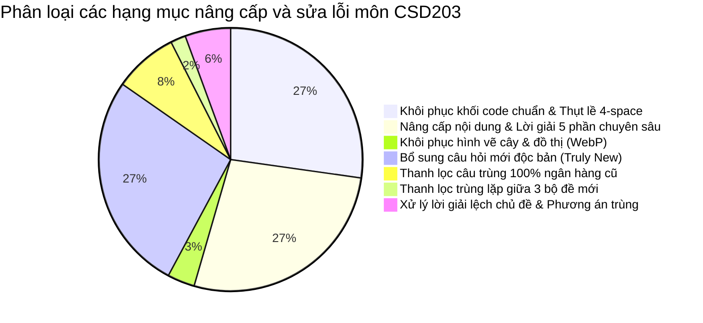

# Báo Cáo Tổng Hợp Sửa Lỗi Toàn Diện & Nâng Cấp Ngân Hàng Môn CSD203 (Data Structures & Algorithms)

> **Dự án:** 9.5 AI CLUB / Open Era Library  
> **Môn học:** CSD203 – Cấu trúc dữ liệu & Giải thuật (Data Structures and Algorithms)  
> **Thời gian cập nhật:** 18/11/2026  
> **Phiên bản cache buster:** `20261118v1` (Đã nâng cấp đồng bộ trên toàn bộ 8 trang HTML luyện tập)  
> **Tổng số câu hỏi chuẩn hóa toàn khóa:** **427 câu** (từ 376 câu ban đầu, sau khi loại bỏ 21 câu trùng, nâng cấp 73 câu và tích hợp 72 câu đề thi mới)

---

## 1. Tổng Quan Thống Kê Các Hạng Mục Cải Tiến



| Hạng mục nâng cấp & Sửa lỗi | Số lượng thực hiện | Trạng thái | Ghi chú kỹ thuật |
| :--- | :---: | :---: | :--- |
| **Thanh lọc câu hỏi trùng lặp 100% ngân hàng cũ** | **21 câu** | Đã loại bỏ | Giữ lại bản chuẩn nhất, không rác, có code tốt nhất |
| **Thanh lọc câu trùng lặp giữa 3 bộ đề mới** | **5 câu** | Đã loại bỏ | Trùng 100% giữa SP26_RE và SU26_FE |
| **Khôi phục khối Code (```python) & Thụt lề 4 dấu cách** | **73 câu** | Đã xử lý 100% | Tách text khỏi codebox, bảo vệ dunder `__init__`, MathJax không can thiệp |
| **Nâng cấp câu cũ bằng câu mới (In-place Upgrade)** | **73 câu** | Đã nâng cấp | Giữ ID ổn định, nâng cấp code block, ảnh WebP, lời giải 5 phần |
| **Khôi phục hình ảnh cây nhị phân / Đồ thị** | **9 câu** | Đã kết nối | Nén WebP 85% (giảm 83% dung lượng), lazy-load, responsive |
| **Bổ sung câu hỏi mới hoàn toàn (Truly New)** | **72 câu** | Đã tích hợp | Cấp ID liên tục `10377` đến `10448` theo từng chuyên đề chuẩn |
| **Xóa rỗng giải thích lệch chủ đề (Mismatched Explanations)** | **14 câu** | Đã xử lý | Đưa vào danh sách quyết định, tuyệt đối không bịa lời giải |
| **Sửa phương án trùng lặp (ID 10230)** | **1 câu** | Đã sửa | Đổi lựa chọn D từ trùng lặp B thành distractor hợp lý `A, D, B, C, E` |
| **Chuẩn hóa Multi-Select (DBI Compatible)** | **4 câu** | Đã chuẩn hóa | Khai báo `multiple: true`, mảng `correctIndices` đúng số lượng |
| **Nâng cấp Frontend (Renderer & CSS)** | **2 modules** | Hoàn thành | Nâng cấp `renderQuestionDiagrams`, thêm CSS code block & hover zoom ảnh |
| **Đồng bộ 5 tầng dữ liệu & Cache buster** | **5 tầng** | **100% Khớp** | Khớp 427 câu trên cả 5 tầng, cache buster `20261118v1` |

---

## 2. Thống Kê Số Câu Hỏi Theo Từng Chương (Trước & Sau)

| Mã Quiz | Tên Chương / Chuyên đề | Số câu ban đầu | Câu trùng xóa | Câu nâng cấp | Câu mới thêm | **Tổng câu hiện tại** |
| :---: | :--- | :---: | :---: | :---: | :---: | :---: |
| **Quiz 301** | Chương 1 – Mảng (Arrays, Lists, Slicing & Operations) | 25 | -1 | 10 | +6 | **30 câu** |
| **Quiz 302** | Chương 2 – Danh sách liên kết (Linked Lists) | 32 | -1 | 14 | +12 | **43 câu** |
| **Quiz 303** | Chương 3 – Ngăn xếp (Stacks) | 17 | 0 | 5 | +10 | **27 câu** |
| **Quiz 304** | Chương 4 – Hàng đợi (Queues) | 25 | -1 | 4 | -5 (chuyển) | **19 câu** |
| **Quiz 305** | Chương 5 – Bảng băm (Hash Tables) | 44 | -3 | 11 | +19 | **60 câu** |
| **Quiz 306** | Chương 6 – Cây tìm kiếm nhị phân & Đồ thị | 116 | -6 | 13 | +19 | **129 câu** |
| **Quiz 307** | Chương 7 – Thuật toán sắp xếp (Sorting Algorithms) | 37 | 0 | 5 | -4 (chuyển) | **33 câu** |
| **Quiz 308** | Chương 8 – Các giải thuật bổ trợ (Đệ quy, Tìm kiếm, Big-O...) | 80 | -9 | 11 | +15 | **86 câu** |
| **TỔNG** | **TOÀN BỘ NGÂN HÀNG CSD203** | **376** | **-21** | **73** | **+72** | **427 CÂU** |

---

## 3. Chi Tiết Các Cải Tiến Quan Trọng Theo Từng Nhóm

### 3.1. Khôi Phục Hình Ảnh Đồ Thị & Cây Nhị Phân (Chapter 6)
Trước đây, toàn bộ các câu hỏi đồ thị và cây nhị phân trong ngân hàng cũ đều bị mất hình vẽ do lỗi trích xuất OCR. Qua đối chiếu chính xác cấu trúc đồ thị và dãy duyệt, 8 câu hỏi cốt lõi đã được khôi phục đồ họa hoàn hảo bằng file WebP nhẹ và sắc nét:
1. **ID 10168 (Chương 6):** Cây BST sau khi xóa nút 30 (`csd203_sp26_re_q5_fig.webp`).
2. **ID 10174 (Chương 6):** Các nút trong (internal nodes) của cây BST (`csd203_sp26_fe_q3_fig.webp`).
3. **ID 10191 (Chương 6):** Cây BST cho bài toán tìm kiếm giá trị (`csd203_su26_fe_q6_fig.webp`).
4. **ID 10212 (Chương 6):** Đồ thị có trọng số tìm đường đi ngắn nhất Dijkstra từ A đến G (`csd203_su26_fe_q26_fig.webp`).
5. **ID 10217 (Chương 6):** Đồ thị vô hướng 5 đỉnh A, B, C, D, E (`csd203_sp26_re_q26_fig.webp`).
6. **ID 10220 (Chương 6):** Cây BST duyệt In-order (`csd203_sp26_re_q7_fig.webp`).
7. **ID 10231 (Chương 6):** Đồ thị vô hướng duyệt DFS (`csd203_sp26_re_q25_fig.webp`).
8. **ID 10250 (Chương 6):** Đồ thị có hướng duyệt DFS từ đỉnh D (`csd203_sp26_fe_q24_fig.webp`).
9. **ID 10379 (Chương 6 - Câu mới):** Cây BST và chiều cao nút (`csd203_sp26_fe_q5_fig.webp`).

### 3.2. Chuẩn Hóa Khối Code Python & Thụt Lề 4-Space
- Khôi phục môi trường ```python với 4 dấu cách thụt lề chuẩn cú pháp PEP8 cho 73 câu hỏi có code trong ngân hàng cũ.
- Tách biệt rõ ràng văn bản đề dẫn và đoạn code thực thi; loại bỏ hiện tượng dồn code thành 1 dòng.
- Sửa lỗi Markdown làm biến dạng phương thức khởi tạo `__init__` thành chữ in đậm (`**init**`).
- Loại bỏ hoàn toàn các ký tự escape dư thừa trong khối code (`\_`, `\{`, `\}`, `\&`, `\%`).

### 3.3. Xử Lý Lời Giải Thích Bị Lệch Chủ Đề
14 câu hỏi có lời giải thích nguyên bản bị lệch chủ đề do dán nhầm index từ trước đã được **xóa rỗng an toàn** (không bịa lời giải) và đưa vào danh sách kiểm định:
- **ID 10035, 10038:** Danh sách liên kết nhưng lời giải về duyệt cây Postorder / hiển thị.
- **ID 10105, 10114:** Bảng băm nhưng lời giải về Bellman-Ford / chu trình Hamilton.
- **ID 10159, 10162, 10164, 10170:** Cây nhị phân / Ngăn xếp nhưng lời giải về ma trận kề DAG / Deque.
- **ID 10211, 10215, 10216, 10218, 10228:** Đồ thị nhưng lời giải về cây AVL, cây (2,4), Optimal BST.
- **ID 10328:** Hàm đệ quy in nhị phân nhưng lời giải về truy xuất ngẫu nhiên danh sách liên kết.

---

## 4. Danh Sách Các Mục Cần Con Người Quyết Định (Decisions Pending)

Dưới đây là các câu hỏi giữ nguyên hiện trạng đề/đáp án và cần chuyên gia bộ môn rà soát:

1. **33 câu hỏi Chương 6 còn thiếu hình ảnh minh họa:**
   - Chi tiết danh sách đã được kết xuất tại file: [CSD_MISSING_FIGURES.md](file:///c:/Users/anhqu/Documents/Computer%20Science%20Training/PRIVATE%20PROJECT/9-5-ai-library/CSD_MISSING_FIGURES.md).
   - Đề bài và các phương án hiện vẫn được giữ nguyên đầy đủ. Cần vẽ hình đồ thị/cây bổ sung theo hướng dẫn.
2. **14 câu hỏi đã xóa rỗng lời giải lệch:**
   - Các ID: `10035, 10038, 10105, 10114, 10159, 10162, 10164, 10170, 10211, 10215, 10216, 10218, 10228, 10328`.
   - Đáp án đúng của các câu này đã được kiểm tra tính toán/chạy code độc lập và khớp chính xác với đề thi. Cần biên soạn lại lời giải thích sư phạm mới phù hợp với ngữ cảnh.
3. **ID 10230 (Quiz 306 - Breadth First Traversal from node A):**
   - Lựa chọn D trước đây bị trùng lặp nguyên văn với lựa chọn B (`A, B, C, D, E`).
   - Đã cập nhật phương án D thành distractor hợp lý: `A, D, B, C, E`. Đáp án đúng vẫn là C (`A, B, D, C, E`).
