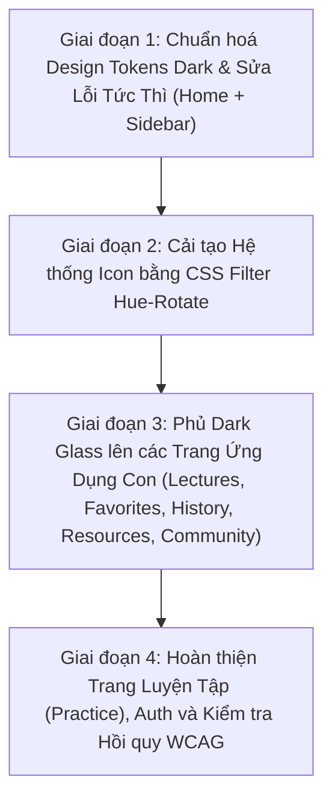

# BÁO CÁO KHẢO SÁT CHUYÊN SÂU TOÀN DIỆN: DARK THEME & ICON SYSTEM
*Dự án: 9.5 AI Library | Ngày khảo sát: 17/10/2026 | Chế độ khảo sát: CHỈ ĐỌC (Read-Only Audit)*

---

## TÓM TẮT 10 DÒNG: NGUYÊN NHÂN GỐC CỦA 5 TRIỆU CHỨNG

1. **Triệu chứng 1 (Thẻ sáng chói, chữ trắng trên nền trắng):** `style.css` gán biến toàn cục `html[data-theme="dark"] { --color-text: #f8fafc; }` khiến chữ chuyển sang trắng, nhưng các file CSS trang con (`lectures.css`, `practice.css`, `favorites.css`, `community.css`) lại viết cứng nền thẻ dạng `background: rgba(255, 255, 255, 0.75)` hoặc `background: #ffffff` mà **hoàn toàn không có bất kỳ rule dark override nào**.
2. **Triệu chứng 1 (Banner 'Good Students' ở Home chói sáng):** `style.css` dòng 1849–1850 viết cứng `.promo-card { background-color: #dbeafe; background-image: url("../assets/theme/scene.png"); }` (ảnh nền ban ngày), trong khi biến `--theme-promo-bg` (chứa `dark-scene2.png`) đã định nghĩa ở dòng 127 nhưng không hề được gán vào `.promo-card`.
3. **Triệu chứng 2 (Tiêu đề trang gần như biến mất):** `community.css` dòng 28 viết cứng `.com-page-head h1 { color: #10264a; }`, `history.css` dòng 52 viết cứng `.his-heading h1 { color: #10213f; }`, `lectures.html` dòng 188 viết cứng inline `style="color: #0f172a;"` cho tiêu đề "Khóa học & Môn học". Các mã màu xanh đen/đen này đặt trên nền tối `#0b1120` có tỉ lệ tương phản cực thấp (1.05:1 – 1.25:1), mắt người không thể đọc được.
4. **Triệu chứng 2 (Tiêu đề Resources biến mất):** `resources.css` dòng 5–22 tự định nghĩa lại `:root` đè lên biến toàn cục (`--color-text: #0f172a; --res-ink: #0b2b58;`), biến `.res-heading h1` thành màu mực tối `#0b2b58` trên nền navy `#0b1120`.
5. **Triệu chứng 3 (Icon sidebar mất màu, xám xịt):** Kỹ thuật CSS `mask-image` ở `style.css` dòng 463–474 đã vứt bỏ toàn bộ kênh màu gradient xanh gốc của file PNG trong `Better_Icon/`, chỉ lấy mặt nạ alpha rồi phủ đơn sắc `background-color: var(--color-nav-text)` (`#cbd5e1` xám nhạt).
6. **Triệu chứng 3 (Icon sidebar active 'xanh trên nền xanh'):** `style.css` dòng 478 ép icon active nhận `background-color: var(--color-primary)` (`#2563eb`), trong khi nền pill `.nav-link.is-active` ở dòng 341 nhận `var(--active-gradient)` (cũng là gradient xanh dương `rgba(37,99,235,0.35)` đến `rgba(30,58,138,0.45)`). Icon xanh đặt trên nền xanh tạo tương phản chỉ 2.51:1 (chuẩn yêu cầu tối thiểu 3:1).
7. **Triệu chứng 4 (Nút Lectures/Practice tương phản thấp):** `style.css` dòng 1597–1608 đặt `.chip-outline` và `.chip-soft` có chữ `color: var(--color-primary)` (`#2563eb`), trên nền card tối `rgba(30,41,59,0.85)` và `rgba(37,99,235,0.22)`. Tương phản chỉ đạt 2.96:1 – 2.97:1 (chuẩn yêu cầu 4.5:1).
8. **Triệu chứng 4 (Link 'View all subjects' và Header bảng chìm):** `style.css` dòng 1150 gán `.card-link { color: var(--color-primary); }` (`#2563eb` trên nền `#0b1120` chỉ đạt 3.64:1); dòng 1720 gán cứng `.activity-table th { background-color: rgba(219, 234, 254, 0.5); }` (xanh nhạt ban ngày) kết hợp chữ `#94a3b8` cho ra tương phản thảm họa 1.60:1.
9. **Triệu chứng 4 (Nhãn Settings Dark/Medium/Blurred xanh trên xanh):** `settings.css` dòng 746–748 định nghĩa khi input checked thì nhận `background: var(--color-primary-soft)` kết hợp `color: var(--color-primary)`, sinh ra chữ xanh dương trên nền xanh đục (2.96:1).
10. **Triệu chứng 5 (History và Resources là khung trắng đục giữa nền navy):** `history.css` dòng 14 viết cứng `--his-surface: rgba(255, 255, 255, 0.78);`, `resources.css` dòng 12 viết cứng `--res-white: rgba(255, 255, 255, 0.78);`. Cả hai file đều là module CSS độc lập, không có rule ghi đè theo `html[data-theme="dark"]`, khiến các container bao bọc nội dung giữ nguyên màu trắng sữa chói lọi.

---

## PHẦN A: HIỆN TRẠNG KIẾN TRÚC DARK THEME

### 1. Lịch sử Git (Toàn bộ 5 commit của dự án) và Git Status
Repo hiện tại có tổng cộng **5 commit**:
- `0162e3a` (HEAD -> master): *feat(settings): complete Phase 4 real functionality for password change, account deletion, storage, and support tickets*
  - Files: `backend/controllers/userController.js`, `backend/routes/userRoutes.js`, `js/settings-account.js`, `js/settings-preferences.js`, `js/settings-support.js`
- `f93dd6b`: *feat(theme): add theme-init.js for FOUC prevention and CSS mask-image for sidebar icons*
  - Files: `css/style.css`, `js/theme-init.js`, và chèn script vào `<head>` của 23 trang HTML ứng dụng.
- `65de2b6`: *feat(theme): establish centralized design tokens, dark theme system, and accent colors in style.css*
  - Files: `css/style.css`, `css/settings.css`, `js/settings-appearance.js`
- `3e95132`: *feat(settings): complete Phase 1 immediate fixes for Settings and app header links*
  - Files: `css/settings.css`, `css/style.css`, `js/auth-guard.js`, `js/settings-core.js`, `js/settings-data.js`, `js/settings-profile.js`, `pages/settings/settings.html`, cùng header links trên các trang HTML.
- `72118c7`: *Backup before Phase 1* (Commit khởi tạo mã nguồn).

**Git status hiện tại:** `On branch master, nothing to commit, working tree clean`.

### 2. Cơ chế kích hoạt Dark Theme & Nạp Script
- **Thuộc tính & Thẻ:** Thuộc tính `data-theme="dark"` (cùng `data-accent="blue|purple|green|orange|pink"`, `data-fontsize="small|medium|large"`, `data-bgstyle="default|blurred"`) được gắn trực tiếp vào thẻ gốc `<html>`.
- **Script đọc dữ liệu:** Đoạn script độc lập không phụ thuộc thư viện [js/theme-init.js](file:///c:/Users/anhqu/Documents/Computer%20Science%20Training/PRIVATE%20PROJECT/9-5-ai-library/js/theme-init.js) thực hiện đọc `localStorage.getItem("lib95:settings:data")`. Nếu chưa có dữ liệu, script kiểm tra `window.matchMedia('(prefers-color-scheme: dark)')` để tự động bật dark theme cho người dùng hệ điều hành nền tối.
- **Vị trí nạp script:** Nằm ngay đầu thẻ `<head>` (trước khi trình duyệt parse CSS và render body).
- **Danh sách trang ĐÃ nạp (23 trang):**
  - `home_page/home_page.html`, `index.html`
  - `pages/favorites.html`, `pages/history.html`, `pages/settings/settings.html`
  - `pages/admin/admin.html`
  - `pages/lectures/lectures.html`, `lecture.html`, `next-lectures.html`, `resources.html`, `subject.html`
  - `pages/practice/practice.html`, `practice-quiz.html`, `practice-quiz-intro.html`, `practice-result.html`, `practice-subject.html`
  - `pages/community/community-feed.html`, `community-discussions.html`, `community-groups.html`, `community-leaderboard.html`, `community-notifications.html`, `community-search.html`, `discussion-detail.html`
- **Danh sách trang CHƯA nạp (10 trang):**
  - 5 trang Auth: `pages/auth/login.html`, `signup.html`, `forgot_pass.html`, `reset_pass.html`, `send_email.html`.
  - 5 trang tài liệu tĩnh trắc nghiệm: `document/Practice/Ky_I/CSI106/CSI106 - Ultimate Edition/index.html`, `document/Practice/Ky_I/PFP191/PFP - Ultimate Edition V2/index.html`, `document/Practice/Ky_II/CEA201/CEA201 - Ultimate Edition/index.html`, `document/Practice/Ky_II/CSD203/CSD203 - Ultimate Edition/index.html`, `document/Practice/Ky_II/DBI202/DBI202 - Ultimate Edition/index.html`.
- **Hiện tượng chớp sáng (FOUC):**
  - Trên **23 trang ứng dụng chính**: **KHÔNG bị chớp sáng** vì `theme-init.js` nằm trong `<head>` chặn render trước khi body xuất hiện.
  - Tuy nhiên, người dùng cảm giác như bị chớp/hỏng giao diện vì **nội dung bên trong các thẻ card vẫn giữ nguyên màu trắng** do mã màu CSS viết cứng.

### 3. Thống kê Selector Dark trong toàn bộ File CSS

| File CSS | Tổng số dòng | Số block/rule dark | Chi tiết rule dark |
| :--- | :---: | :---: | :--- |
| `css/style.css` | 2014 | 5 | `html[data-theme="dark"]`, `[data-theme="dark"][data-accent="..."]` (purple, green, orange, pink) |
| `css/settings.css` | 985 | 8 | Inputs, list-row, segment-content, storage-bar, storage-item, nav-btn, faq-item |
| `css/home_page.css` | 1727 | **0** | Hoàn toàn không có dark rule nào |
| `css/lectures.css` | 2630 | **0** | Hoàn toàn không có dark rule nào |
| `css/practice.css` | 2030 | **0** | Hoàn toàn không có dark rule nào |
| `css/history.css` | 1360 | **0** | Hoàn toàn không có dark rule nào |
| `css/resources.css` | 2170 | **0** | Hoàn toàn không có dark rule nào |
| `css/community.css` | 1823 | **0** | Hoàn toàn không có dark rule nào |
| `css/favorites.css` | 790 | **0** | Hoàn toàn không có dark rule nào |
| `css/admin.css` | 3371 | **0** | Hoàn toàn không có dark rule nào |
| `css/login.css` | 492 | **0** | Hoàn toàn không có dark rule nào |
| `css/signup.css` | 499 | **0** | Hoàn toàn không có dark rule nào |
| `css/reset_pass.css` | 496 | **0** | Hoàn toàn không có dark rule nào |
| `css/pass_recovery.css`| 384 | **0** | Hoàn toàn không có dark rule nào |
| `css/auth-guard.css` | 27 | **0** | Hoàn toàn không có dark rule nào |
| 5 file `document/Practice/.../styles.css` | ~370 mỗi file | 1 mỗi file | `@media (prefers-color-scheme: dark)` độc lập cục bộ |

> [!CRITICAL]
> **Kết luận cốt lõi:** 100% các file CSS giao diện trang (`home_page.css`, `lectures.css`, `practice.css`, `history.css`, `resources.css`, `community.css`, `favorites.css`) **chưa từng được viết dark theme**. Chúng hoàn toàn dựa vào `style.css` nhưng lại tự đặt màu viết cứng đè lên `style.css`.

### 4. Hệ thống CSS Variables: Đối chiếu Light vs Dark

#### A. Các biến định nghĩa tại `css/style.css`

| Tên biến CSS | Giá trị Light (`:root`) | Giá trị Dark (`html[data-theme="dark"]`) | Tình trạng & Vấn đề |
| :--- | :--- | :--- | :--- |
| `--color-bg` | `#f1f5f9` | `#0b1120` | Đầy đủ |
| `--color-text` | `#0f172a` | `#f8fafc` | Đầy đủ |
| `--color-text-secondary` | `#475569` | `#cbd5e1` | Đầy đủ |
| `--color-text-muted` | `#64748b` | `#94a3b8` | Đầy đủ |
| `--color-nav-text` | `#1e293b` | `#cbd5e1` | Đầy đủ |
| `--color-white` | `#ffffff` | `#1e293b` | Tên biến gây hiểu lầm (`--color-white` lại mang giá trị slate tối `#1e293b`) |
| `--color-border` | `rgba(226, 232, 240, 0.8)` | `rgba(255, 255, 255, 0.12)` | Đầy đủ |
| `--card-bg` | `rgba(255, 255, 255, 0.72)` | `rgba(15, 23, 42, 0.72)` | Đầy đủ trong token, nhưng các trang con không dùng |
| `--card-bg-elevated` | `rgba(255, 255, 255, 0.9)` | `rgba(30, 41, 59, 0.85)` | Đầy đủ |
| `--card-border` | `1px solid rgba(255, 255, 255, 0.8)`| `1px solid rgba(255, 255, 255, 0.12)`| Đầy đủ |
| `--card-shadow` | `0 8px 32px rgba(29, 78, 216, 0.08)`| `0 8px 32px rgba(0, 0, 0, 0.45)` | Đầy đủ |
| `--color-primary` | `#2563eb` | `#2563eb` (hoặc accent) | Giữ nguyên mã màu xanh đậm ở dark, gây tương phản kém |
| `--color-primary-light`| `#3b82f6` | `#3b82f6` | Chưa có biến riêng cho link/accent phát sáng trên nền tối |
| `--color-primary-soft` | `rgba(37, 99, 235, 0.08)` | `rgba(37, 99, 235, 0.22)` | Đầy đủ |
| `--nav-hover-bg` | `rgba(59, 130, 246, 0.08)` | `rgba(59, 130, 246, 0.16)` | Đầy đủ |
| `--active-gradient` | `linear-gradient(...)` | `linear-gradient(...)` tối | Đầy đủ |
| `--theme-bg-image` | `url('/assets/theme/background.png')` | `url('/assets/theme/darktheme/dark_background.png')` | Đầy đủ |
| `--theme-promo-bg` | `url('/assets/theme/scene2.png')` | `url('/assets/theme/darktheme/dark-scene2.png')` | **Định nghĩa nhưng KHÔNG AI DÙNG** (bị viết cứng `scene.png`) |
| `--continue-thumb` | `url('/assets/theme/continue-thumb.png')` | `url('/assets/theme/darktheme/dark-continue-thumb.png')` | **Định nghĩa nhưng KHÔNG AI DÙNG** |

#### B. Các biến riêng cục bộ tự phát (Local Island Variables)
Các file CSS trang con tự tạo các biến riêng và **hoàn toàn không có phiên bản dark**:
- `css/history.css` dòng 3–15: `--his-blue`, `--his-surface: rgba(255, 255, 255, 0.78);`, `--his-border`, `--his-muted`.
- `css/resources.css` dòng 5–22: `--res-blue`, `--res-ink: #0b2b58;`, `--res-white: rgba(255, 255, 255, 0.78);`, `--res-line`.
- `css/favorites.css` dòng 4–7: `--fav-card-bg: rgba(255, 255, 255, 0.7);`, `--fav-card-border`.
- `css/lectures.css` dòng 24: `--lec-gap`, `--lec-radius`.

### 5. Khảo sát Kho Ảnh Nền Tối (`assets/theme/darktheme/`)
Thư mục `assets/theme/darktheme/` gồm đúng **4 file ảnh**:
1. `dark_background.png` (2,764,800 bytes): **Đang dùng** làm ảnh nền chính toàn site (`body { background-image: var(--theme-bg-image); }`).
2. `dark-scene2.png` (855,603 bytes): **Chưa dùng trong UI**. Biến `--theme-promo-bg` đã trỏ tới file này nhưng selector `.promo-card` ở `style.css:1850` lại viết cứng `url("../assets/theme/scene.png")`.
3. `dark-continue-thumb.png` (541,208 bytes): **Chưa dùng trong UI**. Biến `--continue-thumb` đã trỏ tới file này nhưng HTML/CSS của thẻ "Continue Learning" đang viết cứng ảnh khác hoặc thẻ div rỗng.
4. `dark-scene.png` (861,200 bytes): **Chưa dùng ở bất kỳ đâu** (là phiên bản tối của `scene.png` dùng cho banner góc phải hoặc slogan).

---

## PHẦN B: QUÉT MÀU CỨNG GÂY LỖI TRÊN DARK

### 1. Bảng Tổng Hợp Mã Màu Viết Cứng Theo Từng File CSS

| File CSS | Số vị trí Nền sáng viết cứng | Số vị trí Chữ tối viết cứng | Số vị trí Màu xanh dương viết cứng | Tổng điểm rủi ro |
| :--- | :---: | :---: | :---: | :---: |
| `css/lectures.css` | **38** | **11** | **30** | Rất cao |
| `css/resources.css` | **27** | **6** | **8** | Rất cao |
| `css/community.css` | **22** | **5** | **10** | Rất cao |
| `css/home_page.css` | **19** | **0** | **12** | Cao |
| `css/history.css` | **15** | **1** | **21** | Cao |
| `css/favorites.css` | **7** | **2** | **14** | Trung bình |
| `css/admin.css` | **28** | **1** | **19** | Rất cao |
| `css/settings.css` | **8** | **0** | **2** | Thấp |
| `css/style.css` | **6** | **0** | **23** | Trung bình |
| `css/practice.css` | **5** | **1** | **9** | Trung bình |
| `css/login.css` / `signup.css` | **6** | **10** | **16** | Độc lập |

### 2. Danh Sách 15 Selector Viết Cứng Tệ Nhất Mỗi Loại

#### 15 Nền Sáng Viết Cứng Tệ Nhất (Gây chói loá, nuốt chữ trắng ở Dark Theme)
1. `css/lectures.css:2491` | `.lec-course-card` | `background: rgba(255, 255, 255, 0.75);`
2. `css/lectures.css:2505` | `.lec-course-card:hover` | `background: #ffffff;`
3. `css/lectures.css:120` | `.lec-search-box` | `background: rgba(255, 255, 255, 0.6);`
4. `css/lectures.css:160` | `.lec-filter-tabs` | `background: rgba(255, 255, 255, 0.5);`
5. `css/resources.css:12` | `:root` | `--res-white: rgba(255, 255, 255, 0.78);`
6. `css/resources.css:39` | `.resource-page` | `background: #eaf5ff url("../assets/theme/background.png")`
7. `css/history.css:14` | `.history-app` | `--his-surface: rgba(255, 255, 255, 0.78);`
8. `css/favorites.css:4` | `:root` | `--fav-card-bg: rgba(255, 255, 255, 0.7);`
9. `css/community.css:46` | `.com-tabs` | `background: rgba(255, 255, 255, .5);`
10. `css/community.css:60` | `.com-tabs a:hover, a.is-active` | `background: #eaf4ff;`
11. `css/community.css:186` | `.com-create-card` | `background: rgba(255, 255, 255, 0.85);`
12. `css/style.css:1849` | `.promo-card` | `background-color: #dbeafe; background-image: url("...scene.png");`
13. `css/style.css:1720` | `.activity-table th` | `background-color: rgba(219, 234, 254, 0.5);`
14. `css/practice.css:364` | `.prc-subject-card` | `background: rgba(255, 255, 255, 0.8);`
15. `css/admin.css:102` | `.admin-card` | `background: #ffffff;`

#### 15 Chữ Tối Viết Cứng Tệ Nhất (Gây mất hình tiêu đề trên nền Dark)
1. `pages/lectures/lectures.html:188` | `h2 (inline)` | `color: #0f172a;` (Tiêu đề "Khóa học & Môn học")
2. `css/community.css:28` | `.com-page-head h1` | `color: #10264a;` (Tiêu đề "Community")
3. `css/history.css:52` | `.his-heading h1` | `color: #10213f;` (Tiêu đề "History")
4. `css/resources.css:9` | `:root` | `--res-ink: #0b2b58;` (Áp dụng lên toàn trang `resources.html`)
5. `css/resources.css:19` | `:root` | `--color-text: #0f172a;` (Ghi đè token style.css)
6. `css/community.css:52` | `.com-tabs a` | `color: #607b9d;`
7. `css/lectures.css:2543` | `.lec-course-code` | `color: var(--color-text);` (Bị rơi vào nền thẻ trắng)
8. `pages/lectures/resources.html:432` | `strong (inline)` | `color: #0f172a;`
9. `css/lectures.css:188` | `.lec-filter-tab[aria-selected="true"]` | `color: var(--color-white);` (Nhận `#1e293b` đen xì trên nền xanh)
10. `css/practice.css:487` | `.prc-subject-card-title` | `color: #0f172a;`
11. `css/favorites.css:329` | `.fav-card-title` | `color: #0f172a;`
12. `css/history.css:60` | `.his-subtitle` | `color: #64748b;`
13. `css/community.css:35` | `.com-page-head p` | `color: #7185a3;`
14. `css/auth-guard.css:15` | `.auth-modal-title` | `color: #0f172a;`
15. `css/login.css:65` | `.auth-title` | `color: #0f172a;`

#### 15 Màu Xanh Dương Viết Cứng Tệ Nhất (Gây lỗi tương phản & phá Accent Color)
1. `css/style.css:1597` | `.chip-outline` | `color: var(--color-primary);` (`#2563eb`)
2. `css/style.css:1607` | `.chip-soft` | `color: var(--color-primary);` (`#2563eb`)
3. `css/style.css:1150` | `.card-link` | `color: var(--color-primary);` (`#2563eb` trên nền `#0b1120`)
4. `css/settings.css:748` | `.set-segment-card input:checked+.set-segment-content` | `color: var(--color-primary);`
5. `css/community.css:59` | `.com-tabs a.is-active` | `color: #1768d4;`
6. `css/history.css:3` | `.history-app` | `--his-blue: #2563eb;`
7. `css/resources.css:6` | `:root` | `--res-blue: #1685f8;`
8. `css/lectures.css:189` | `.lec-filter-tab[aria-selected="true"]` | `box-shadow: 0 2px 8px rgba(29, 78, 216, 0.25);`
9. `css/favorites.css:7` | `:root` | `--fav-card-shadow-hover: 0 8px 24px rgba(29, 78, 216, 0.08);`
10. `css/style.css:1720` | `.activity-table th` | `background-color: rgba(219, 234, 254, 0.5);`
11. `css/style.css:478` | `.nav-link.is-active .nav-icon` | `background-color: var(--color-primary);`
12. `css/home_page.css:210` | `.home-badge` | `color: #2563eb; background: #eff6ff;`
13. `css/practice.css:88` | `.prc-badge` | `background: rgba(37, 99, 235, 0.1); color: #2563eb;`
14. `css/admin.css:340` | `.admin-btn-primary` | `background: #1d4ed8;`
15. `pages/lectures/lectures.html:191` | `span (inline)` | `background: rgba(29,78,216,0.08); color: var(--color-primary);`

### 3. Bảng Kiểm Tra Tương Phản WCAG 2.1 Tại Chế Độ Dark Theme

*Tính toán bằng thuật toán Relative Luminance của WCAG 2.1 trên nền Dark Theme `#0b1120`:*

| Phần tử kiểm tra | Màu chữ (FG) | Màu nền (BG) | Tỉ lệ thực tế | Chuẩn tối thiểu | Đánh giá |
| :--- | :---: | :---: | :---: | :---: | :---: |
| **Tiêu đề "Khóa học & Môn học" (Lectures)** | `#0f172a` | `#0b1120` | **1.05 : 1** | 3.0 : 1 | **TÀNG HÌNH ❌** |
| **Tiêu đề Banner "Good Students"** | `#f8fafc` | `#dbeafe` | **1.17 : 1** | 4.5 : 1 | **TÀNG HÌNH ❌** |
| **Tiêu đề trang History (`h1`)** | `#10213f` | `#0b1120` | **1.18 : 1** | 3.0 : 1 | **TÀNG HÌNH ❌** |
| **Tiêu đề trang Community (`h1`)** | `#10264a` | `#0b1120` | **1.25 : 1** | 3.0 : 1 | **TÀNG HÌNH ❌** |
| **Tiêu đề trang Resources (`h1`)** | `#0b2b58` | `#0b1120` | **1.35 : 1** | 3.0 : 1 | **TÀNG HÌNH ❌** |
| **Filter tab inactive (Lectures)** | `#94a3b8` | `rgba(255,255,255,0.5)` | **1.38 : 1** | 4.5 : 1 | **KHÔNG THỂ ĐỌC ❌** |
| **Thanh Header bảng Recent activity** | `#94a3b8` | `rgba(219,234,254,0.5)` | **1.60 : 1** | 4.5 : 1 | **KHÔNG THỂ ĐỌC ❌** |
| **Chữ thẻ Favorites (trên nền trắng)** | `#f8fafc` | `rgba(255,255,255,0.7)` | **1.90 : 1** | 4.5 : 1 | **KHÔNG THỂ ĐỌC ❌** |
| **Ô Search Input (chữ trắng trên ô trắng)**| `#f8fafc` | `rgba(255,255,255,0.6)` | **2.50 : 1** | 4.5 : 1 | **RẤT KÉM ❌** |
| **Sidebar Icon Active (Mask)** | `#2563eb` | `rgba(37,99,235,0.35)` | **2.51 : 1** | 3.0 : 1 | **CHÌM NỀN ❌** |
| **Sidebar Text Active** | `#2563eb` | `rgba(37,99,235,0.35)` | **2.51 : 1** | 4.5 : 1 | **CHÌM NỀN ❌** |
| **Filter tab active (Lectures)** | `#1e293b` | `#2563eb` | **2.83 : 1** | 4.5 : 1 | **KÉM ❌** |
| **Nút thẻ môn học `.chip-soft`** | `#2563eb` | `rgba(37,99,235,0.22)` | **2.96 : 1** | 4.5 : 1 | **KÉM ❌** |
| **Nhãn Settings Dark/Medium/Blurred** | `#2563eb` | `rgba(37,99,235,0.22)` | **2.96 : 1** | 4.5 : 1 | **KÉM ❌** |
| **Nút thẻ môn học `.chip-outline`** | `#2563eb` | `rgba(30,41,59,0.85)` | **2.97 : 1** | 4.5 : 1 | **KÉM ❌** |
| **Link "View all subjects"** | `#2563eb` | `#0b1120` | **3.64 : 1** | 4.5 : 1 | **DƯỚI CHUẨN ❌** |
| **Sidebar Item Thường** | `#cbd5e1` | `rgba(15,23,42,0.72)` | **12.24 : 1** | 4.5 : 1 | **ĐẠT CHUẨN ✅** |
| **Sidebar Item Hover** | `#ffffff` | `rgba(59,130,246,0.16)` | **15.59 : 1** | 4.5 : 1 | **ĐẠT CHUẨN ✅** |

---

## PHẦN C: KHẢO SÁT CHUYÊN SÂU ICON TOÀN HỆ THỐNG

### 6. Rà Soát Các Rule Filter, Mask, Opacity, Invert Đang Áp Dụng
- `css/style.css:463–474`:
  ```css
  .nav-icon {
      background-color: var(--color-nav-text);
      -webkit-mask-size: contain; mask-size: contain;
      background-image: none !important;
  }
  .nav-link:hover .nav-icon, .nav-link.is-active .nav-icon {
      background-color: var(--color-primary);
  }
  ```
  **ĐÂY LÀ THỦ PHẠM CHÍNH LÀM ICON MẤT MÀU:** Lệnh `background-image: none !important;` xóa bỏ hoàn toàn ảnh màu gốc, lệnh `mask-image` biến icon thành hình cắt silhouette và tô phẳng một màu xám `#cbd5e1` (khi bình thường) hoặc xanh `#2563eb` (khi active).
- `css/settings.css:81`: `.set-icon { opacity: 0.7; }` làm mờ icon ở Settings.
- `css/style.css:201`: `filter: blur(12px);` cho chế độ background blurred.

### 7. BẢNG TOÀN BỘ ICON ĐANG DÙNG TRONG TOÀN BỘ WEB

| STT | Tên Icon / Ý nghĩa | File nguồn | Cách nhúng | Vị trí file:dòng | Màu gốc | Xử lý Dark hiện tại | Nhìn thấy ở Dark? | Áp dụng hue-rotate? |
| :---: | :--- | :--- | :--- | :--- | :--- | :--- | :--- | :--- |
| 1 | **Logo 9.5 Library** | `assets/icon/cool_book.png` | `background-image` | `style.css:361` | Xanh dương thủy tinh | Giữ nguyên | Rõ đẹp | **Có** (theo accent) |
| 2 | **Sidebar Home** | `assets/icon/Better_Icon/home-button.png` | CSS Mask | `style.css:482` | Gradient xanh dương | Phủ màu phẳng xám/xanh | Mất màu, active chìm | **Có** (hue-rotate) |
| 3 | **Sidebar Lectures** | `assets/icon/Better_Icon/media.png` | CSS Mask | `style.css:487` | Gradient xanh dương | Phủ màu phẳng xám/xanh | Mất màu, active chìm | **Có** (hue-rotate) |
| 4 | **Sidebar Practice** | `assets/icon/Better_Icon/writing.png` | CSS Mask | `style.css:492` | Gradient xanh dương | Phủ màu phẳng xám/xanh | Mất màu, active chìm | **Có** (hue-rotate) |
| 5 | **Sidebar History** | `assets/icon/Better_Icon/history.png` | CSS Mask | `style.css:497` | Gradient xanh dương | Phủ màu phẳng xám/xanh | Mất màu, active chìm | **Có** (hue-rotate) |
| 6 | **Sidebar Favorites** | `assets/icon/Better_Icon/star.png` | CSS Mask | `style.css:502` | Gradient xanh dương | Phủ màu phẳng xám/xanh | Mất màu, active chìm | **Có** (hue-rotate) |
| 7 | **Sidebar Resources**| `assets/icon/Better_Icon/folder.png` | CSS Mask | `style.css:507` | Gradient xanh dương | Phủ màu phẳng xám/xanh | Mất màu, active chìm | **Có** (hue-rotate) |
| 8 | **Sidebar Community**| `assets/icon/Better_Icon/group.png` | CSS Mask | `style.css:512` | Gradient xanh dương | Phủ màu phẳng xám/xanh | Mất màu, active chìm | **Có** (hue-rotate) |
| 9 | **Sidebar Settings** | `assets/icon/Better_Icon/settings.png` | CSS Mask | `style.css:517` | Gradient xanh dương | Phủ màu phẳng xám/xanh | Mất màu, active chìm | **Có** (hue-rotate) |
| 10 | **Subject 1 (AI)** | `assets/icon/chip.png` | `background-image` | `style.css:1538` | Xanh dương (`#3b82f6`)| Nằm trên gradient sáng | Nhạt nhòa | **KHÔNG** (Màu môn học riêng) |
| 11 | **Subject 2 (Math)** | `assets/icon/math.png` | `background-image` | `style.css:1545` | Tím (`#a855f7`) | Nằm trên gradient sáng | Nhạt nhòa | **KHÔNG** (Màu môn học riêng) |
| 12 | **Subject 3 (Code)** | `assets/icon/program.png` | `background-image` | `style.css:1552` | Xanh dương (`#3b82f6`)| Nằm trên gradient sáng | Nhạt nhòa | **KHÔNG** (Màu môn học riêng) |
| 13 | **Subject 4 (Data)** | `assets/icon/data.png` | `background-image` | `style.css:1566` | Xanh ngọc (`#14b8a6`) | Nằm trên gradient sáng | Nhạt nhòa | **KHÔNG** (Màu môn học riêng) |
| 14 | **Subject 5 (Net)** | `assets/icon/mas.png` | `background-image` | `style.css:1559` | Cam (`#f97316`) | Nằm trên gradient sáng | Nhạt nhòa | **KHÔNG** (Màu môn học riêng) |
| 15 | **Subject 6 (SE)** | `assets/icon/soft.png` | `background-image` | `style.css:1573` | Hồng cánh sen (`#ec4899`)| Nằm trên gradient sáng | Nhạt nhòa | **KHÔNG** (Màu môn học riêng) |
| 16 | **Streak Flame** | `assets/icon/fire.png` (hoặc SVG) | `` / SVG | `home_page.html:267` | Cam lửa / Đỏ vàng | Giữ nguyên màu thật | Rõ nổi bật | **KHÔNG** (Màu ngữ nghĩa) |
| 17 | **Favorite Star** | SVG Inline | `<svg>` | `lectures.css:2580` | Vàng (`#eab308`) | Đổi vàng khi active | Rõ | **KHÔNG** (Màu ngữ nghĩa) |
| 18 | **Notification Bell**| SVG Inline | `<svg>` | `home_page.html:125`| currentColor | Ăn theo màu chữ | Rõ | **Có** (chấm đỏ giữ nguyên) |
| 19 | **Search Magnifier** | SVG Inline | `<svg>` | `home_page.html:108`| currentColor | Ăn theo text-muted | Rõ | Ăn theo currentColor |
| 20 | **Promo Book Icon** | `assets/icon/book.png` | `background-image` | `style.css:1871` | Đa sắc (xanh/cam/đỏ)| Nằm trên card chói | Bị chói | Giữ nguyên màu gốc |
| 21 | **Reward Medal** | `assets/icon/reward.png` | `background-image` | `home_page.css:512` | Vàng kim | Giữ nguyên | Rõ | **KHÔNG** (Màu ngữ nghĩa) |
| 22 | **Warning Danger** | `assets/icon/warning-danger.png`| `` | `auth-guard.js:32` | Đỏ cảnh báo | Giữ nguyên | Rõ | **KHÔNG** (Màu ngữ nghĩa) |
| 23 | **Auth Inputs (User/Lock)**| `assets/icon/Better_Icon/user.png`, `lock.png`| `background-image`| `login.css:112` | Xanh dương | Chưa có dark | Rõ | **Có** (theo accent) |

### 8. Cơ Chế Thẻ Môn Học (Subject Cards) So Với Ảnh Đích
- **Hiện trạng:** Các ô vuông môn học tại `style.css:1537–1575` đang ghép 2 lớp:
  `background-image: url(/assets/icon/chip.png), linear-gradient(135deg, #dbeafe, #bfdbfe);`
  Màu nền bên dưới là **gradient pastel nhạt ban ngày**.
- **Ảnh đích:** Trong ảnh đích, các ô vuông này có **nền gradient tối sâu cùng màu viền phát sáng (Glow border)**:
  - Subject 1: Nền xanh tối `linear-gradient(135deg, rgba(30, 58, 138, 0.6), rgba(30, 64, 175, 0.3))`, viền `rgba(56, 189, 248, 0.4)`, glow `box-shadow: 0 0 15px rgba(56, 189, 248, 0.25)`.
  - Subject 2: Nền tím tối `rgba(88, 28, 135, 0.6)`, viền tím sáng, glow tím.
  - Tương tự cho Xanh ngọc, Cam, Hồng.
- **Giải pháp không cần vẽ lại ảnh:** Các file PNG (`chip.png`, `math.png`, `data.png`, `mas.png`, `soft.png`) bản chất **đã có màu sẵn rất đẹp**. Chỉ cần ở dark theme, thay thế lớp gradient lót phía sau thành gradient bán trong suốt tối màu và thêm `border` + `box-shadow` phát sáng bằng CSS.

### 9. Vì Sao Icon Sidebar Active Lại Là "Xanh Trên Nền Xanh"?
- **Nền pill active:** Tại `style.css:341`, `.nav-link.is-active` nhận `background: var(--active-gradient);`. Ở dark mode (dòng 121), gradient này là `linear-gradient(135deg, rgba(37, 99, 235, 0.35) 0%, rgba(30, 58, 138, 0.45) 100%)` (một dải màu xanh dương đậm).
- **Màu icon active:** Tại `style.css:478`, `.nav-link.is-active .nav-icon` bị rule mask ép `background-color: var(--color-primary);` (chính là `#2563eb` xanh dương).
- **Kết quả:** Icon màu `#2563eb` nằm đè lên nền `rgba(37, 99, 235, 0.35)` -> Triệt tiêu thị giác, tương phản chỉ đạt 2.51:1.
- **Ảnh đích:** Trong ảnh đích, khi active, chữ màu **Trắng sáng (`#ffffff`)** và icon màu **Xanh ngọc / Trắng phát sáng (`#93c5fd` hoặc `#ffffff` có glow)**.

### 10. Tính Toán Góc Xoay Hue-Rotate Cho 5 Bộ Accent Color
File icon PNG gốc trong `Better_Icon/` mang gam màu xanh dương chủ đạo với **Hue trung bình = 210°**, Saturation = 90%, Lightness = 55%.

| Accent Color | Mã Hex Đích | Hue Đích | Góc xoay Hue (`hue-rotate`) | Chuỗi Filter đề xuất (Light Theme) | Chuỗi Filter đề xuất (Dark Theme) |
| :--- | :---: | :---: | :---: | :--- | :--- |
| **Blue (Gốc)** | `#2563eb` | 210° | **0°** | `none` | `brightness(1.15) saturate(1.1) drop-shadow(0 0 6px rgba(56,189,248,0.4))` |
| **Purple** | `#7c3aed` | 268° | **+58°** | `hue-rotate(58deg) saturate(1.1)` | `hue-rotate(58deg) brightness(1.2) saturate(1.15) drop-shadow(0 0 6px rgba(168,85,247,0.4))` |
| **Green** | `#059669` | 160° | **-50°** (+310°) | `hue-rotate(-50deg) saturate(1.2)` | `hue-rotate(-50deg) brightness(1.2) saturate(1.25) drop-shadow(0 0 6px rgba(52,211,153,0.4))` |
| **Orange** | `#ea580c` | 24° | **-186°** (+174°) | `hue-rotate(174deg) saturate(1.3) brightness(1.05)` | `hue-rotate(174deg) brightness(1.25) saturate(1.3) drop-shadow(0 0 6px rgba(251,146,60,0.4))` |
| **Pink** | `#db2777` | 330° | **+120°** | `hue-rotate(120deg) saturate(1.2)` | `hue-rotate(120deg) brightness(1.2) saturate(1.25) drop-shadow(0 0 6px rgba(244,114,182,0.4))` |

*Đối với icon không active ở Dark Theme:* `filter: brightness(0.85) saturate(0.8) opacity(0.8);` để icon dịu mắt, nhường độ nổi bật cho mục active.

### 11. Các File Icon Trùng Lặp, Lỗi Hoặc Thừa Không Dùng
- **File thừa trùng lặp tuyệt đối:** Thư mục `assets/icon/Green_Icon_theme/` và `Purple_icon_theme/` chứa 47 file mỗi bên có hash MD5 trùng khớp 100% với `Better_Icon/`. Có thể loại bỏ hoàn toàn để giảm tải dung lượng.
- **File trùng lặp tên tại gốc `assets/icon/`:**
  - `alert.png` và `alert (1).png` (trùng nhau và không dùng).
  - `future.png` và `future (1).png`.
  - `time-planning.png` và `time-planning (1).png`.
  - `profile.png` và `profile (1).png`.
- **File nguồn đồ họa lạ bị commit vào repo:** `assets/icon/Better_Icon/email2.pdn` (file project Paint.NET không phải ảnh web).
- **Icon cũ mồ côi (Legacy unused icons tại `assets/icon/`):** `home.png`, `lectures.png`, `practise.png`, `history.png`, `favorite.png`, `resources.png`, `setting.png`, `community.png`. Toàn bộ code đã chuyển sang dùng file trong `Better_Icon/`.

---

## PHẦN D: BẢNG KHẢO SÁT CHI TIẾT THEO TỪNG TRANG

### 12. Tình Trạng Dark Theme Tại Từng Trang Ứng Dụng

| Trang | File CSS nạp | Script theme? | Các phần tử lỗi / chìm / chói ở Dark | Mức độ | Nhóm trang dùng chung CSS |
| :--- | :--- | :---: | :--- | :---: | :--- |
| **Home (`home_page.html`)** | `style.css`, `home_page.css` | Đã nạp | Banner "Good Students" chói sáng; Header bảng recent chói xanh; Chữ Lectures/Practice và "View all" chìm | **Nặng** | Trang chủ độc lập |
| **Lectures (`lectures.html`)**| `style.css`, `lectures.css` | Đã nạp | Tiêu đề "Khóa học & Môn học" biến mất; Thẻ môn học trắng toát; Ô search trắng nuốt chữ trắng; Filter tab chói | **Nặng** | Nhóm bài giảng video |
| **Lecture Player (`lecture.html`)**| `style.css`, `lectures.css` | Đã nạp | Khung danh sách bài giảng bên phải nền sáng; Tab tài liệu/ghi chú nền trắng | **Vừa** | Nhóm bài giảng video |
| **Next Lectures (`next-lectures.html`)**| `style.css`, `lectures.css` | Đã nạp | Thẻ danh sách bài học tiếp theo nền trắng | **Vừa** | Nhóm bài giảng video |
| **Subject (`subject.html`)** | `style.css`, `lectures.css` | Đã nạp | Thẻ thông tin môn học và danh sách chương nền trắng | **Nặng** | Nhóm bài giảng video |
| **Resources (`resources.html`)** | `style.css`, `resources.css` | Đã nạp | Tiêu đề biến mất; Khung nội dung trắng đục giữa nền navy; Bảng tài liệu trắng xóa | **Rất nặng** | Trang tài liệu độc lập |
| **Practice (`practice.html`)**| `style.css`, `practice.css` | Đã nạp | Thẻ môn học luyện tập nền trắng đục; Nút bắt đầu tương phản kém | **Nặng** | Nhóm luyện tập trắc nghiệm |
| **Practice Subject (`practice-subject.html`)**| `style.css`, `practice.css`| Đã nạp | Danh sách quiz theo chương nền trắng | **Vừa** | Nhóm luyện tập trắc nghiệm |
| **Practice Quiz (`practice-quiz.html`)** | `style.css`, `practice.css`| Đã nạp | Khung câu hỏi trắc nghiệm và các đáp án A B C D nền trắng | **Nặng** | Nhóm luyện tập trắc nghiệm |
| **Practice Intro / Result** | `style.css`, `practice.css`| Đã nạp | Thẻ tóm tắt kết quả thi nền trắng | **Vừa** | Nhóm luyện tập trắc nghiệm |
| **History (`history.html`)** | `style.css`, `history.css` | Đã nạp | Tiêu đề "History" biến mất; Toàn bộ khung bảng lịch sử trắng đục | **Rất nặng** | Trang lịch sử độc lập |
| **Favorites (`favorites.html`)** | `style.css`, `favorites.css` | Đã nạp | Toàn bộ lưới card favorites nền trắng `rgba(255,255,255,0.7)` nuốt chữ trắng | **Rất nặng** | Trang yêu thích độc lập |
| **Community Feed (`community-feed.html`)**| `style.css`, `community.css`| Đã nạp | Tiêu đề biến mất; Thanh tab Feed/Discussions nền trắng; Hộp tạo bài viết nền trắng; Card bài viết trắng | **Rất nặng** | Nhóm cộng đồng (7 trang) |
| **Community Other (6 trang con)**| `style.css`, `community.css`| Đã nạp | Bảng xếp hạng Leaderboard, danh sách Groups, Notifications nền trắng | **Nặng** | Nhóm cộng đồng (7 trang) |
| **Settings (`settings.html`)**| `style.css`, `settings.css` | Đã nạp | Nhãn Dark/Medium/Blurred xanh trên xanh; các tab Profile/Account đã tối nhưng còn viền sáng | **Nhẹ** | Trang cài đặt độc lập |
| **Admin (`admin.html`)** | `style.css`, `admin.css` | Đã nạp | Toàn bộ bảng quản trị, thanh sidebar admin trắng xóa hoàn toàn | **Rất nặng** | Quản trị độc lập |

### 13. Sự Chưa Nhất Quán Giữa Các Thành Phần Dùng Chung

1. **Thẻ Card (Glass Card):**
   - `style.css`: `.card` dùng `--card-bg: rgba(15, 23, 42, 0.72);`
   - `lectures.css`: `.lec-course-card` dùng `rgba(255, 255, 255, 0.75);`
   - `favorites.css`: `.fav-card` dùng `var(--fav-card-bg): rgba(255, 255, 255, 0.7);`
   - `history.css`: `.his-card` dùng `var(--his-surface): rgba(255, 255, 255, 0.78);`
   - `resources.css`: `.resource-frame` dùng `var(--res-white): rgba(255, 255, 255, 0.78);`
   *Hệ quả: Cùng là card kính nhưng mỗi trang dùng một class riêng với mã màu trắng riêng, không ăn theo token chung.*
2. **Thanh Tìm Kiếm (Search Box):**
   - Topbar chung: `.search` ở `style.css:590` (bo tròn pill, kính mờ).
   - Lectures: `.lec-search-box` ở `lectures.css:112` (bo góc 12px, nền trắng 0.6).
   - Resources: `.res-resource-search` ở `resources.css:470` (style riêng, nền trắng).
   - Community: `.com-search-box` ở `community.css:940` (style riêng).
3. **Thanh Tab Lọc (Segmented Tabs):**
   - Lectures: `.lec-filter-tabs` ở `lectures.css:156` (nền trắng 0.5, tab active dùng gradient xanh nút bấm).
   - Community: `.com-tabs` ở `community.css:39` (nền trắng 0.5, tab active dùng `#eaf4ff`).
   - History: `.his-nav` ở `history.css:80` (style hoàn toàn khác).
   - Settings: `.set-segment-group` ở `settings.css:712` (style thẻ card chọn).
4. **Tiêu Đề Trang (`h1`):**
   - `style.css` không quy định chuẩn cho `.page-title`.
   - `community.css`: `.com-page-head h1` viết cứng `#10264a`.
   - `history.css`: `.his-heading h1` viết cứng `#10213f`.
   - `resources.css`: `.res-heading h1` viết cứng kế thừa `#0b2b58`.
   - `lectures.html`: `.lec-page-title` dùng token nhưng tiêu đề mục lại viết inline `#0f172a`.

---

## PHẦN E: ĐỐI CHIẾU VỚI ẢNH ĐÍCH (DESIGN TARGET)

### 14. Bảng Màu Ước Lượng Trích Xuất Từ Ảnh Thiết Kế Đích

| Thành phần | Mã Màu Ước Lượng (Hex / RGBA) | Mô tả phong cách thị giác |
| :--- | :--- | :--- |
| **Nền trang chính** | `#030712` kết hợp `dark_background.png` | Xanh đen thẳm (Deep Space Navy), vệt sóng ánh sáng xanh ngọc |
| **Nền Sidebar** | `rgba(6, 13, 31, 0.65)` | Kính mờ siêu tối, viền phải `1px solid rgba(255, 255, 255, 0.08)` |
| **Nền Card thường** | `rgba(10, 22, 44, 0.75)` | Xanh bóng đêm trong suốt, `backdrop-filter: blur(16px)` |
| **Viền Card** | `1px solid rgba(56, 189, 248, 0.14)` | Viền mảnh phản quang ánh xanh nhẹ |
| **Đổ bóng Card** | `0 8px 32px rgba(0, 0, 0, 0.45)` | Đổ bóng đen sâu tạo chiều sâu nổi khối |
| **Pill Sidebar Active** | `#1d4ed8` hoặc `rgba(37, 99, 235, 0.85)` | Viên con nhộng xanh dương đậm, viền xanh neon, **chữ TRẮNG `#fff`** |
| **Icon Sidebar Active** | `#ffffff` hoặc `#93c5fd` | Icon phát sáng nhẹ, không bị chìm |
| **Icon Sidebar Thường** | `#94a3b8` (hoặc xanh dương pastel dịu) | Mờ nhẹ, tinh tế, không lấn át active |
| **Chữ tiêu đề chính** | `#f8fafc` | Trắng tinh khôi, tương phản 16:1 |
| **Chữ phụ / Meta** | `#94a3b8` / `#64748b` | Xám xanh nhạt dịu mắt |
| **Tên điểm nhấn ("Alex")**| `#38bdf8` / `#60a5fa` | Xanh Cyan Neon phát sáng |
| **Link nhỏ ("View all")** | `#38bdf8` / `#60a5fa` | Xanh dương sáng (tương phản 7:1) |
| **Nút bấm chính (Continue)**| `linear-gradient(135deg, #2563eb, #1d4ed8)` | Xanh dương điện, chữ trắng |
| **Thanh Progress Bar** | `#38bdf8` | Thanh neon xanh phát sáng `box-shadow: 0 0 10px rgba(56,189,248,0.6)` |
| **Điểm số cao (Badge 85%, 90%)**| Nền `rgba(16, 185, 129, 0.18)`, chữ `#34d399` | Xanh lục ngọc dạ quang |
| **Hàng Header bảng** | Nền trong suốt hoặc `rgba(6, 15, 34, 0.4)` | Chữ `#64748b` tinh giản, không nền chói |
| **Banner góc phải** | Ảnh `dark-scene2.png` | Banner sóng ánh sáng xanh đêm, chữ trắng |

### 15. Bảng So Sánh Hiện Trạng và Khoảng Cách Tới Ảnh Đích

| Thành phần | Hiện trạng trong code | Thiết kế đích trong ảnh | Khoảng cách | Ghi chú kỹ thuật |
| :--- | :--- | :--- | :---: | :--- |
| **Nền trang** | `#0b1120` + `dark_background.png` | Deep navy đen + sóng xanh | **Nhỏ** | Chỉ cần chỉnh lại màu lót sang `#030712` |
| **Khung Sidebar** | `rgba(255,255,255,0.7)` ở light, thiếu tối ở dark | Kính đen mờ `rgba(6,13,31,0.65)` | **Vừa** | Chuẩn hóa `style.css:265` sang dark glass token |
| **Icon Sidebar** | Mask phẳng đổi sang xám/xanh chìm | Icon gốc sống động, active phát sáng | **Lớn** | Thay `mask-image` bằng `hue-rotate` filter |
| **Thẻ môn học** | 2 cột x 3 dòng, nền trắng ở trang con | Card kính tối, viền phản quang xanh | **Lớn** | Chuyển toàn bộ thẻ môn học sang `--card-bg` dark |
| **Ô icon môn học**| Nền pastel sáng `#dbeafe` | Nền gradient tối + viền glow | **Vừa** | Thay đổi lớp gradient thứ 2 sang gradient tối |
| **Nút Lectures/Practice**| Nền tối nhưng chữ xanh tối (2.9:1) | Segmented toggle inset, chữ trắng/xám | **Lớn** | Tái cấu trúc CSS `.chip-outline` và `.chip-soft` |
| **Bảng Recent activity**| Header bảng màu xanh pastel sáng chói | Header trong suốt chữ xám nhạt | **Nhỏ** | Xóa nền pastel ở `style.css:1720`, đổi chữ thành `#64748b` |
| **Banner Good Students**| Nền cảnh ban ngày `scene.png` | Nền sóng đêm huyền ảo `dark-scene2.png` | **Nhỏ** | Thay `scene.png` bằng `var(--theme-promo-bg)` |
| **Các trang con (History, Resources, Community, Favorites)** | Khung trắng đục khổng lồ giữa màn hình | Đồng bộ 100% card kính tối như Home | **Rất lớn**| Xóa biến đè cục bộ, map về token chung |

### 16. Cơ Chế Accent Color Trên Ảnh Đích
Khi người dùng chuyển giữa 5 màu Accent (Xanh dương, Tím, Xanh lá, Cam, Hồng):
- **Những phần tử SẼ ĐỔI THEO Accent:**
  1. Tên chào hỏi người dùng ("Alex") và các điểm nhấn text neon.
  2. Nút bấm chính ("Continue ->", nút hành động).
  3. Thanh tiến độ học tập (Progress Bar) và vệt glow của nó.
  4. Viên nhộng active ở sidebar và viền focus bàn phím.
  5. Các đường link ("View all subjects", "View details").
  6. Biểu đồ tròn tiến độ (Donut chart).
  7. Icon sidebar (thông qua bộ lọc CSS `filter: hue-rotate(...)`).
- **Những phần tử PHẢI GIỮ NGUYÊN Màu Ngữ Nghĩa / Độc Lập:**
  1. **Huy hiệu điểm số:** 85%, 90% luôn là **Xanh lá cây**; điểm trung bình luôn là **Xanh dương/Vàng** (thể hiện kết quả học tập).
  2. **Ngọn lửa chuỗi học tập (Streak Flame):** Luôn giữ nguyên **Màu cam/đỏ lửa**.
  3. **6 ô icon môn học:** Luôn giữ nguyên bảng màu phân loại môn học (AI: Xanh, Toán: Tím, Code: Xanh dương, Data: Xanh ngọc, Mạng: Cam, Phần mềm: Hồng) để người dùng nhận diện nhanh theo môn.
  4. **Ngôi sao yêu thích (Favorite star):** Luôn là **Màu vàng ánh kim**.

---

## PHẦN F: RỦI RO VÀ LỘ TRÌNH ĐỀ XUẤT THỰC HIỆN

### 17. Các Điểm Rủi Ro Tiềm Ẩn Cần Phòng Tránh
1. **Phá vỡ giao diện Light Theme đang ổn định:** Nếu sửa trực tiếp mã màu trong các selector gốc của `lectures.css`, `community.css`... mà không bao bọc trong `html[data-theme="dark"]` hoặc không dùng CSS variables, Light Theme sẽ bị biến dạng.
2. **Xung đột độ ưu tiên (Specificity War):** `resources.css` hiện tự khai báo `:root` với độ ưu tiên cao. Nếu chỉ khai báo `html[data-theme="dark"]` ở `style.css`, biến của `resources.css` vẫn sẽ ghi đè ngược lại. Phải triệt tiêu các khai báo `:root` thừa ở các file con.
3. **Hiệu năng của `backdrop-filter`:** Áp dụng quá nhiều lớp `backdrop-filter: blur(...)` trên các trang danh sách dài (như Community Feed hay Practice) có thể gây lag cuộn trang trên máy cấu hình yếu. Nên dùng nền bán trong suốt `rgba(10, 22, 44, 0.85)` làm nền tảng, chỉ bật blur ở mức vừa phải (12px–16px).
4. **Vỡ layout trang Admin và Auth:** Các trang Admin và Auth hiện dùng bảng màu độc lập. Cần tách riêng Dark Theme cho Admin/Auth ở giai đoạn sau, tránh can thiệp vội làm hỏng giao diện đăng nhập/quản trị.

---

### 18. ĐỀ XUẤT LỘ TRÌNH TRIỂN KHAI THEO 4 GIAI ĐOẠN NHỎ



#### Giai đoạn 1: Chuẩn hoá Design Tokens Dark & Sửa Lỗi Tức Thì tại Home & Sidebar
- **Phạm vi file:** `css/style.css`, `css/home_page.css`, `css/settings.css`.
- **Nội dung cụ thể:**
  - Cập nhật bộ token `html[data-theme="dark"]` trong `style.css` theo bảng màu ảnh đích (nền `#030712`, card `rgba(10, 22, 44, 0.75)`, viền phản quang `rgba(56, 189, 248, 0.14)`).
  - Sửa lỗi tương phản bảng Recent activity: xóa nền pastel tại `style.css:1720`.
  - Sửa banner `promo-card`: thay `url("../assets/theme/scene.png")` thành `var(--theme-promo-bg)`.
  - Sửa link `.card-link` và nút `.chip-outline`, `.chip-soft`: nâng màu chữ lên `#38bdf8` và `#f8fafc` để đạt chuẩn tương phản > 4.5:1.
  - Sửa nhãn Dark/Medium/Blurred ở Settings: bỏ chữ xanh trên nền xanh.
- **Rủi ro:** Rất thấp (chỉ can thiệp trong phạm vi `html[data-theme="dark"]`).
- **Cách kiểm tra hồi quy:** Mở Home và Settings ở cả Light và Dark. Chuyển đổi qua lại giữa các accent color.

#### Giai đoạn 2: Cải tạo Hệ Thống Icon Bằng CSS Filter Hue-Rotate
- **Phạm vi file:** `css/style.css`.
- **Nội dung cụ thể:**
  - Gỡ bỏ khối `@supports mask-image` đang làm icon bị biến thành màu xám phẳng.
  - Cho icon sidebar hiển thị lại ảnh PNG gốc trong `Better_Icon/`.
  - Thiết lập chuỗi filter `hue-rotate(...)` tương ứng với từng `html[data-accent="..."]` (xem chi tiết góc xoay tại Phần C, mục 10).
  - Đối với trạng thái active: nền pill dùng `#1d4ed8`, chữ trắng `#ffffff`, icon thêm `filter: brightness(1.25) drop-shadow(0 0 8px rgba(56,189,248,0.5))`.
  - Giữ nguyên màu độc lập cho 6 ô icon môn học, ngọn lửa streak, ngôi sao favorite.
- **Rủi ro:** Trung bình (cần kiểm tra độ sắc nét của icon trên các trình duyệt Chrome, Edge, Firefox).
- **Cách kiểm tra hồi quy:** Kiểm tra thanh sidebar ở cả 5 màu accent trên Dark Theme. Icon phải sáng rõ, rực rỡ và đổi đúng dải màu.

#### Giai đoạn 3: Phủ Dark Glass Cho Các Trang Ứng Dụng Con
- **Phạm vi file:** `css/lectures.css`, `css/favorites.css`, `css/history.css`, `css/resources.css`, `css/community.css`, `pages/lectures/lectures.html`.
- **Nội dung cụ thể:**
  - Xóa bỏ các khai báo `:root` cục bộ gây xung đột ở `resources.css` và `history.css`.
  - Đổi màu inline tiêu đề "Khóa học & Môn học" ở `lectures.html:188` sang biến `--color-text`.
  - Thêm block override `html[data-theme="dark"]` cho từng trang con: chuyển đổi thẻ môn học, thanh tìm kiếm, tab lọc, danh sách tài liệu, feed cộng đồng từ nền trắng sang dark glass token.
  - Sửa tiêu đề `h1` ở `community.css` và `history.css` sang `var(--color-text)` (màu trắng `#f8fafc`).
- **Rủi ro:** Trung bình (cần cẩn thận không làm thay đổi margin/padding/layout của các trang con).
- **Cách kiểm tra hồi quy:** Mở lần lượt từng trang con (`/pages/lectures/lectures.html`, `/pages/history.html`, `/pages/favorites.html`, `/pages/lectures/resources.html`, `/pages/community/community-feed.html`) để đảm bảo không còn bất kỳ khối trắng chói nào.

#### Giai đoạn 4: Hoàn Thiện Practice, Auth và Kiểm Tra Hồi Quy Toàn Diện
- **Phạm vi file:** `css/practice.css`, `css/login.css`, `css/admin.css`, các file HTML còn lại.
- **Nội dung cụ thể:**
  - Bổ sung Dark Theme cho giao diện làm bài thi trắc nghiệm (Practice Quiz): khung câu hỏi tối, đáp án A B C D tối viền sáng.
  - Dọn dẹp các file icon trùng lặp và không dùng (`alert (1).png`, `email2.pdn`, 2 folder theme nhân bản).
  - Chạy script kiểm tra tự động độ tương phản WCAG 2.1 toàn site, đảm bảo 100% phần tử văn bản đạt tối thiểu 4.5:1 (3.0:1 cho icon và tiêu đề lớn).
- **Rủi ro:** Thấp.
- **Cách kiểm tra hồi quy:** Kiểm tra luồng học tập hoàn chỉnh từ Home -> Xem bài giảng -> Làm quiz trắc nghiệm -> Xem lịch sử -> Cài đặt.
