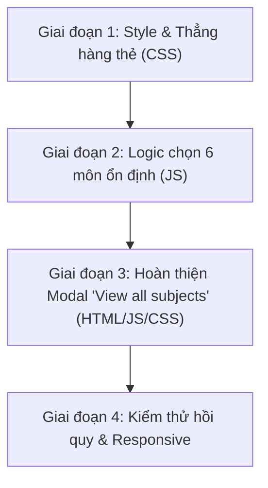

# BÁO CÁO KHẢO SÁT: HOME "YOUR SUBJECTS" + NÚT PRACTICE + VIEW ALL SUBJECTS

*Thời điểm khảo sát: 19/10/2026*  
*Chế độ: CHỈ ĐỌC (Read-only audit)*

---

## TÓM TẮT 10 DÒNG
1. **Tiến độ thẻ môn**: Tính bằng điểm trung bình (`avgScore`) của các lần nộp bài (`attempts`) trong `lib95:practice:attempts` qua hàm `core.getSubjectAverageScore(sub.id)`; biến `progressPct` luôn bằng 0 do lỗi truy cập thuộc tính `currentIndex` trên kiểu số.
2. **Nguồn dữ liệu tiến độ**: Lấy 100% từ Module Practice (localStorage client), không phân chia theo `userId` và hoàn toàn không đọc tiến độ video từ Module Lectures.
3. **Nơi render thẻ môn**: Hàm `renderSubjects()` tại `home_page/home_page.js:17-104`, nạp trực tiếp danh sách 7 môn từ `core.getSubjects()` theo thứ tự mảng tĩnh trong `js/practice-data.js`.
4. **Sự kiện kích hoạt render lại**: Duy nhất `DOMContentLoaded`. Sự kiện `storage` (`lib95:favorites:subjects`) chỉ toggle class `.is-favorited` trên icon sao chứ không render lại khối môn.
5. **Tình trạng nút "View all subjects" trên Home**: Thẻ `<a href="#" class="card-link">` tại `home_page/home_page.html:286`, là liên kết chết, chưa có bất kỳ event listener nào.
6. **Khả năng tái dùng modal Practice**: Hàm `core.showModal()` có sẵn trong runtime Home, nhưng CSS modal (`.prc-modal`) chỉ nằm trong `practice.css` (Home không nạp file này) và đường dẫn môn trong modal Practice đang là đường dẫn tương đối hẹp.
7. **Nguyên nhân lệch hàng**: Thẻ tên dài "Foundations of Computer Science" chiếm 2 dòng làm chiều cao tiêu đề tăng gấp đôi, đẩy thanh tiến độ và cụm nút hành động xuống thấp hơn các thẻ 1 dòng lân cận.
8. **Phạm vi nút Practice (.chip-soft)**: Class `.chip-soft` chỉ xuất hiện duy nhất trên `home_page.html` (chưa dùng ở bất kỳ trang nào khác).
9. **Rủi ro Dark Mode khi thêm shadow**: Class `html[data-theme="dark"] .chip-soft` hiện không set `box-shadow: none;`, nên bóng từ Light mode sẽ bị rò rỉ sang Dark mode nếu không giới hạn selector hoặc reset rõ ràng.
10. **Lưới thẻ môn (Grid)**: Đang cố định `repeat(3, minmax(0, 1fr))` không có media query responsive; 7 thẻ sinh ra hàng 3 đơn độc (3-3-1), trong khi 6 thẻ tạo bố cục hoàn hảo 3x2.

---

## PHẦN A: HIỆN TRẠNG KHỐI "YOUR SUBJECTS"

### 1. Cấu trúc khung HTML và hàm render thẻ môn
- **Khung HTML container**: Nằm tại [`home_page/home_page.html:283-290`](file:///c:/Users/anhqu/Documents/Computer%20Science%20Training/PRIVATE%20PROJECT/9-5-ai-library/home_page/home_page.html#L283-L290):
```html
<section class="subjects" aria-labelledby="subjects-title">
    <header class="section-header">
        <h2 class="section-title" id="subjects-title">Your subjects</h2>
        <a href="#" class="card-link">View all subjects</a>
    </header>
    <ul class="subject-grid">
        <!-- Được JS ghi đè toàn bộ nội dung khi chạy -->
    </ul>
</section>
```
- **Nút "View all subjects"**:
  - Thẻ: `<a>`
  - Href: `#`
  - Class: `card-link`
  - Listener: **Chưa có bất kỳ listener nào** (liên kết rỗng).
- **Hàm render thẻ môn**:
  - Tên hàm: `renderSubjects()` tại [`home_page/home_page.js:17-104`](file:///c:/Users/anhqu/Documents/Computer%20Science%20Training/PRIVATE%20PROJECT/9-5-ai-library/home_page/home_page.js#L17-L104).
  - Nguồn dữ liệu: `core.getSubjects()` từ `window.Lib95.practice.core` (định nghĩa tại [`js/practice-core.js:67-69`](file:///c:/Users/anhqu/Documents/Computer%20Science%20Training/PRIVATE%20PROJECT/9-5-ai-library/js/practice-core.js#L67-L69), trả về bản sao nông của `window.Lib95.practice.data.subjects`).
  - Thứ tự hiển thị hiện tại: Giữ nguyên thứ tự mảng ban đầu trong `js/practice-data.js` (CEA201 -> DBI202 -> PFP191 -> CSD203 -> CSI106 -> MAD101 -> MAE101).
- **Mã nguồn template render một thẻ môn** ([`home_page/home_page.js:51-74`](file:///c:/Users/anhqu/Documents/Computer%20Science%20Training/PRIVATE%20PROJECT/9-5-ai-library/home_page/home_page.js#L51-L74)):
```javascript
<li>
    <article class="card subject-card" data-subject-id="${sub.id}">
        <button type="button" class="subject-fav-btn ${isFav ? 'is-favorited' : ''}" data-subject-id="${sub.id}" aria-label="Favorite ${sub.name}" title="${isFav ? 'Bỏ yêu thích' : 'Yêu thích môn học'}">
            <svg class="star-icon" viewBox="0 0 24 24" aria-hidden="true">
                <polygon points="12 2 15.09 8.26 22 9.27 17 14.14 18.18 21.02 12 17.77 5.82 21.02 7 14.14 2 9.27 8.91 8.26 12 2"/>
            </svg>
        </button>
        <span class="subject-icon ${sub.icon}" aria-hidden="true"></span>
        <div class="subject-info">
            <h3 class="subject-name">${sub.name}</h3>
            <p class="subject-desc">${sub.title}</p>
            <div class="progress-row">
                <progress class="progress" value="${displayProgress}" max="100" aria-label="Tiến độ ${sub.name}">${displayProgress}%</progress>
                <span class="progress-label">${displayProgress}%</span>
            </div>
            <div class="subject-actions">
                <a href="../pages/lectures/lectures.html" class="chip chip-outline">Lectures</a>
                <a href="../pages/practice/practice-subject.html?subject=${sub.id}" class="chip chip-soft">Practice</a>
            </div>
        </div>
    </article>
</li>
```

---

### 2. Cách tính tiến độ trên thẻ ("19%", "3%", "0%")
- **Công thức và code thực tế** ([`home_page/home_page.js:27-48`](file:///c:/Users/anhqu/Documents/Computer%20Science%20Training/PRIVATE%20PROJECT/9-5-ai-library/home_page/home_page.js#L27-L48)):
```javascript
const quizzes = core.getQuizzes(sub.id);
let totalQuestions = 0;
let answeredQuestions = 0;

quizzes.forEach(q => {
  totalQuestions += q.questionCount || 0;
  const prog = core.getQuizProgress(q.id);
  if (prog && prog.currentIndex) {
      answeredQuestions += prog.currentIndex;
  }
});
const avgScore = core.getSubjectAverageScore(sub.id);

let progressPct = 0;
if (totalQuestions > 0) {
  progressPct = Math.round((answeredQuestions / totalQuestions) * 100);
}
if (progressPct > 100) progressPct = 100;
let displayProgress = avgScore > 0 ? avgScore : progressPct;
```
- **Hàm `core.getSubjectAverageScore(subjectId)`** ([`js/practice-core.js:195-203`](file:///c:/Users/anhqu/Documents/Computer%20Science%20Training/PRIVATE%20PROJECT/9-5-ai-library/js/practice-core.js#L195-L203)):
```javascript
function getSubjectAverageScore(subjectId) {
  var attempts = getAttempts();
  var subjectAttempts = attempts.filter(function (a) {
    return a.subjectId === Number(subjectId);
  });
  if (subjectAttempts.length === 0) return 0;
  var total = subjectAttempts.reduce(function (sum, a) { return sum + a.score; }, 0);
  return Math.round(total / subjectAttempts.length);
}
```
- **Phân tích bản chất tiến độ**:
  - `core.getQuizProgress(quizId)` ([`js/practice-core.js:177-183`](file:///c:/Users/anhqu/Documents/Computer%20Science%20Training/PRIVATE%20PROJECT/9-5-ai-library/js/practice-core.js#L177-L183)) trả về một **số nguyên tỷ lệ phần trăm** (ví dụ `0` hoặc `50`), chứ không trả về object. Do đó `prog.currentIndex` luôn là `undefined`, dẫn đến `answeredQuestions` luôn bằng `0` và `progressPct` luôn bằng `0`.
  - Kết quả là `displayProgress` **phụ thuộc 100% vào `avgScore`**.
  - `avgScore` là **điểm số trung bình (0 - 100) của tất cả các lần nộp quiz đã hoàn thành** của môn đó, KHÔNG PHẢI tỷ lệ phần trăm số quiz đã hoàn thành trên tổng số quiz.
- **Một quiz tính là "hoàn thành" khi nào?**
  - Khi user nộp bài thành công, hàm `submitQuiz()` trong [`js/practice-quiz.js:570-584`](file:///c:/Users/anhqu/Documents/Computer%20Science%20Training/PRIVATE%20PROJECT/9-5-ai-library/js/practice-quiz.js#L570-L584) tạo một bản ghi `attempt` với điểm số `score` (tính theo số câu đúng) và lưu vào `lib95:practice:attempts`. Không yêu cầu ngưỡng điểm đậu (ngay cả 5% hay 20% cũng được lưu và tính vào điểm trung bình).
- **Môn không có quiz thì tiến độ là gì?**
  - Môn không có quiz: `quizzes` rỗng, `totalQuestions = 0`, `subjectAttempts` rỗng, `avgScore = 0`. Biểu thức `avgScore > 0 ? avgScore : progressPct` trả về `0`. Thẻ hiển thị số `0%` bình thường (không bị `NaN`, không bị ẩn thẻ).
- **Tiến độ có phụ thuộc userId đăng nhập không?**
  - **KHÔNG**. Hàm `storageGet` trong [`js/practice-core.js:50-57`](file:///c:/Users/anhqu/Documents/Computer%20Science%20Training/PRIVATE%20PROJECT/9-5-ai-library/js/practice-core.js#L50-L57) đọc trực tiếp từ key `lib95:practice:attempts` trong `localStorage` của trình duyệt, không gán kèm `userId`. Mọi tài khoản đăng nhập trên cùng trình duyệt này đều dùng chung lịch sử bài làm này.

---

### 3. Hiện trạng tiến độ các môn
- **Trong dữ liệu seed tĩnh** ([`js/practice-data.js:31195`](file:///c:/Users/anhqu/Documents/Computer%20Science%20Training/PRIVATE%20PROJECT/9-5-ai-library/js/practice-data.js#L31195)):
  `"attempts": []` (mảng rỗng). Mặc định khi chưa có dữ liệu `localStorage`, **100% môn đều có tiến độ 0%**.
- **Trong phiên làm việc thực tế của user** (theo ảnh chụp màn hình Home `media_1792392171014_de57a313.png`):
  | Môn học | Mã môn | Tiến độ hiển thị | Bản chất giá trị |
  |---|---|---|---|
  | Computer Architecture | CEA201 | **19%** | Điểm trung bình các lượt làm quiz môn CEA201 |
  | Foundations of Computer Science | CSI106 | **3%** | Điểm trung bình các lượt làm quiz môn CSI106 |
  | Database | DBI202 | **0%** | Chưa có bài làm hoàn thành |
  | Programming Fundamentals | PFP191 | **0%** | Chưa có bài làm hoàn thành |
  | Data Structure & Algorithm | CSD203 | **0%** | Chưa có bài làm hoàn thành |
  | Discrete Mathematics | MAD101 | **0%** | Chưa có bài làm hoàn thành |
  | Mathematics for Engineering | MAE101 | **0%** | Chưa có bài làm hoàn thành |
- **Kết luận**: Tình huống đa số môn bằng 0% là trạng thái chuẩn và rất phổ biến. Vì vậy logic phá hoà (tie-breaker) khi các môn bằng tiến độ là cực kỳ trọng yếu.

---

### 4. Danh sách môn trả về từ `core.getSubjects()`
- **Số lượng**: 7 môn học.
- **Thứ tự và cấu trúc trường** ([`js/practice-data.js:7-50`](file:///c:/Users/anhqu/Documents/Computer%20Science%20Training/PRIVATE%20PROJECT/9-5-ai-library/js/practice-data.js#L7-L50)):
  | ID | `name` (Tên môn) | `title` (Mã môn) | `icon` (Class icon) | Số lượng Quiz |
  |---|---|---|---|---|
  | 1 | Computer Architecture | CEA201 | `subject1-icon` | 4 quizzes |
  | 2 | Database | DBI202 | `subject4-icon` | 4 quizzes |
  | 3 | Programming Fundamentals | PFP191 | `subject3-icon` | 4 quizzes |
  | 4 | Data Structure & Algorithm | CSD203 | `subject5-icon` | 4 quizzes |
  | 5 | Foundations of Computer Science | CSI106 | `subject6-icon` | 4 quizzes |
  | 6 | Discrete Mathematics | MAD101 | `subject2-icon` | 63 quizzes |
  | 7 | Mathematics for Engineering | MAE101 | `subject7-icon` | 60 quizzes |
- **Tình trạng bài giảng (Lectures)**:
  - Cả 7 môn đều có Quiz trong Practice.
  - Tuy nhiên, trong Module Lectures ([`backend/server.js`](file:///c:/Users/anhqu/Documents/Computer%20Science%20Training/PRIVATE%20PROJECT/9-5-ai-library/backend/server.js) / LMS database), chỉ có **2 môn** là CEA201 (có 1 video) và DBI202 (0 video). MAD101 và MAE101 **chưa hề có bài giảng**.
- **Hành vi nút "Lectures" trên thẻ môn ở Home**:
  - Tại [`home_page/home_page.js:68`](file:///c:/Users/anhqu/Documents/Computer%20Science%20Training/PRIVATE%20PROJECT/9-5-ai-library/home_page/home_page.js#L68):
    `<a href="../pages/lectures/lectures.html" class="chip chip-outline">Lectures</a>`
  - Nút này **khoá cứng đường dẫn** về trang tổng `lectures.html`, không kèm `subjectId`. Bất kể bấm nút Lectures ở môn nào (kể cả MAD101 hay MAE101), trình duyệt đều chỉ mở trang danh sách bài giảng chung.

---

### 5. Cấu trúc thẻ môn và cơ chế nút Favorite
- **Các thành phần HTML bên trong thẻ**:
  1. `<button class="subject-fav-btn">`: Nút sao góc phải trên cùng (`position: absolute; top: 12px; right: 14px;`).
  2. `<span class="subject-icon ...">`: Icon đồ họa môn học (64x64px).
  3. `<div class="subject-info">`: Khối thông tin gồm:
     - `<h3 class="subject-name">`: Tên đầy đủ của môn.
     - `<p class="subject-desc">`: Mã môn học (ví dụ CEA201).
     - `<div class="progress-row">`: Thanh progress bar kèm nhãn % (`<progress>`, `<span class="progress-label">`).
     - `<div class="subject-actions">`: 2 nút link `.chip.chip-outline` (Lectures) và `.chip.chip-soft` (Practice).
- **Cơ chế hoạt động của nút sao Favorite**:
  - Listener được gắn tại [`home_page/home_page.js:80-91`](file:///c:/Users/anhqu/Documents/Computer%20Science%20Training/PRIVATE%20PROJECT/9-5-ai-library/home_page/home_page.js#L80-L91).
  - Khi click: gọi `core.toggleSubjectFavorite(subId)` ([`js/practice-core.js:468-490`](file:///c:/Users/anhqu/Documents/Computer%20Science%20Training/PRIVATE%20PROJECT/9-5-ai-library/js/practice-core.js#L468-L490)).
  - Nơi lưu trữ:
    1. Mảng bộ nhớ `favoriteSubjectIds` trong `practice-core.js`.
    2. Gửi request POST lên API `/api/favorites` (nếu có token).
    3. Lưu key `lib95:favorites:subjects` trong `localStorage`.
  - **Có render lại cả khối không?**: **KHÔNG**. Hàm chỉ thực hiện:
    `btn.classList.toggle('is-favorited', nowFav);`
    và gọi `updateFavButtonUI()` để đồng bộ class trên các nút sao hiện có trong DOM. Hoàn toàn không build lại chuỗi HTML của grid.
  - **Có phụ thuộc thứ tự thẻ không?**: Không, nút sao định danh thông qua `data-subject-id`.
  - **Tác động khi giới hạn 6 môn tiêu biểu**: Nếu 6 môn tiêu biểu được chọn cố định hoặc lưu cache ổn định, việc bấm sao trên 6 thẻ này sẽ giữ nguyên vị trí thẻ, chỉ đổi màu sao vàng/rỗng. Nhưng nếu logic chọn 6 môn lại lấy tiêu chí `isFavorite` để sắp xếp và chạy lại ngay khi bấm sao thì thẻ sẽ bị nhảy vị trí gây xáo trộn giao diện.

---

### 6. Sự phụ thuộc của các khối khác trên Home vào danh sách môn
- **Khối "Continue learning"** ([`home_page/home_page.js:106-179`](file:///c:/Users/anhqu/Documents/Computer%20Science%20Training/PRIVATE%20PROJECT/9-5-ai-library/home_page/home_page.js#L106-L179)):
  - Kiểm tra `core.getLatestInProgress()`: Nếu có quiz đang làm dở thì ưu tiên hiện.
  - Nếu không có: Lấy `attempts[0]` (lần làm bài gần nhất trong lịch sử). Lấy môn học của attempt đó `subject = core.getSubjectById(latestAtt.subjectId)`, sắp xếp các quiz của môn đó theo `order`, tìm vị trí quiz vừa làm và gợi ý quiz tiếp theo `quizzes[lastIdx + 1]`.
  - **Lý do hiển thị "Chương 8: Cây (Trees) – Phần 2 · Discrete Mathematics · Up Next 0%"**: Trong lịch sử bài làm của user, lần nộp bài gần nhất là một quiz thuộc môn MAD101 (Chương 8 - Phần 1). Do đó hệ thống tự động tính quiz kế tiếp trong cây chương trình của MAD101 là Chương 8 - Phần 2. Vì bài này user chưa bắt đầu làm nên tiến độ của bài là `0%` và gắn nhãn "Up Next".
  - Khối này **hoàn toàn không phụ thuộc** vào thứ tự hay danh sách hiển thị của 6 thẻ môn trong "Your subjects".
- **Khối "Latest quiz score"** ([`home_page/home_page.js:181-215`](file:///c:/Users/anhqu/Documents/Computer%20Science%20Training/PRIVATE%20PROJECT/9-5-ai-library/home_page/home_page.js#L181-L215)):
  - Đọc trực tiếp `attempts[0]` và gọi `core.getSubjectById(latest.subjectId)`. Không phụ thuộc thẻ môn.
- **Khối "Recent activity"** ([`home_page/home_page.js:217-261`](file:///c:/Users/anhqu/Documents/Computer%20Science%20Training/PRIVATE%20PROJECT/9-5-ai-library/home_page/home_page.js#L217-L261)):
  - Đọc `attempts.slice(0, 5)` và gọi `core.getSubjectById(att.subjectId)`. Không phụ thuộc thẻ môn.

---

## PHẦN B: LOGIC CHỌN 6 MÔN (KHẢO SÁT ĐIỀU KIỆN ÁP DỤNG)

### 7. Các tiện ích sắp xếp và ngẫu nhiên hiện có trong dự án
- **Hàm sắp xếp có sẵn**:
  - `practice-core.js`: Chỉ có sắp xếp quiz theo `order` và sắp xếp attempts theo `finishedAt desc`. Chưa có hàm xếp hạng môn học.
  - `favorites-logic.js:280-289`: Có logic sắp xếp danh mục yêu thích theo `newest`, `oldest`, `az`.
- **Hàm ngẫu nhiên (Random)**:
  - Dự án **chưa có bất kỳ thư viện seed-random nào** (như LCG hay Mulberry32).
  - Dự án chỉ dùng duy nhất hàm bản địa `Math.random()` để sinh ID attempt tại [`js/practice-core.js:145`](file:///c:/Users/anhqu/Documents/Computer%20Science%20Training/PRIVATE%20PROJECT/9-5-ai-library/js/practice-core.js#L145).

---

### 8. Các tiêu chí khả dĩ để xếp hạng môn học
Từ cấu trúc thực tế của `attempts` ([`js/practice-quiz.js:570-581`](file:///c:/Users/anhqu/Documents/Computer%20Science%20Training/PRIVATE%20PROJECT/9-5-ai-library/js/practice-quiz.js#L570-L581)), các thuộc tính có thể khai thác gồm:
1. `displayProgress` (% hoàn thành / điểm trung bình hiện tại): Tính từ `core.getSubjectAverageScore(sub.id)`.
2. `attemptCount` (Số lần luyện tập của môn): Đếm số bản ghi trong `attempts` có `subjectId === sub.id`.
3. `lastAttemptTime` (Thời điểm học gần nhất): Giá trị `finishedAt` lớn nhất trong các `attempt` của môn đó.
4. `isFavorite`: Môn được người dùng yêu thích (`core.isSubjectFavorited(sub.id)`).
5. `quizCount`: Tổng số quiz sẵn có của môn (`core.getQuizzes(sub.id).length`).

---

### 9. Rủi ro của thuật toán chọn ngẫu nhiên và các sự kiện kích hoạt
- **Rủi ro khi dùng `Math.random()` không seed**:
  - Nếu mỗi lần tải trang đều gọi `Math.random()` để chọn môn, 6 môn hiển thị sẽ bị tráo đổi liên tục sau mỗi lần F5 hoặc chuyển trang quay về Home.
  - Người dùng sẽ có cảm giác hệ thống bị lỗi chớp nháy (layout shift), mất ổn định vị trí các môn mình đang theo dõi.
- **Các sự kiện hiện đang kích hoạt trong `home_page/home_page.js`**:
  1. `DOMContentLoaded` ([`L263`](file:///c:/Users/anhqu/Documents/Computer%20Science%20Training/PRIVATE%20PROJECT/9-5-ai-library/home_page/home_page.js#L263)): Kích hoạt `initDashboard()`, chạy `renderSubjects()`.
  2. `window.addEventListener('storage')` ([`L94`](file:///c:/Users/anhqu/Documents/Computer%20Science%20Training/PRIVATE%20PROJECT/9-5-ai-library/home_page/home_page.js#L94)): Chỉ lắng nghe key `lib95:favorites:subjects` để đổi trạng thái active của icon sao. **Không** gọi lại `renderSubjects()`.
  3. `window.addEventListener('storage')` trong `syncProfile.js:76`: Chỉ cập nhật tên/avatar user khi key `user` đổi, không can thiệp thẻ môn.
- **Kết luận giải pháp ổn định**: Cần cơ chế tie-breaker xác định (deterministic) hoặc lưu danh sách 6 môn được chọn vào `localStorage` / `sessionStorage`, hoặc seed ngẫu nhiên theo ngày (`YYYY-MM-DD + userId`) để đảm bảo trong cùng một ngày/phiên làm việc, danh sách 6 môn hoàn toàn cố định không bị nhảy.

---

### 10. Tổng số môn và cơ chế môn ẩn/khoá
- Hiện tại tổng số môn là **7 môn** (vừa đủ lớn hơn 6).
- Trong mã nguồn hiện tại, **không có bất kỳ cờ hay cơ chế nào dành cho môn bị ẩn (`hidden`) hoặc bị khoá (`locked`)**. Mọi môn trong `DATA.subjects` đều được xem là khả dụng và hiển thị công khai.
- Nếu sau này danh sách môn thu gọn còn $\le 6$, hàm `slice(0, 6)` sẽ hiển thị đầy đủ tất cả các môn hiện có mà không phát sinh lỗi.

---

## PHẦN C: "VIEW ALL SUBJECTS"

### 11. Bảng thống kê toàn bộ liên kết "View all" trên hệ thống
| STT | Tệp & Dòng | Nội dung text | Trạng thái kỹ thuật | Hành vi thực tế |
|---|---|---|---|---|
| 1 | [`home_page/home_page.html:286`](file:///c:/Users/anhqu/Documents/Computer%20Science%20Training/PRIVATE%20PROJECT/9-5-ai-library/home_page/home_page.html#L286) | "View all subjects" | `<a href="#" class="card-link">` | **Chưa gắn listener**, liên kết chết, không có phản hồi. |
| 2 | [`home_page/home_page.html:424`](file:///c:/Users/anhqu/Documents/Computer%20Science%20Training/PRIVATE%20PROJECT/9-5-ai-library/home_page/home_page.html#L424) | "View all" (Recent activity) | `<a href="#" class="card-link">` | Chưa gắn listener, liên kết chết. |
| 3 | [`pages/practice/practice.html:234`](file:///c:/Users/anhqu/Documents/Computer%20Science%20Training/PRIVATE%20PROJECT/9-5-ai-library/pages/practice/practice.html#L234) | "View all subjects →" | `<a href="#" class="prc-view-all">` | **Đã kích hoạt**: Click listener tại `practice-list.js:35`, mở modal danh sách tất cả môn. |
| 4 | [`pages/community/community-feed.html:220`](file:///c:/Users/anhqu/Documents/Computer%20Science%20Training/PRIVATE%20PROJECT/9-5-ai-library/pages/community/community-feed.html#L220) | "View all" | `<a href="community-leaderboard.html">` | Điều hướng sang trang bảng xếp hạng cộng đồng. |
| 5 | [`index.html:238`](file:///c:/Users/anhqu/Documents/Computer%20Science%20Training/PRIVATE%20PROJECT/9-5-ai-library/index.html#L238) | "View all events →" | `<a class="home-page__text-link" href="pages/lectures/lectures.html">` | Điều hướng sang trang bài giảng. |
| 6 | Các trang (`home_page`, `lectures`, `practice`, `settings`) | "View all notifications" | `<a href="#" class="notification-footer">` | Chưa gắn listener (chỉ riêng community trỏ tới `community-notifications.html`). |

---

### 12. Phân tích Modal "All Subjects" của trang Practice
- **Cơ chế thực thi** ([`js/practice-list.js:35-60`](file:///c:/Users/anhqu/Documents/Computer%20Science%20Training/PRIVATE%20PROJECT/9-5-ai-library/js/practice-list.js#L35-L60)):
  - Khi click `.prc-view-all`: Duyệt `core.getSubjects()`, ráp chuỗi HTML danh sách thẻ `<ul><li>...</li></ul>`.
  - Gọi hàm `core.showModal({ title: 'All Subjects', message: listHtml, confirmText: 'Close', ... })`.
- **Cấu trúc mỗi dòng môn trong modal**:
  - Gồm icon tile vuông 32x32px (`.prc-subject-icon-tile`), tên môn (`sub.name`), mã môn (`sub.title`).
  - Đường dẫn đích: `href="practice-subject.html?subject=${sub.id}"`.
- **Đánh giá tính năng**:
  - Ô tìm kiếm: **Chưa có**.
  - Đóng bằng Esc: **Đã có** (`practice-core.js:357-364`).
  - Đóng khi click nền: **Đã có** (`practice-core.js:349-354`).
  - Trap focus: **Chưa hoàn chỉnh** (chỉ focus nút Confirm khi mở, chưa chặn phím Tab thoát ra ngoài).
- **Khả năng tái dùng trực tiếp cho Home**:
  - **Không thể gọi nguyên bản** vì 3 rào cản:
    1. **Thiếu CSS**: Giao diện modal phụ thuộc vào `.prc-modal-overlay`, `.prc-modal`, `.prc-subject-icon-tile` được viết trong [`css/practice.css`](file:///c:/Users/anhqu/Documents/Computer%20Science%20Training/PRIVATE%20PROJECT/9-5-ai-library/css/practice.css#L1707). `home_page.html` không nạp file này.
    2. **Sai lệch đường dẫn**: Link `practice-subject.html?subject=...` là đường dẫn tương đối dành cho thư mục `pages/practice/`. Nếu gọi từ `home_page/home_page.html`, link sẽ bị lỗi 404 (cần là `/pages/practice/practice-subject.html?subject=...`).
    3. **Thiếu hành động kép**: Modal Practice chỉ có link vào làm quiz; trên Home, người dùng cần cả lựa chọn vào Lectures hoặc Practice.

---

### 13. Các mẫu Modal khác trong dự án
1. **Mẫu Settings / Favorites (HTML tĩnh ẩn sẵn)**:
   - File HTML chứa sẵn khung `<div id="modal-..." class="set-modal" hidden>` hoặc `#fav-modal-remove`.
   - CSS sử dụng `.set-modal-backdrop` và `.set-modal-container` với hiệu ứng kính mờ (glassmorphism).
   - JS điều khiển bằng thuộc tính `hidden = false/true`.
   - Ưu điểm: Tách biệt rõ HTML và JS, dễ style đồng bộ theme, không phụ thuộc module Practice.
2. **Mẫu Practice Core (Inject DOM động)**:
   - `core.showModal()` tạo động thẻ `div` chèn vào `document.body` rồi xoá khi đóng.
   - Ưu điểm: Tiện lợi không cần sửa HTML. Nhược điểm: Phụ thuộc vào các class CSS modal của Practice.

---

### 14. So sánh nguồn dữ liệu giữa Lectures và Practice
- **Lectures**: Nạp động qua API `/api/lms/courses` từ cơ sở dữ liệu backend. Chỉ chứa các môn học do giảng viên/quản trị tạo bài giảng video (hiện tại có **CEA201** và **DBI202**).
- **Practice**: Nạp tĩnh từ [`js/practice-data.js`](file:///c:/Users/anhqu/Documents/Computer%20Science%20Training/PRIVATE%20PROJECT/9-5-ai-library/js/practice-data.js), gồm đầy đủ **7 môn học**.
- **Khẳng định**: Khối "Your subjects" trên Home vốn được xây dựng dựa trên `window.Lib95.practice.core`, do đó modal "View all subjects" trên Home **bắt buộc phải lấy từ nguồn 7 môn của Practice** để đảm bảo tính nhất quán với các thẻ hiển thị bên ngoài.

---

### 15. Thiết kế trang đích cho từng môn trong Modal Home
- **Đường dẫn chuẩn**:
  - Nút/Link Practice: `/pages/practice/practice-subject.html?subject=${sub.id}` (áp dụng cho cả 7 môn).
  - Nút/Link Lectures: `/pages/lectures/lectures.html` (đối với các môn có video như CEA201, DBI202; riêng MAD101 và MAE101 chưa có video thì có thể làm mờ nút hoặc gắn tooltip *"Sắp ra mắt"* để tránh người dùng bỡ ngỡ khi vào trang bài giảng trống).

---

## PHẦN D: NÚT PRACTICE VÀ GIAO DIỆN THẺ MÔN (LIGHT MODE)

### 16. Phân tích class và CSS nút Practice / Lectures
- **Tên class**:
  - Nút Lectures: `.chip.chip-outline`
  - Nút Practice: `.chip.chip-soft`
- **Mã nguồn CSS Light Mode hiện tại** ([`css/style.css:1727-1756`](file:///c:/Users/anhqu/Documents/Computer%20Science%20Training/PRIVATE%20PROJECT/9-5-ai-library/css/style.css#L1727-L1756)):
```css
.chip {
    flex: 1;
    padding: 3px 0;
    font-size: 12px;
    font-weight: 600;
    text-align: center;
    text-decoration: none;
    border-radius: 10px;
    transition: background-color 0.2s, box-shadow 0.2s;
}

.chip-outline {
    color: var(--color-primary);
    background-color: var(--card-bg-elevated);
    border: 1px solid var(--color-primary-light);
}

.chip-outline:hover {
    background-color: var(--color-primary-soft);
}

.chip-soft {
    color: var(--color-primary);
    background-color: var(--color-primary-soft);
    border: 1px solid transparent;
}

.chip-soft:hover {
    background-color: var(--nav-hover-bg);
}
```
- **Mã nguồn CSS Dark Mode hiện tại** ([`css/style.css:2300-2320`](file:///c:/Users/anhqu/Documents/Computer%20Science%20Training/PRIVATE%20PROJECT/9-5-ai-library/css/style.css#L2300-L2320)):
```css
html[data-theme="dark"] .chip-outline {
    color: #f8fafc;
    background-color: rgba(30, 58, 138, 0.45);
    border: 1px solid var(--accent-bright);
    box-shadow: 0 0 10px var(--accent-glow);
}

html[data-theme="dark"] .chip-outline:hover {
    background-color: rgba(37, 99, 235, 0.6);
}

html[data-theme="dark"] .chip-soft {
    color: #94a3b8;
    background-color: rgba(255, 255, 255, 0.04);
    border: 1px solid rgba(255, 255, 255, 0.08);
}

html[data-theme="dark"] .chip-soft:hover {
    background-color: rgba(255, 255, 255, 0.08);
    color: #f8fafc;
}
```
- **Phạm vi sử dụng**: Qua kiểm tra toàn dự án, class `.chip-soft` và `.chip-outline` **chỉ xuất hiện duy nhất trên `home_page/home_page.html`**. Không một trang nào khác sử dụng class này.
- **Selector an toàn nhất nếu chỉ muốn áp dụng cho Home**:
  `html:not([data-theme="dark"]) .subject-card .chip-soft` hoặc `.subject-card .chip-soft`.

---

### 17. Độ tương phản và giá trị `box-shadow` nhẹ đề xuất
- **Độ nổi hiện tại của nút Practice ở Light Mode**:
  - Nền thẻ môn: Kính mờ trắng đục `--card-bg: rgba(255, 255, 255, 0.65)`.
  - Nền nút Practice (`.chip-soft`): Xanh rất nhạt `--color-primary-soft: #eff6ff`.
  - Viền nút: `transparent` (trong suốt).
  - Đánh giá thị giác: Nền nút gần như chìm vào nền thẻ trắng đục, chỉ có màu chữ xanh đậm `#1d4ed8` là nhìn thấy được. Do thiếu viền và thiếu shadow nên nút tạo cảm giác "phẳng lỳ" và thiếu tính xúc giác (affordance) của một nút bấm.
- **3 giá trị `box-shadow` tham khảo chuẩn ngôn ngữ dự án**:
  1. *Độ bóng nhẹ tinh tế (Subtle Elevation)*:  
     `box-shadow: 0 1px 3px rgba(15, 23, 42, 0.08), 0 1px 2px rgba(15, 23, 42, 0.04);`
  2. *Độ bóng có ánh xanh thương hiệu (Tinted Brand Glow - Khuyên dùng)*:  
     `box-shadow: 0 2px 6px rgba(29, 78, 216, 0.12);`  
     (Tương thích hoàn hảo với biến `--color-primary: #1d4ed8`, tạo ánh nổi dịu nhẹ).
  3. *Độ bóng nút hành động phụ (Soft Action)*:  
     `box-shadow: 0 2px 8px var(--color-primary-glow);`  
     (Sử dụng biến thiết kế có sẵn tại `style.css:11` `--color-primary-glow: rgba(29, 78, 216, 0.2)`).

---

### 18. Nguyên nhân lệch hàng thẻ môn và giải pháp căn chỉnh
- **Cấu trúc layout bên trong thẻ** ([`css/style.css:1610-1623`](file:///c:/Users/anhqu/Documents/Computer%20Science%20Training/PRIVATE%20PROJECT/9-5-ai-library/css/style.css#L1610-L1623)):
  - `.subject-card`: `display: flex; align-items: center; gap: 12px; height: 100%;`
  - `.subject-info`: `flex: 1; min-width: 0; padding-right: 28px;` (chế độ block thông thường).
- **Nguyên nhân gây lệch hàng**:
  - Tên môn `.subject-name` có font-size `15px`, `font-weight: 700`.
  - Các môn thông thường như "Computer Architecture", "Database", "Discrete Mathematics" chỉ vừa vặn 1 dòng (chiều cao ~20px).
  - Riêng môn "Foundations of Computer Science" (CSI106) có chuỗi quá dài nên tự động rớt dòng thứ 2 thành:
    *Foundations of Computer*  
    *Science*  
    (Chiều cao tăng lên ~40px).
  - Do `.subject-info` là khối block tuần tự, tiêu đề cao thêm ~20px sẽ đẩy toàn bộ phần tử bên dưới (thanh tiến độ và 2 nút bấm) tụt xuống tương ứng 20px so với 2 thẻ bên cạnh trong cùng hàng lưới.
- **Giải pháp căn thẳng hàng hoàn hảo (không đổi font-size)**:
  - *Phương án 1 (Khuyên dùng - Cố định độ cao tiêu đề 2 dòng)*:
    ```css
    .subject-name {
        margin: 0;
        font-size: 15px;
        font-weight: 700;
        line-height: 1.35;
        min-height: 41px; /* Đảm bảo luôn giữ đúng diện tích 2 dòng */
        display: -webkit-box;
        -webkit-line-clamp: 2;
        -webkit-box-orient: vertical;
        overflow: hidden;
    }
    ```
    Khi mọi thẻ đều dành sẵn 2 dòng cho tiêu đề, các thẻ 1 dòng sẽ có khoảng thở nhẹ bên dưới, đảm bảo 100% thanh tiến độ và nút bấm của mọi thẻ trong hàng đều thẳng tắp ngang hàng nhau.
  - *Phương án 2 (Flexbox đẩy đáy)*: Đặt `.subject-info { display: flex; flex-direction: column; height: 100%; }` và cho `.progress-row { margin-top: auto; }`.

---

### 19. Bố cục lưới thẻ môn (Grid) tại các Breakpoint
- **Hiện trạng CSS** ([`css/style.css:1601-1608`](file:///c:/Users/anhqu/Documents/Computer%20Science%20Training/PRIVATE%20PROJECT/9-5-ai-library/css/style.css#L1601-L1608)):
  ```css
  .subject-grid {
      display: grid;
      grid-template-columns: repeat(3, minmax(0, 1fr));
      gap: 12px;
  }
  ```
  Trong `style.css` **hoàn toàn chưa có media query** cho `.subject-grid`.
- **Hiện trạng 7 thẻ vs 6 thẻ**:
  - Khi có 7 thẻ: Lưới chia thành 3 hàng (Hàng 1: 3 thẻ, Hàng 2: 3 thẻ, Hàng 3: duy nhất 1 thẻ lẻ loi ở cột 1, để trống 2 cột bên phải rất mất cân đối).
  - Khi giới hạn đúng 6 thẻ: Lưới chia thành 2 hàng chuẩn chỉnh $3 \times 2 = 6$, vuông vắn và đối xứng.
- **Bố cục Breakpoint khuyến nghị bổ sung**:
  - Desktop ($> 1024px$): 3 cột ($3 \times 2 = 6$ thẻ).
  - Tablet ($640px - 1024px$): 2 cột ($2 \times 3 = 6$ thẻ).
  - Mobile ($< 640px$): 1 cột ($1 \times 6 = 6$ thẻ).

---

### 20. Tác động của Shadow đối với Dark Mode
- Tại [`css/style.css:2311-2315`](file:///c:/Users/anhqu/Documents/Computer%20Science%20Training/PRIVATE%20PROJECT/9-5-ai-library/css/style.css#L2311-L2315):
  ```css
  html[data-theme="dark"] .chip-soft {
      color: #94a3b8;
      background-color: rgba(255, 255, 255, 0.04);
      border: 1px solid rgba(255, 255, 255, 0.08);
  }
  ```
- Nhận xét: Quy tắc này **chưa có khai báo `box-shadow`**.
- Nếu thêm `box-shadow: 0 2px 6px rgba(...)` trực tiếp vào selector chung `.chip-soft` ở dòng 1748, bóng mờ này sẽ thừa kế sang cả Dark mode, tạo ra quầng bóng tối hoặc ám xanh không mong muốn trên nền thẻ tối.
- **Giải pháp triệt để**:
  1. Chỉ áp dụng bóng cho Light mode bằng selector:  
     `html:not([data-theme="dark"]) .chip-soft { box-shadow: 0 2px 6px rgba(29, 78, 216, 0.12); }`
  2. Hoặc bổ sung tường minh vào Dark mode:  
     `html[data-theme="dark"] .chip-soft { box-shadow: none; }`.

---

## PHẦN E: ĐỀ XUẤT VÀ RỦI RO

### 21. Phương án đề xuất cho Logic chọn 6 môn tiêu biểu

#### A. Thứ tự ưu tiên xếp hạng (Sorting Pipeline)
1. **Tiến độ / Điểm bài làm (`displayProgress`) giảm dần**: Các môn user đang tích cực học (tiến độ cao) được ưu tiên lên đầu.
2. **Số lượt làm bài (`attemptCount`) giảm dần**: Nếu cùng tiến độ (ví dụ nhiều môn cùng 0%), môn nào đã từng được làm nhiều lần hơn sẽ ưu tiên trước.
3. **Môn yêu thích (`isFavorite`)**: Môn có gắn sao được ưu tiên hơn môn không gắn sao.
4. **Phá hoà ngẫu nhiên ổn định (Deterministic Seeded Tie-breaker)**:
   - Thay vì dùng `Math.random()` trôi nổi gây nhảy vị trí mỗi lần F5, ta dùng thuật toán sinh số ngẫu nhiên có seed dựa trên:  
     `seed = Ngày hiện tại (YYYY-MM-DD) + userId` (hoặc chuỗi ngẫu nhiên lưu trong `localStorage['lib95:home:subject_seed']`).
   - Kết quả: Trong suốt ngày hôm đó, thứ tự 6 môn hiển thị là hoàn toàn cố định đối với người dùng; sang ngày hôm sau sẽ tự động đổi ngẫu nhiên sang một bộ 6 môn khác nếu tiến độ vẫn bằng nhau.
   - Luôn đảm bảo lấy đúng 6 môn phân biệt bằng cách áp dụng thuật toán Fisher-Yates shuffle có seed trên nhóm các môn bằng điểm.

#### B. Nơi đặt hàm lựa chọn
- Đặt hàm `getFeaturedSubjects(limit = 6)` trong [`home_page/home_page.js`](file:///c:/Users/anhqu/Documents/Computer%20Science%20Training/PRIVATE%20PROJECT/9-5-ai-library/home_page/home_page.js) (hoặc xuất từ `js/practice-core.js` nếu muốn các widget khác dùng chung).

---

### 22. Phương án triển khai "View all subjects"

#### Đánh giá so sánh:
| Tiêu chí | Phương án A: Modal popup tại chỗ (Khuyên dùng) | Phương án B: Chuyển hướng sang trang riêng |
|---|---|---|
| **Trải nghiệm người dùng (UX)** | Nhanh, mượt, giữ ngữ cảnh Home, xem xong đóng lại ngay trong 1 click. | Phải tải lại toàn trang, rời khỏi màn hình chính. |
| **Phù hợp dữ liệu** | 7 môn học là số lượng vừa vặn cho một modal gọn gàng, có ô tìm kiếm tức thì. | 7 môn là quá ít để tạo hẳn một trang mới riêng biệt. |
| **Tính đồng bộ thiết kế** | Đồng điệu với modal All Subjects của Practice và modal Settings/Favorites. | Cần tạo thêm file HTML mới và cập nhật routing. |

#### Kiến trúc triển khai đề xuất cho Modal trên Home:
- Xây dựng modal độc lập ngay trong `home_page/home_page.html` (hoặc inject linh hoạt qua JS) với style kế thừa từ hệ thống glassmorphism của `css/style.css`.
- Nội dung mỗi dòng trong modal:
  - Icon môn học theo đúng màu sắc (`.subject-icon` tương ứng).
  - Tên môn + Mã môn.
  - Thanh tiến độ mini của môn đó.
  - 2 nút hành động nhanh: **Lectures** (trỏ tới bài giảng) và **Practice** (trỏ thẳng vào luyện tập môn đó).
  - Ô tìm kiếm nhanh (Filter input) ở trên cùng giúp lọc ngay theo tên hoặc mã môn.

---

### 23. Danh sách tệp cần cập nhật

| Tệp | Bắt buộc / Tuỳ chọn | Mục đích thay đổi |
|---|---|---|
| [`home_page/home_page.js`](file:///c:/Users/anhqu/Documents/Computer%20Science%20Training/PRIVATE%20PROJECT/9-5-ai-library/home_page/home_page.js) | **Bắt buộc** | - Bổ sung logic xếp hạng và chọn 6 môn tiêu biểu ổn định.<br>- Gắn sự kiện click mở modal cho nút "View all subjects".<br>- Khắc phục lỗi tính `progressPct` từ `currentIndex`. |
| [`css/style.css`](file:///c:/Users/anhqu/Documents/Computer%20Science%20Training/PRIVATE%20PROJECT/9-5-ai-library/css/style.css) | **Bắt buộc** | - Thêm `box-shadow` nhẹ cho `.chip-soft` ở Light mode (và reset rõ ở Dark mode).<br>- Thêm `min-height` cho `.subject-name` để chống lệch hàng.<br>- Thêm style cho Modal "All Subjects" trên Home.<br>- Bổ sung media query responsive (1 cột, 2 cột) cho `.subject-grid`. |
| [`home_page/home_page.html`](file:///c:/Users/anhqu/Documents/Computer%20Science%20Training/PRIVATE%20PROJECT/9-5-ai-library/home_page/home_page.html) | **Tuỳ chọn** | Thêm markup khung modal tĩnh nếu chọn hướng tiếp cận HTML tĩnh (giống modal Favorites/Settings). |

#### Đánh giá rủi ro hồi quy (Regression Risks):
- **Practice modal**: Không ảnh hưởng vì modal của Home hoạt động độc lập trong namespace Home/Style.css.
- **Favorites / Stars**: Giữ nguyên cơ chế `core.toggleSubjectFavorite`, chỉ cập nhật UI class `.is-favorited` mà không làm đảo lộn danh sách 6 môn đã chọn.
- **Dark Mode**: Đảm bảo khai báo `box-shadow: none` cho `.chip-soft` trong Dark theme để không làm biến đổi giao diện tối đã duyệt trước đó.
- **Continue learning**: Không bị ảnh hưởng vì hàm đọc dữ liệu độc lập từ `attempts[0]`.

---

### 24. Kế hoạch triển khai theo từng giai đoạn (Staged Roadmap)



1. **Giai đoạn 1: Tinh chỉnh Giao diện Thẻ môn & Nút Practice (CSS)**
   - *Phạm vi*: `css/style.css`.
   - *Hành động*:
     - Thêm bóng nhẹ `box-shadow: 0 2px 6px rgba(29, 78, 216, 0.12)` cho `.chip-soft` ở Light mode; giữ `box-shadow: none` ở Dark mode.
     - Thiết lập `min-height: 41px` và `-webkit-line-clamp: 2` cho `.subject-name` để mọi hàng thẻ môn thẳng tắp.
     - Thêm media query cho `.subject-grid` (3 cột desktop, 2 cột tablet, 1 cột mobile).
   - *Kiểm tra*: Xem giao diện Light và Dark trên màn hình desktop và co giãn cửa sổ trình duyệt.

2. **Giai đoạn 2: Logic chọn 6 môn tiêu biểu ổn định (JS)**
   - *Phạm vi*: `home_page/home_page.js`.
   - *Hành động*:
     - Xây dựng thuật toán xếp hạng: ưu tiên % tiến độ > số lượt làm bài > favorite > phá hoà ngẫu nhiên có seed theo ngày.
     - Đảm bảo luôn lấy ra đúng 6 môn khác nhau.
     - Đảm bảo khi bấm sao yêu thích không làm tráo đổi vị trí thẻ.
   - *Kiểm tra*: Refresh trang nhiều lần, kiểm tra danh sách 6 môn giữ nguyên vị trí, bấm sao yêu thích không bị giật.

3. **Giai đoạn 3: Hoàn thiện tính năng "View all subjects" (Modal Popup)**
   - *Phạm vi*: `home_page/home_page.html`, `home_page/home_page.js`, `css/style.css`.
   - *Hành động*:
     - Gắn listener cho `<a href="#" class="card-link">View all subjects</a>`.
     - Hiển thị modal glassmorphism danh sách toàn bộ 7 môn với đầy đủ icon, tên môn, thanh tiến độ và 2 nút bấm Lectures / Practice.
     - Hỗ trợ đóng bằng phím `Escape`, nút Close và click overlay.
   - *Kiểm tra*: Click nút mở modal, kiểm tra liên kết của từng môn, thử đóng bằng các phương thức.

4. **Giai đoạn 4: Kiểm thử toàn diện & Hồi quy**
   - *Phạm vi*: Kiểm tra chéo giữa Home, Practice, Lectures, Favorites và Dark theme.
   - *Hành định*: Xác nhận không có lỗi console, không ảnh hưởng tới tiến độ hay dữ liệu người dùng.
