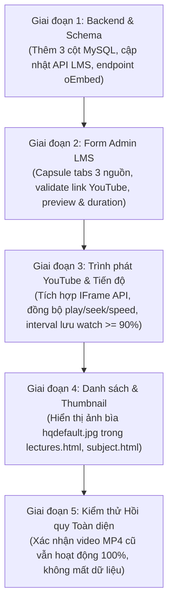

# KHẢO SÁT HỆ THỐNG BÀI GIẢNG ĐỂ THÊM NGUỒN VIDEO "LINK YOUTUBE" (LMS YOUTUBE AUDIT)

---

## TÓM TẮT 10 DÒNG
1. **Dữ liệu lưu trữ & Schema**: Lưu duy nhất trong MySQL (bảng `lectures` và `courses`), trường video hiện tại là `video_url TEXT`, thời lượng là `duration_min INT DEFAULT 18` (phút); không có `backend/data/lms-store.json`.
2. **Luồng gửi Form Admin**: Gửi 1 request JSON `POST /api/lms/courses/:courseId/lectures` (hoặc `PUT /api/lms/lectures/:id`); nếu upload video thì upload file qua FormData trước, lấy URL rồi mới bấm lưu JSON.
3. **API Video của trình phát**: Dùng thẻ `<video id="lec-video">` với giao diện tự dựng; phụ thuộc vào `.play()`, `.pause()`, `.currentTime`, `.duration`, `.playbackRate`, `.requestFullscreen()`, sự kiện `timeupdate`, `loadedmetadata`, `play`, `pause`.
4. **Tiến độ & Hoàn thành**: Tính theo % (`currentTime / duration * 100`), lưu tại localStorage `lib95:lectures:watch:<id>`; đạt $\ge 90\%$ thì tự động đánh dấu hoàn thành vào `lib95:lectures:completedIds` và cập nhật sidebar.
5. **Ghi chú (Notes)**: `lecture-notes.js` chỉ là trình soạn thảo văn bản đơn thuần (`contenteditable`), lưu vào `lib95:lectures:note:<id>`; **hoàn toàn KHÔNG** có timestamp gắn với video và không có nút nhảy tới giây.
6. **CSP & Bảo mật nhúng**: Server và HTML **hoàn toàn KHÔNG** cấu hình thẻ meta CSP hay header CSP nào; không chặn iframe `youtube.com`, `youtube-nocookie.com`, script `iframe_api` hay ảnh `i.ytimg.com`.
7. **Kết quả thử oEmbed**: Endpoint `https://www.youtube.com/oembed` trả HTTP 200, **không cần API key**, trả `title`, `author_name`, `thumbnail_url`, nhưng **CORS: null** (bị chặn nếu gọi từ browser, cần gọi qua backend) và **không trả duration**.
8. **Tính năng sẽ mất khi dùng YouTube**: Mất nút đổi tốc độ tự chế nếu focus vào iframe, không thể dùng `requestPictureInPicture()` trên iframe (phải dùng PiP của browser/YouTube), không chặn tải hay can thiệp menu chuột phải trong iframe, phím tắt ngoài iframe bị nuốt khi focus nằm trong iframe.
9. **Số file cần can thiệp**: Bắt buộc sửa 6 file (`initDb.js`, `lmsController.js`, `admin.html`, `admin-lms.js`, `lecture.html`, `lecture-player.js`); tùy chọn sửa 3 file (`lectures-core.js`, `lectures-list.js`, `lectures.css`).
10. **Rủi ro lớn nhất**: Video YouTube bị chủ kênh tắt tính năng nhúng (lỗi 101/150) hoặc bị xóa/riêng tư (lỗi 100); YouTube không phát sự kiện `timeupdate` nên bắt buộc phải dùng interval polling để đồng bộ thanh seek và tính tiến độ $\ge 90\%$.

---

## PHẦN A: MÔ HÌNH DỮ LIỆU VÀ BACKEND CỦA BÀI GIẢNG

### 1. Nơi lưu trữ dữ liệu bài giảng & Schema thực tế
- **Nơi lưu thực sự**: 100% trong cơ sở dữ liệu **MySQL** (`ai_club_db`), gồm các bảng: `courses`, `lectures`, `lecture_resources`, `lecture_comments`.
- **Về file `backend/data/lms-store.json`**: Biến `STORE_PATH` chỉ được khai báo ở dòng 5 file [`backend/config/initDb.js`](file:///c:/Users/anhqu/Documents/Computer%20Science%20Training/PRIVATE%20PROJECT/9-5-ai-library/backend/config/initDb.js#L5) nhưng **không bao giờ được sử dụng**. Thư mục `backend/data/` thực tế rỗng; toàn bộ controller [`backend/controllers/lmsController.js`](file:///c:/Users/anhqu/Documents/Computer%20Science%20Training/PRIVATE%20PROJECT/9-5-ai-library/backend/controllers/lmsController.js) truy vấn trực tiếp MySQL qua module `db`.
- **DDL của bảng `lectures`** ([`backend/config/initDb.js:28-44`](file:///c:/Users/anhqu/Documents/Computer%20Science%20Training/PRIVATE%20PROJECT/9-5-ai-library/backend/config/initDb.js#L28-L44)):
```sql
CREATE TABLE IF NOT EXISTS lectures (
  id INT AUTO_INCREMENT PRIMARY KEY,
  course_id INT NOT NULL,
  chapter_order INT DEFAULT 1,
  title VARCHAR(255) NOT NULL,
  type VARCHAR(50) DEFAULT 'video',
  duration_min INT DEFAULT 18,
  video_url TEXT,
  description TEXT,
  key_takeaways JSON,
  overview_html LONGTEXT,
  status VARCHAR(20) DEFAULT 'in-progress',
  created_at TIMESTAMP DEFAULT CURRENT_TIMESTAMP,
  INDEX (course_id),
  CONSTRAINT fk_lecture_course FOREIGN KEY (course_id) REFERENCES courses(id) ON DELETE CASCADE
) ENGINE=InnoDB DEFAULT CHARSET=utf8mb4 COLLATE=utf8mb4_unicode_ci;
```
- **Mẫu một bài giảng thực tế trong MySQL** (`SELECT * FROM lectures WHERE id = 1`):
```json
{
  "id": 1,
  "course_id": 1,
  "chapter_order": 1,
  "title": "Computer Organization and Architecture: Number Systems",
  "type": "video",
  "duration_min": 18,
  "video_url": "/document/Lectures/Ky_II/CEA201/test/Giải_mã_Hệ_thống_Số.mp4",
  "description": "Hệ thống hóa toàn bộ kiến thức cốt lõi về Hệ thống số (Number Systems)...",
  "key_takeaways": "[\"Hệ thống số theo vị trí...\", \"Hệ Thập phân...\", \"Quy tắc chuyển đổi cơ số...\", \"Hệ Thập lục phân...\"]",
  "overview_html": "<div class=\"lec-feynman-container\">...</div>",
  "status": "in-progress",
  "created_at": "2026-10-14T15:40:10.000Z"
}
```
- **Kiểu và đơn vị của `duration`**: 
  - Trong MySQL: cột `duration_min` có kiểu số nguyên `INT`, đơn vị là **phút** (ví dụ: `18`).
  - Phía API/ffprobe: có tính toán `duration_sec` dạng số thực (giây) khi upload hoặc browse, nhưng khi lưu vào bảng `lectures` chỉ lưu `duration_min`.

---

### 2. Danh sách đầy đủ Endpoints LMS

| Method | Path | Middleware quyền | Hàm xử lý | File:Dòng | Chức năng |
| :--- | :--- | :--- | :--- | :--- | :--- |
| `GET` | `/api/lms/courses` | Công khai | `getAllCourses` | [`lmsRoutes.js:8`](file:///c:/Users/anhqu/Documents/Computer%20Science%20Training/PRIVATE%20PROJECT/9-5-ai-library/backend/routes/lmsRoutes.js#L8), [`lmsController.js:32`](file:///c:/Users/anhqu/Documents/Computer%20Science%20Training/PRIVATE%20PROJECT/9-5-ai-library/backend/controllers/lmsController.js#L32) | Lấy danh sách khóa học kèm số bài giảng |
| `GET` | `/api/lms/courses/:id` | Công khai | `getCourseById` | [`lmsRoutes.js:9`](file:///c:/Users/anhqu/Documents/Computer%20Science%20Training/PRIVATE%20PROJECT/9-5-ai-library/backend/routes/lmsRoutes.js#L9), [`lmsController.js:49`](file:///c:/Users/anhqu/Documents/Computer%20Science%20Training/PRIVATE%20PROJECT/9-5-ai-library/backend/controllers/lmsController.js#L49) | Xem chi tiết 1 khóa học |
| `POST` | `/api/lms/courses` | `verifyToken`, `isStaffAdminOwner` | `createCourse` | [`lmsRoutes.js:12`](file:///c:/Users/anhqu/Documents/Computer%20Science%20Training/PRIVATE%20PROJECT/9-5-ai-library/backend/routes/lmsRoutes.js#L12), [`lmsController.js:64`](file:///c:/Users/anhqu/Documents/Computer%20Science%20Training/PRIVATE%20PROJECT/9-5-ai-library/backend/controllers/lmsController.js#L64) | Tạo khóa học mới |
| `PUT` | `/api/lms/courses/:id` | `verifyToken`, `isStaffAdminOwner` | `updateCourse` | [`lmsRoutes.js:13`](file:///c:/Users/anhqu/Documents/Computer%20Science%20Training/PRIVATE%20PROJECT/9-5-ai-library/backend/routes/lmsRoutes.js#L13), [`lmsController.js:108`](file:///c:/Users/anhqu/Documents/Computer%20Science%20Training/PRIVATE%20PROJECT/9-5-ai-library/backend/controllers/lmsController.js#L108) | Cập nhật thông tin khóa học |
| `DELETE` | `/api/lms/courses/:id` | `verifyToken`, `isStaffAdminOwner` | `deleteCourse` | [`lmsRoutes.js:14`](file:///c:/Users/anhqu/Documents/Computer%20Science%20Training/PRIVATE%20PROJECT/9-5-ai-library/backend/routes/lmsRoutes.js#L14), [`lmsController.js:147`](file:///c:/Users/anhqu/Documents/Computer%20Science%20Training/PRIVATE%20PROJECT/9-5-ai-library/backend/controllers/lmsController.js#L147) | Xóa khóa học |
| `GET` | `/api/lms/courses/:courseId/lectures` | Công khai | `getCourseLectures` | [`lmsRoutes.js:18`](file:///c:/Users/anhqu/Documents/Computer%20Science%20Training/PRIVATE%20PROJECT/9-5-ai-library/backend/routes/lmsRoutes.js#L18), [`lmsController.js:162`](file:///c:/Users/anhqu/Documents/Computer%20Science%20Training/PRIVATE%20PROJECT/9-5-ai-library/backend/controllers/lmsController.js#L162) | Lấy danh sách bài giảng theo khóa học |
| `GET` | `/api/lms/lectures/:id` | Công khai | `getLectureDetail` | [`lmsRoutes.js:20`](file:///c:/Users/anhqu/Documents/Computer%20Science%20Training/PRIVATE%20PROJECT/9-5-ai-library/backend/routes/lmsRoutes.js#L20), [`lmsController.js:181`](file:///c:/Users/anhqu/Documents/Computer%20Science%20Training/PRIVATE%20PROJECT/9-5-ai-library/backend/controllers/lmsController.js#L181) | Chi tiết bài giảng (kèm overview, resources, comments) |
| `POST` | `/api/lms/courses/:courseId/lectures` | `verifyToken`, `isStaffAdminOwner` | `createLecture` | [`lmsRoutes.js:23`](file:///c:/Users/anhqu/Documents/Computer%20Science%20Training/PRIVATE%20PROJECT/9-5-ai-library/backend/routes/lmsRoutes.js#L23), [`lmsController.js:222`](file:///c:/Users/anhqu/Documents/Computer%20Science%20Training/PRIVATE%20PROJECT/9-5-ai-library/backend/controllers/lmsController.js#L222) | Tạo bài giảng mới theo courseId |
| `POST` | `/api/lms/lectures` | `verifyToken`, `isStaffAdminOwner` | `createLecture` | [`lmsRoutes.js:24`](file:///c:/Users/anhqu/Documents/Computer%20Science%20Training/PRIVATE%20PROJECT/9-5-ai-library/backend/routes/lmsRoutes.js#L24), [`lmsController.js:222`](file:///c:/Users/anhqu/Documents/Computer%20Science%20Training/PRIVATE%20PROJECT/9-5-ai-library/backend/controllers/lmsController.js#L222) | Endpoint phụ tạo bài giảng |
| `PUT` | `/api/lms/lectures/:id` | `verifyToken`, `isStaffAdminOwner` | `updateLecture` | [`lmsRoutes.js:25`](file:///c:/Users/anhqu/Documents/Computer%20Science%20Training/PRIVATE%20PROJECT/9-5-ai-library/backend/routes/lmsRoutes.js#L25), [`lmsController.js:284`](file:///c:/Users/anhqu/Documents/Computer%20Science%20Training/PRIVATE%20PROJECT/9-5-ai-library/backend/controllers/lmsController.js#L284) | Cập nhật bài giảng |
| `DELETE` | `/api/lms/lectures/:id` | `verifyToken`, `isStaffAdminOwner` | `deleteLecture` | [`lmsRoutes.js:26`](file:///c:/Users/anhqu/Documents/Computer%20Science%20Training/PRIVATE%20PROJECT/9-5-ai-library/backend/routes/lmsRoutes.js#L26), [`lmsController.js:359`](file:///c:/Users/anhqu/Documents/Computer%20Science%20Training/PRIVATE%20PROJECT/9-5-ai-library/backend/controllers/lmsController.js#L359) | Xóa bài giảng |
| `POST` | `/api/lms/upload-video` | `verifyToken`, `isStaffAdminOwner` | `upload.single('video')` | [`lmsRoutes.js:124-154`](file:///c:/Users/anhqu/Documents/Computer%20Science%20Training/PRIVATE%20PROJECT/9-5-ai-library/backend/routes/lmsRoutes.js#L124-L154) | Upload video (multer, max 1GB, lưu `document/Lectures/Uploads`, chạy ffmpeg faststart & ffprobe) |
| `GET` | `/api/lms/browse-videos` | `verifyToken`, `isStaffAdminOwner` | `browseLocalVideos` | [`lmsRoutes.js:157`](file:///c:/Users/anhqu/Documents/Computer%20Science%20Training/PRIVATE%20PROJECT/9-5-ai-library/backend/routes/lmsRoutes.js#L157), [`lmsController.js:374`](file:///c:/Users/anhqu/Documents/Computer%20Science%20Training/PRIVATE%20PROJECT/9-5-ai-library/backend/controllers/lmsController.js#L374) | Quét đệ quy `document/Lectures/` lấy danh sách video có sẵn |
| `GET` | `/api/lms/lectures/:lectureId/comments` | Công khai | `getComments` | [`lmsRoutes.js:160`](file:///c:/Users/anhqu/Documents/Computer%20Science%20Training/PRIVATE%20PROJECT/9-5-ai-library/backend/routes/lmsRoutes.js#L160), [`lmsController.js:420`](file:///c:/Users/anhqu/Documents/Computer%20Science%20Training/PRIVATE%20PROJECT/9-5-ai-library/backend/controllers/lmsController.js#L420) | Lấy danh sách bình luận |
| `POST` | `/api/lms/lectures/:lectureId/comments` | Tùy chọn token | `addComment` | [`lmsRoutes.js:162-169`](file:///c:/Users/anhqu/Documents/Computer%20Science%20Training/PRIVATE%20PROJECT/9-5-ai-library/backend/routes/lmsRoutes.js#L162-L169), [`lmsController.js:436`](file:///c:/Users/anhqu/Documents/Computer%20Science%20Training/PRIVATE%20PROJECT/9-5-ai-library/backend/controllers/lmsController.js#L436) | Gửi bình luận bài giảng |
| `DELETE` | `/api/lms/comments/:commentId` | `verifyToken` | `deleteComment` | [`lmsRoutes.js:171`](file:///c:/Users/anhqu/Documents/Computer%20Science%20Training/PRIVATE%20PROJECT/9-5-ai-library/backend/routes/lmsRoutes.js#L171), [`lmsController.js:468`](file:///c:/Users/anhqu/Documents/Computer%20Science%20Training/PRIVATE%20PROJECT/9-5-ai-library/backend/controllers/lmsController.js#L468) | Xóa bình luận (chỉ tác giả hoặc Staff/Admin/Owner) |

- **Cơ chế phục vụ file video**:
  File video tĩnh (`.mp4`, `.webm`, `.mov`) được phục vụ thông qua middleware `express.static(path.join(__dirname, '../'))` tại [`backend/server.js:69-71`](file:///c:/Users/anhqu/Documents/Computer%20Science%20Training/PRIVATE%20PROJECT/9-5-ai-library/backend/server.js#L69-L71). Thư viện `send` tích hợp sẵn trong Express tự động hỗ trợ **HTTP Range Requests (mã 206 Partial Content)**, cho phép trình phát tua (seek) video trực tiếp.
- **Kiểm tra quyền**:
  Middleware `isStaffAdminOwner` tại [`backend/middlewares/authMiddleware.js:27-35`](file:///c:/Users/anhqu/Documents/Computer%20Science%20Training/PRIVATE%20PROJECT/9-5-ai-library/backend/middlewares/authMiddleware.js#L27-L35) kiểm tra `['staff', 'admin', 'owner'].includes(req.user.role)`. Thành viên vai trò `member` hoặc khách chưa đăng nhập sẽ nhận phản hồi mã lỗi `403 Forbidden`.

---

### 3. Logic xử lý file khi xóa bài giảng hoặc đổi video
- **Kiểm tra mã nguồn xóa bài giảng** ([`backend/controllers/lmsController.js:359-371`](file:///c:/Users/anhqu/Documents/Computer%20Science%20Training/PRIVATE%20PROJECT/9-5-ai-library/backend/controllers/lmsController.js#L359-L371)):
```javascript
exports.deleteLecture = async (req, res) => {
  try {
    const { id } = req.params;
    const [result] = await db.query('DELETE FROM lectures WHERE id = ?', [id]);
    if (result.affectedRows === 0) {
      return res.status(404).json({ error: 'Không tìm thấy bài giảng để xóa' });
    }
    res.json({ success: true, message: 'Đã xóa bài giảng thành công' });
  } catch (error) { ... }
};
```
- **Kết luận**:
  - Hệ thống **KHÔNG XÓA** file vật lý khỏi đĩa khi bài giảng bị xóa hoặc khi đổi video.
  - Không có bất kỳ lệnh `fs.unlink` hay `fs.unlinkSync` nào trong `deleteLecture` hoặc `updateLecture`.
  - **Hệ quả đối với YouTube**: Khi thêm bài giảng YouTube hoặc xóa bài giảng YouTube, **hoàn toàn không có nguy cơ kích hoạt logic xóa nhầm file** vì backend chỉ xóa bản ghi trong bảng MySQL.

---

### 4. Validation hiện có khi tạo/sửa bài giảng
- **Phía Backend** ([`backend/controllers/lmsController.js:239-241`](file:///c:/Users/anhqu/Documents/Computer%20Science%20Training/PRIVATE%20PROJECT/9-5-ai-library/backend/controllers/lmsController.js#L239-L241)):
  ```javascript
  if (!course_id || !title) {
    return res.status(400).json({ error: 'ID khóa học và tiêu đề bài giảng là bắt buộc' });
  }
  ```
  - Backend **không kiểm tra** trùng `chapter_order`.
  - Backend **không kiểm tra** file video có tồn tại trên đĩa hay không.
  - Backend **không kiểm tra** định dạng hay đuôi mở rộng của `video_url`.
- **Phía Frontend** ([`js/admin-lms.js:843-854`](file:///c:/Users/anhqu/Documents/Computer%20Science%20Training/PRIVATE%20PROJECT/9-5-ai-library/js/admin-lms.js#L843-L854)):
  - Kiểm tra bắt buộc: `courseId`, `title`, và `videoUrl`.
  - Nếu `videoUrl` rỗng: báo `alert('Vui lòng tải lên hoặc chọn video cho bài giảng!')`.
  - Chỗ giả định video là file: Trong hàm `setVideoAssigned` ([`js/admin-lms.js:498`](file:///c:/Users/anhqu/Documents/Computer%20Science%20Training/PRIVATE%20PROJECT/9-5-ai-library/js/admin-lms.js#L498)), form gán URL trực tiếp vào `videoPreview.src = url` của thẻ `<video id="lms-video-preview">`. Nếu là link YouTube thông thường, thẻ `<video>` này sẽ báo lỗi không phát được.

---

### 5. Cấu hình Backend & Môi trường mạng
- **Phiên bản Node.js**: `v24.15.0`.
- **Global `fetch`**: **Có sẵn toàn cục** (Node.js từ v18 trở lên đã hỗ trợ `fetch` nguyên bản không cần cài thêm thư viện).
- **Thư viện HTTP trong package.json**: Không có `axios` hay `node-fetch`. Có thể dùng trực tiếp `fetch()` toàn cục.
- **Helmet / CSP / CORS trong `backend/server.js`**:
  - `helmet`: **Không sử dụng**.
  - `Content-Security-Policy`: **Không cấu hình** (không có header CSP nào được đặt).
  - `CORS`: Cấu hình mở `app.use(cors())` cho phép mọi domain.
  - Không có rate-limit hay route proxy nào.
- **Khả năng nhúng**: Do không có CSP, trình duyệt sẽ **không chặn** iframe từ `youtube.com` hay `youtube-nocookie.com`, và không chặn tải script `https://www.youtube.com/iframe_api`.

---

## PHẦN B: FORM ADMIN "THÊM BÀI GIẢNG MỚI"

### 6. Cấu trúc Markup & JavaScript xử lý Form Admin
- **Vị trí Markup**: [`pages/admin/admin.html:387-518`](file:///c:/Users/anhqu/Documents/Computer%20Science%20Training/PRIVATE%20PROJECT/9-5-ai-library/pages/admin/admin.html#L387-L518).
- **Các trường nhập liệu trong Form**:
  1. Khóa học: `<select id="lms-lec-course-select" required>`
  2. Thứ tự chương: `<input type="number" id="lms-lec-order" min="1" value="1" required>`
  3. Tên bài giảng / Tên chương: `<input type="text" id="lms-lec-title" required>`
  4. Badge thời lượng: `<span id="lms-duration-auto-badge">` kèm hidden input `<input type="hidden" id="lms-lec-duration" value="0">`
  5. Vùng kéo thả upload video: `<div id="lms-video-upload-area">` chứa:
     - Input file ẩn: `<input type="file" id="lms-video-file-input" accept="video/mp4,video/webm,video/quicktime,video/x-matroska">`
     - State trống: `<div id="lms-video-upload-empty">` (Bấm để Tải lên Video từ máy tính)
     - State đã chọn: `<div id="lms-video-upload-selected">` (hiển thị tên file, dung lượng, thời lượng, nút Đổi video, nút Xóa, và thẻ preview `<video id="lms-video-preview">`)
     - Thanh tiến trình: `<div id="lms-video-upload-progress">`
  6. Dropdown chọn video có sẵn: `<select id="lms-lec-video-detected">`
  7. Hidden input lưu URL video thực: `<input type="hidden" id="lms-lec-video-url" value="">`
  8. Mô tả ngắn: `<textarea id="lms-lec-desc" rows="2">`
  9. Key takeaways: `<textarea id="lms-lec-takeaways" rows="3">`
  10. Nội dung Overview (Feynman/KaTeX): `<textarea id="lms-lec-overview" rows="8">`
  11. Đính kèm tài liệu: `<div id="lms-lec-resources-container">`
  12. Nút hành động: `<button id="lms-btn-save-lecture">` (Lưu bài giảng), `<button id="lms-btn-cancel-edit">` (Hủy sửa), `<button id="lms-btn-reset-form">` (Tạo mới).
- **Cách nhận diện thời lượng tự động**:
  - Khi người dùng chọn file từ máy: Client tạo thẻ video ảo trong bộ nhớ `document.createElement('video')`, gán `URL.createObjectURL(file)` và lắng nghe `tempVideo.onloadedmetadata` để đọc `tempVideo.duration` ([`js/admin-lms.js:538-550`](file:///c:/Users/anhqu/Documents/Computer%20Science%20Training/PRIVATE%20PROJECT/9-5-ai-library/js/admin-lms.js#L538-L550)).
  - Đồng thời phía backend khi upload: dùng lệnh `ffprobe` đọc `format=duration` để kiểm chứng lại ([`backend/routes/lmsRoutes.js:63-75`](file:///c:/Users/anhqu/Documents/Computer%20Science%20Training/PRIVATE%20PROJECT/9-5-ai-library/backend/routes/lmsRoutes.js#L63-L75)).
- **Chế độ sửa bài giảng (Edit mode)**:
  - Khi bấm nút bút chì `✎` ở danh sách bài giảng: hàm `editLecture(id)` ([`js/admin-lms.js:750-798`](file:///c:/Users/anhqu/Documents/Computer%20Science%20Training/PRIVATE%20PROJECT/9-5-ai-library/js/admin-lms.js#L750-L798)) gọi `GET /api/lms/lectures/:id`, điền lại toàn bộ thông tin vào form, gọi `setVideoAssigned(l.video_url, fName, 'Đã lưu trên hệ thống', l.duration_min, l.duration_min + ' phút')`.
  - Chuyển `isEditingLecture = true`, hiện nút "Hủy sửa", đổi nhãn nút lưu thành "💾 Cập nhật bài giảng".

---

### 7. Luồng gửi dữ liệu của Form
- **Định dạng gửi**: JSON (`application/json`), gửi bằng `fetch()`.
- **Số lượng request**:
  - Nếu admin **tải video mới từ máy**: Gồm 2 request riêng biệt:
    1. Request 1: `POST /api/lms/upload-video` bằng `XMLHttpRequest` gửi `FormData` chứa file video. Khi nhận JSON phản hồi chứa `{ url: '/document/...', duration_min: 18 }`, client điền URL vào `#lms-lec-video-url`.
    2. Request 2: Khi bấm "Lưu bài giảng", gửi 1 payload JSON duy nhất tới `POST /api/lms/courses/:courseId/lectures` (hoặc `PUT /api/lms/lectures/:id`).
  - Nếu admin **chọn video có sẵn trên máy** (hoặc sau này là **dán link YouTube**): Chỉ cần **1 request JSON** duy nhất gửi dữ liệu bài giảng lên backend khi bấm nút Lưu.
- **Xử lý kết quả & tải lại**:
  - Thành công: Hiện toast thông báo qua `showToast()`, gọi `resetLectureForm()`, gọi `loadCourses()` và `loadLectures(courseId)` để cập nhật lại danh sách ngay lập tức.
  - Thất bại: Hiển thị thông báo qua `alert(data.error)`.

---

### 8. Hiển thị bài giảng trong Danh sách Admin & Bảng khóa học
- **Cột phải "Danh sách bài giảng"** ([`js/admin-lms.js:686-705`](file:///c:/Users/anhqu/Documents/Computer%20Science%20Training/PRIVATE%20PROJECT/9-5-ai-library/js/admin-lms.js#L686-L705)):
  - Chỉ đọc 3 trường: `l.chapter_order`, `l.title`, và `l.duration_min` (hiển thị `duration_min + 'm'`).
  - **Hoàn toàn không đọc hay phụ thuộc đường dẫn `video_url`** khi hiển thị danh sách bài giảng cột phải.
- **Bảng khóa học "Số bài giảng"** ([`js/admin-lms.js:258`](file:///c:/Users/anhqu/Documents/Computer%20Science%20Training/PRIVATE%20PROJECT/9-5-ai-library/js/admin-lms.js#L258)):
  - Đọc `c.lecture_count` (do backend đếm qua `COUNT(l.id)`).
  - Không đọc đường dẫn video, không tính tổng thời lượng trong bảng admin này.

---

### 9. Mẫu giao diện lựa chọn & Phong cách Dark/Light
- **Mẫu giao diện Segmented Control sẵn có**:
  - Tại trang Quản trị, tab Moderation ([`pages/admin/admin.html:551-560`](file:///c:/Users/anhqu/Documents/Computer%20Science%20Training/PRIVATE%20PROJECT/9-5-ai-library/pages/admin/admin.html#L551-L560)) và Settings ([`css/admin-settings.css:42-78`](file:///c:/Users/anhqu/Documents/Computer%20Science%20Training/PRIVATE%20PROJECT/9-5-ai-library/css/admin-settings.css#L42-L78)) đã có sẵn mẫu **Capsule Segmented Control** cực kỳ đẹp mắt với class `.mod-tabs-group` và `.mod-tab-btn`.
  - Có thể tái sử dụng nguyên vẹn mẫu segmented này để làm bộ chuyển 3 chế độ nguồn video:
    `[ 📁 Tải file lên ]  [ 💾 Video trên máy ]  [ 📺 Link YouTube ]`
- **Giao diện Dark/Light**:
  - Khung admin dùng biến màu của `theme-tokens.css` và `css/admin.css`.
  - Hệ thống thông báo lỗi: Có sẵn hàm `showToast(msg, 'error')` với nền đỏ `#ef4444` và `showToast(msg, 'success')` với nền xanh `#10b981`.

---

## PHẦN C: TRÌNH PHÁT VÀ CÁC TÍNH NĂNG PHỤ THUỘC VIDEO

### 10. Phân tích chi tiết Trình phát Video (`lecture.html` + `lecture-player.js`)
- **Loại trình phát**: Giao diện điều khiển tự dựng hoàn toàn (Custom HTML5 Player), bọc quanh phần tử `<video id="lec-video">`.
- **Bảng truy cập phần tử Video trong Codebase**:

| Phần tử / Thuộc tính / Sự kiện | File & Dòng | Mục đích | Cần tương đương khi dùng YouTube? |
| :--- | :--- | :--- | :--- |
| `video.src = safeUrl` | [`lecture-player.js:106`](file:///c:/Users/anhqu/Documents/Computer%20Science%20Training/PRIVATE%20PROJECT/9-5-ai-library/js/lecture-player.js#L106) | Nạp URL file video | **Có**: Cần gọi `player.loadVideoById(youtubeId)` hoặc khởi tạo `YT.Player` |
| `video.duration` | [`lecture-player.js:111, 133, 187, 198, 212`](file:///c:/Users/anhqu/Documents/Computer%20Science%20Training/PRIVATE%20PROJECT/9-5-ai-library/js/lecture-player.js#L111) | Lấy tổng thời lượng video (giây) | **Có**: Thay bằng `player.getDuration()` |
| `video.currentTime` | [`lecture-player.js:188, 197, 213, 248, 250`](file:///c:/Users/anhqu/Documents/Computer%20Science%20Training/PRIVATE%20PROJECT/9-5-ai-library/js/lecture-player.js#L188) | Lấy hoặc tua thời gian phát | **Có**: Đọc qua `player.getCurrentTime()`, tua qua `player.seekTo(sec, true)` |
| `video.paused` | [`lecture-player.js:147, 160, 259`](file:///c:/Users/anhqu/Documents/Computer%20Science%20Training/PRIVATE%20PROJECT/9-5-ai-library/js/lecture-player.js#L147) | Kiểm tra trạng thái đang tạm dừng | **Có**: Kiểm tra `player.getPlayerState() !== 1` (1 là PLAYING) |
| `video.play()` | [`lecture-player.js:148`](file:///c:/Users/anhqu/Documents/Computer%20Science%20Training/PRIVATE%20PROJECT/9-5-ai-library/js/lecture-player.js#L148) | Phát video | **Có**: Thay bằng `player.playVideo()` |
| `video.pause()` | [`lecture-player.js:155, 271`](file:///c:/Users/anhqu/Documents/Computer%20Science%20Training/PRIVATE%20PROJECT/9-5-ai-library/js/lecture-player.js#L155) | Tạm dừng video | **Có**: Thay bằng `player.pauseVideo()` |
| `video.playbackRate = ...` | [`lecture-player.js:223`](file:///c:/Users/anhqu/Documents/Computer%20Science%20Training/PRIVATE%20PROJECT/9-5-ai-library/js/lecture-player.js#L223) | Đổi tốc độ phát (1x, 1.25x, 1.5x, 2x) | **Có**: Thay bằng `player.setPlaybackRate(speed)` |
| `video.requestFullscreen()` | [`lecture-player.js:232`](file:///c:/Users/anhqu/Documents/Computer%20Science%20Training/PRIVATE%20PROJECT/9-5-ai-library/js/lecture-player.js#L232) | Bật toàn màn hình | **Có**: Gọi fullscreen trên `#lec-player-wrapper` hoặc dùng nút fullscreen của YouTube |
| Sự kiện `'play'` & `'pause'` | [`lecture-player.js:172-173`](file:///c:/Users/anhqu/Documents/Computer%20Science%20Training/PRIVATE%20PROJECT/9-5-ai-library/js/lecture-player.js#L172-L173) | Cập nhật icon Play/Pause trên UI | **Có**: Bắt qua `onStateChange` của YouTube API (`1: PLAYING`, `2: PAUSED`) |
| Sự kiện `'loadedmetadata'` | [`lecture-player.js:186`](file:///c:/Users/anhqu/Documents/Computer%20Science%20Training/PRIVATE%20PROJECT/9-5-ai-library/js/lecture-player.js#L186) | Hiển thị tổng thời lượng trên thanh time | **Có**: Bắt trong callback `onReady` của `YT.Player` |
| Sự kiện `'timeupdate'` | [`lecture-player.js:195`](file:///c:/Users/anhqu/Documents/Computer%20Science%20Training/PRIVATE%20PROJECT/9-5-ai-library/js/lecture-player.js#L195) | Cập nhật thanh seek và lưu tiến độ | **Có**: **YouTube không có event này**, bắt buộc dùng `setInterval` (mỗi 500ms) để thăm dò |
| Phím tắt `Space`, `ArrowLeft`, `ArrowRight` | [`lecture-player.js:244-250`](file:///c:/Users/anhqu/Documents/Computer%20Science%20Training/PRIVATE%20PROJECT/9-5-ai-library/js/lecture-player.js#L244-L250) | Phím tắt bàn phím ngoài tài liệu | **Có**: Hoạt động khi focus ở trang ngoài; khi focus vào trong iframe YouTube sẽ dùng phím tắt native của YouTube |

---

### 11. Cơ chế Tiến độ & Đánh dấu Hoàn thành
- **Ngưỡng hoàn thành**: Xem đạt từ **$90\%$** thời lượng video trở lên (`percent >= 90`) ([`js/lecture-player.js:139`](file:///c:/Users/anhqu/Documents/Computer%20Science%20Training/PRIVATE%20PROJECT/9-5-ai-library/js/lecture-player.js#L139)).
- **Nơi lưu trữ**:
  1. Tiến độ % đang xem: lưu vào localStorage `lib95:lectures:watch:<lectureId>`.
  2. Danh sách bài đã hoàn thành: lưu mảng ID vào localStorage `lib95:lectures:completedIds`.
- **Cập nhật tiến độ tới các màn hình khác**:
  - **Mở khóa bài giảng kế tiếp**: [`js/lectures-core.js:73-89`](file:///c:/Users/anhqu/Documents/Computer%20Science%20Training/PRIVATE%20PROJECT/9-5-ai-library/js/lectures-core.js#L73-L89) duyệt danh sách bài giảng; bài sau chỉ mở khóa (`status !== 'locked'`) khi bài trước đã có trong `completedIds`.
  - **Thanh tiến độ môn học (Subject Progress)**: [`js/lectures-core.js:94-99`](file:///c:/Users/anhqu/Documents/Computer%20Science%20Training/PRIVATE%20PROJECT/9-5-ai-library/js/lectures-core.js#L94-L99) tính `completed / total * 100`.
  - **Thanh tiến độ bài học trong Lectures List**: [`js/lectures-list.js:243`](file:///c:/Users/anhqu/Documents/Computer%20Science%20Training/PRIVATE%20PROJECT/9-5-ai-library/js/lectures-list.js#L243) đọc trực tiếp từ `core.storageGet('watch:' + lec.id)`.
  - **Trang chủ (Home Page)**: Phần "Continue learning" và "Your subjects" hiện tại đọc từ module `practice.core.getAttempts()`.
  - **Trang Favorites**: Lưu theo môn học (`lecture_courses`) lấy từ API MySQL `GET /api/favorites`.

---

### 12. Ghi chú (Notes)
- **Kiểm tra file [`js/lecture-notes.js`](file:///c:/Users/anhqu/Documents/Computer%20Science%20Training/PRIVATE%20PROJECT/9-5-ai-library/js/lecture-notes.js)**:
  - Tab Notes là một trình soạn thảo văn bản HTML đơn thuần (`contenteditable`), lưu vào `lib95:lectures:note:<lectureId>`.
  - Các nút định dạng: `bold`, `italic`, `underline`, `list`, `link`, `clear`.
  - **Kết luận**: **HOÀN TOÀN KHÔNG CÓ** tính năng gắn mốc thời gian (timestamp) vào ghi chú và không có nút bấm nhảy tới giây video. Do đó, việc chuyển sang video YouTube **không làm ảnh hưởng** đến tính năng ghi chú.

---

### 13. Bài giảng kế tiếp, Danh sách bài giảng & Thumbnail
- **Trường dữ liệu bài giảng được dùng**:
  - `durationMin`: Dùng để hiển thị thời lượng (vd: `18 min`), tính tổng thời gian môn học và thời gian còn lại ([`js/lectures-list.js:422`](file:///c:/Users/anhqu/Documents/Computer%20Science%20Training/PRIVATE%20PROJECT/9-5-ai-library/js/lectures-list.js#L422)).
  - `title`, `order`, `status`, `type`.
- **Thumbnail / Ảnh bìa hiện tại**:
  - Hiện tại hệ thống **chưa có cột thumbnail riêng** trong CSDL.
  - Các hàng bài giảng trong `lectures.html`, `subject.html` và `next-lectures.html` hiển thị ảnh bìa bằng một khối màu chuyển sắc gradient (`linear-gradient(135deg, gradientFrom, gradientTo)`) dựa trên màu của môn học ([`js/lectures-list.js:257, 512`](file:///c:/Users/anhqu/Documents/Computer%20Science%20Training/PRIVATE%20PROJECT/9-5-ai-library/js/lectures-list.js#L257)).
- **Cơ hội lớn với YouTube**:
  - Khi dùng YouTube, mỗi video tự động có ảnh đại diện chất lượng cao tại:
    👉 `https://i.ytimg.com/vi/<YOUTUBE_ID>/hqdefault.jpg`
  - Ta có thể dùng link này chèn trực tiếp làm ảnh nền cho thẻ `.lec-row-thumb` ở danh sách bài học, giúp giao diện trực quan và chuyên nghiệp hơn rất nhiều.

---

### 14. Các tính năng mở rộng & Bảo vệ nội dung
- **Phụ đề / Transcript**: Chưa có thẻ `<track>` hay chức năng transcript trong code hiện tại.
- **Bảo vệ nội dung / Chống tải**:
  - Không có `controlsList="nodownload"`.
  - Không có script chặn chuột phải trên video.
  - Chỉ có các tài liệu trong tab Resources là có nút Download.

---

### 15. Trạng thái lỗi hiện tại của Trình phát
- Hiện tại thẻ `<video>` chưa có listener `error` để hiển thị banner khi file bị thiếu.
- Tuy nhiên, khi cả bài giảng không tìm thấy (404), trang render khối giao diện `.lec-empty` với icon cảnh báo `⚠️` ([`js/lecture-player.js:614-619`](file:///c:/Users/anhqu/Documents/Computer%20Science%20Training/PRIVATE%20PROJECT/9-5-ai-library/js/lecture-player.js#L614-L619)).
- Khung `.lec-empty` này có thể được dùng lại để báo lỗi thân thiện khi video YouTube bị chủ sở hữu tắt nhúng hoặc bị xóa.

---

## PHẦN D: YOUTUBE (KỸ THUẬT)

### 16. Hiện trạng iframe & CSP trong dự án
- Toàn bộ source code sản phẩm hiện tại **chưa từng dùng iframe nhúng video YouTube**.
- Trong file [`backend/server.js`](file:///c:/Users/anhqu/Documents/Computer%20Science%20Training/PRIVATE%20PROJECT/9-5-ai-library/backend/server.js) và các trang HTML **hoàn toàn không có CSP (Content Security Policy)** chặn các domain của YouTube (`youtube.com`, `www.youtube-nocookie.com`, `s.ytimg.com`, `i.ytimg.com`).

---

### 17. Môi trường chạy & Xử lý khi mất mạng Internet
- Dự án là web application chạy trên cổng 3000 (phát triển local và chuẩn bị triển khai trên Tenten.vn).
- Video MP4 lưu trên máy chủ chạy được trong mạng nội bộ, nhưng **video YouTube bắt buộc người xem phải có kết nối Internet**.
- **Đề xuất xử lý**: Khi bài giảng là nguồn YouTube, trước khi nạp IFrame Player, kiểm tra `navigator.onLine`. Nếu mất mạng, hiển thị thông báo nhẹ nhàng:
  > *"Bài giảng này được phát từ nguồn YouTube và yêu cầu kết nối Internet. Vui lòng kiểm tra lại đường truyền mạng của bạn."*

---

### 18. Kết quả gọi thử oEmbed thực tế
Đã thực hiện 1 lần request `GET` tới endpoint công khai của YouTube với URL `https://www.youtube.com/watch?v=dQw4w9WgXcQ`:
- **HTTP Status**: `200 OK`.
- **API Key**: **KHÔNG CẦN API KEY**.
- **CORS Header**: `Access-Control-Allow-Origin: null` (YouTube oEmbed **chặn browser fetch trực tiếp** từ origin khác; do đó phải gọi qua backend hoặc backend làm proxy nhỏ).
- **Các trường nhận được**:
  ```json
  {
    "title": "Rick Astley - Never Gonna Give You Up (Official Video) (4K Remaster)",
    "author_name": "Rick Astley",
    "thumbnail_url": "https://i.ytimg.com/vi/dQw4w9WgXcQ/hqdefault.jpg",
    "html": "<iframe ...></iframe>"
  }
  ```
- **Thời lượng (duration)**: **HOÀN TOÀN KHÔNG CÓ** trong kết quả oEmbed.
- **Lựa chọn phương án lấy thời lượng**:
  - *(a) IFrame Player API `getDuration()`*: Nạp một iframe ẩn hoặc preview player ngay trên form admin khi dán link, chờ sự kiện `onReady` đọc `player.getDuration()` để tự động điền thời lượng.
  - *(b) Nhập tay (Manual fallback)*: Cho phép admin tự gõ số phút nếu cần sửa.
  - *(c) YouTube Data API v3*: Cần API key, cấu hình Google Cloud phức tạp, có giới hạn quota $\rightarrow$ **Không khuyến nghị**.
  - 👉 **Lựa chọn tối ưu**: Kết hợp **(a) tự động nhận diện qua Player API preview + (b) cho phép sửa tay**.

---

### 19. Bộ trích xuất YouTube ID & Xử lý rủi ro
- **Tiêu chí an toàn**:
  - Chỉ chấp nhận các domain: `youtube.com`, `www.youtube.com`, `m.youtube.com`, `youtu.be`, `youtube-nocookie.com`.
  - Mã định danh video phải khớp đúng chuẩn 11 ký tự: `^[A-Za-z0-9_-]{11}$`.
  - Loại bỏ hoàn toàn các tham số phụ như `&t=...`, `&si=...`, `&feature=...`.
  - **Từ chối link Playlist thuần túy** (`/playlist?list=...`) vì không có thời lượng xác định.
- **Hàm trích xuất đề xuất**:
```javascript
function extractYouTubeId(url) {
  if (!url || typeof url !== 'string') return null;
  url = url.trim();
  if (/^[A-Za-z0-9_-]{11}$/.test(url)) return url;
  try {
    var u = new URL(url.indexOf('://') === -1 ? 'https://' + url : url);
    var host = u.hostname.toLowerCase();
    if (host === 'youtu.be' || host === 'www.youtu.be') {
      var id = u.pathname.substring(1).split('/')[0];
      return /^[A-Za-z0-9_-]{11}$/.test(id) ? id : null;
    }
    if (host.indexOf('youtube.com') !== -1 || host.indexOf('youtube-nocookie.com') !== -1) {
      if (u.searchParams.has('v')) {
        var v = u.searchParams.get('v');
        return /^[A-Za-z0-9_-]{11}$/.test(v) ? v : null;
      }
      var m = u.pathname.match(/^\/(?:embed|shorts|live)\/([A-Za-z0-9_-]{11})/);
      if (m) return m[1];
    }
  } catch (e) {}
  return null;
}
```

---

### 20. Tích hợp IFrame Player API (`https://www.youtube.com/iframe_api`)
- **Các hàm API thay thế**:
  - Khởi tạo: `new YT.Player('lec-youtube-iframe', { videoId: id, playerVars: {...}, events: { onReady, onStateChange, onError } })`.
  - Phát/Dừng: `player.playVideo()`, `player.pauseVideo()`.
  - Tua video: `player.seekTo(seconds, true)`.
  - Đổi tốc độ: `player.setPlaybackRate(speed)`.
  - Kiểm tra hoàn thành $\ge 90\%$: Chạy một interval mỗi 1000ms khi trạng thái là `YT.PlayerState.PLAYING` (1), đọc `player.getCurrentTime() / player.getDuration() * 100`, ghi nhận tiến độ vào localStorage `lib95:lectures:watch:<id>`.
  - Sự kiện `onError`: Bắt mã lỗi `101` hoặc `150` (video bị chặn nhúng) và mã `100` (video không tồn tại/bị xóa) để hiển thị thông báo lỗi rõ ràng.

---

### 21. Quyền riêng tư & Tham số tối ưu
- **Sử dụng domain**: `https://www.youtube-nocookie.com` (chế độ bảo mật tăng cường, không ghi cookie theo dõi người dùng cho đến khi video được bấm phát).
- **Tham số `playerVars` khuyến nghị**:
  ```javascript
  {
    enablejsapi: 1,
    origin: window.location.origin,
    rel: 0,
    modestbranding: 1,
    playsinline: 1,
    iv_load_policy: 3
  }
  ```

---

## PHẦN E: PHẠM VI ẢNH HƯỞNG, RỦI RO VÀ ĐỀ XUẤT

### 22. Danh sách mọi nơi đọc trường `video_url`

| File & Vị trí | Ngữ cảnh hiện tại | Cần làm khi thêm nguồn YouTube |
| :--- | :--- | :--- |
| [`backend/controllers/lmsController.js:251`](file:///c:/Users/anhqu/Documents/Computer%20Science%20Training/PRIVATE%20PROJECT/9-5-ai-library/backend/controllers/lmsController.js#L251) | `INSERT INTO lectures (...) VALUES (..., video_url)` | Bổ sung lưu thêm `video_source` ('file' hoặc 'youtube'), `youtube_id`, `thumbnail_url`. |
| [`backend/controllers/lmsController.js:319`](file:///c:/Users/anhqu/Documents/Computer%20Science%20Training/PRIVATE%20PROJECT/9-5-ai-library/backend/controllers/lmsController.js#L319) | `UPDATE lectures SET ... video_url = ?` | Hỗ trợ cập nhật các trường mới khi sửa bài giảng. |
| [`backend/controllers/lmsController.js:166`](file:///c:/Users/anhqu/Documents/Computer%20Science%20Training/PRIVATE%20PROJECT/9-5-ai-library/backend/controllers/lmsController.js#L166) | `SELECT id, ..., video_url FROM lectures` | Bổ sung `video_source`, `youtube_id`, `thumbnail_url` vào câu SELECT. |
| [`js/admin-lms.js:487-514`](file:///c:/Users/anhqu/Documents/Computer%20Science%20Training/PRIVATE%20PROJECT/9-5-ai-library/js/admin-lms.js#L487-L514) | `setVideoAssigned(url, ...)` gán vào `videoPreview.src` | Phân nhánh: nếu là YouTube thì ẩn thẻ video preview MP4 và hiển thị thumbnail hoặc embed preview. |
| [`js/admin-lms.js:769`](file:///c:/Users/anhqu/Documents/Computer%20Science%20Training/PRIVATE%20PROJECT/9-5-ai-library/js/admin-lms.js#L769) | `editLecture(id)` nạp lại `l.video_url` | Nhận diện loại nguồn để kích hoạt đúng tab (Tải lên / File máy / YouTube). |
| [`js/admin-lms.js:839, 868`](file:///c:/Users/anhqu/Documents/Computer%20Science%20Training/PRIVATE%20PROJECT/9-5-ai-library/js/admin-lms.js#L839) | Lưu bài giảng gửi `video_url` | Gửi thêm `video_source`, `youtube_id`, `thumbnail_url` trong payload JSON. |
| [`js/lectures-core.js:406, 463`](file:///c:/Users/anhqu/Documents/Computer%20Science%20Training/PRIVATE%20PROJECT/9-5-ai-library/js/lectures-core.js#L406) | Map `videoUrl: l.video_url` | Bổ sung map `videoSource: l.video_source`, `youtubeId: l.youtube_id`, `thumbnailUrl: l.thumbnail_url`. |
| [`js/lecture-player.js:102-106`](file:///c:/Users/anhqu/Documents/Computer%20Science%20Training/PRIVATE%20PROJECT/9-5-ai-library/js/lecture-player.js#L102-L106) | Gán `video.src = safeUrl` | Phân nhánh: nếu nguồn là file thì chạy player HTML5 cũ; nếu nguồn là YouTube thì ẩn thẻ video và kích hoạt YouTube IFrame Player API. |
| [`pages/lectures/lecture.html:214`](file:///c:/Users/anhqu/Documents/Computer%20Science%20Training/PRIVATE%20PROJECT/9-5-ai-library/pages/lectures/lecture.html#L214) | Container `#lec-player-wrapper` | Thêm thẻ chứa iframe YouTube `<div id="lec-youtube-player" style="display:none;"></div>`. |

---

### 23. Thiết kế Cơ sở Dữ liệu & Tính Tương thích Ngược
- **Bổ sung 3 cột vào bảng `lectures`** (thực hiện tự động trong `backend/config/initDb.js` tương tự như các cột `is_hidden` trước đây):
  ```sql
  ALTER TABLE lectures
    ADD COLUMN video_source ENUM('file', 'youtube') DEFAULT 'file' AFTER type,
    ADD COLUMN youtube_id VARCHAR(32) NULL DEFAULT NULL AFTER video_url,
    ADD COLUMN thumbnail_url VARCHAR(500) NULL DEFAULT NULL AFTER youtube_id;
  ```
- **Tương thích ngược**:
  - Mọi bài giảng cũ có sẵn trong CSDL sẽ tự động mang giá trị `video_source = 'file'`.
  - Cột `video_url` hiện tại vẫn giữ nguyên đường dẫn file `/document/Lectures/...`.
  - **Không có bất kỳ sự thay đổi hay đứt gãy nào** đối với các bài giảng hiện có.

---

### 24. Danh sách các File Cần Can Thiệp

#### A. File Bắt Buộc (Mandatory - 6 files):
1. [`backend/config/initDb.js`](file:///c:/Users/anhqu/Documents/Computer%20Science%20Training/PRIVATE%20PROJECT/9-5-ai-library/backend/config/initDb.js): Thêm logic tự động kiểm tra và thêm 3 cột mới vào bảng `lectures`.
2. [`backend/controllers/lmsController.js`](file:///c:/Users/anhqu/Documents/Computer%20Science%20Training/PRIVATE%20PROJECT/9-5-ai-library/backend/controllers/lmsController.js): Cập nhật `createLecture`, `updateLecture`, `getCourseLectures`, `getLectureDetail` hỗ trợ 3 trường mới; thêm endpoint helper lấy thông tin oEmbed (tiêu đề, thumbnail) an toàn tránh CORS.
3. [`pages/admin/admin.html`](file:///c:/Users/anhqu/Documents/Computer%20Science%20Training/PRIVATE%20PROJECT/9-5-ai-library/pages/admin/admin.html): Bổ sung Capsule Segmented Control chọn nguồn video (Tải file / File có sẵn / Dán link YouTube) và ô nhập link YouTube.
4. [`js/admin-lms.js`](file:///c:/Users/anhqu/Documents/Computer%20Science%20Training/PRIVATE%20PROJECT/9-5-ai-library/js/admin-lms.js): Xử lý sự kiện chuyển tab nguồn, parse YouTube ID 11 ký tự, preview thumbnail, tự động lấy thời lượng và lưu vào backend.
5. [`pages/lectures/lecture.html`](file:///c:/Users/anhqu/Documents/Computer%20Science%20Training/PRIVATE%20PROJECT/9-5-ai-library/pages/lectures/lecture.html): Bổ sung container `#lec-youtube-player` bên trong `#lec-player-wrapper`.
6. [`js/lecture-player.js`](file:///c:/Users/anhqu/Documents/Computer%20Science%20Training/PRIVATE%20PROJECT/9-5-ai-library/js/lecture-player.js): Tích hợp YouTube IFrame Player API, đồng bộ tiến độ $\ge 90\%$, tự động đánh dấu hoàn thành, đồng bộ thanh điều khiển.

#### B. File Tùy chọn / Nâng cấp trải nghiệm (Optional - 3 files):
7. [`js/lectures-core.js`](file:///c:/Users/anhqu/Documents/Computer%20Science%20Training/PRIVATE%20PROJECT/9-5-ai-library/js/lectures-core.js): Đồng bộ các trường mới khi mapping dữ liệu.
8. [`js/lectures-list.js`](file:///c:/Users/anhqu/Documents/Computer%20Science%20Training/PRIVATE%20PROJECT/9-5-ai-library/js/lectures-list.js): Sử dụng `thumbnail_url` từ YouTube để hiển thị ảnh bìa thật thay cho gradient mặc định.
9. [`css/lectures.css`](file:///c:/Users/anhqu/Documents/Computer%20Science%20Training/PRIVATE%20PROJECT/9-5-ai-library/css/lectures.css): CSS cho iframe YouTube chuẩn tỷ lệ 16:9 responsive.

---

### 25. Thứ tự triển khai đề xuất theo 5 Giai đoạn

Mermaid flow thể hiện quy trình 5 giai đoạn:



1. **Giai đoạn 1 — Backend & CSDL**:
   - Thêm cột `video_source`, `youtube_id`, `thumbnail_url` vào bảng `lectures` qua `initDb.js`.
   - Cập nhật các hàm `createLecture`, `updateLecture`, `getLectureDetail` trong `lmsController.js`.
   - Thêm endpoint `GET /api/lms/youtube-info?url=...` gọi oEmbed từ server Node.js để trả về `title`, `author_name`, `thumbnail_url` mà không bị lỗi CORS trình duyệt.
2. **Giai đoạn 2 — Giao diện Admin LMS**:
   - Thêm Capsule Segmented Control vào form bài giảng admin.
   - Thêm ô nhập link YouTube với tính năng nhận diện ID tự động ngay khi dán (paste).
   - Tự động điền tiêu đề gợi ý và thời lượng video.
3. **Giai đoạn 3 — Trình phát Video Học tập (`lecture.html`)**:
   - Trong `lecture-player.js`, kiểm tra `lecture.videoSource === 'youtube'`.
   - Nếu là YouTube: ẩn thẻ `<video>`, nạp YouTube IFrame API qua `https://www.youtube-nocookie.com/iframe_api`.
   - Thiết lập vòng lặp interval (mỗi 1000ms) để theo dõi thời gian và ghi nhận tiến độ $\ge 90\%$ vào `localStorage` chuẩn như video cũ.
4. **Giai đoạn 4 — Đồng bộ Ảnh bìa & Trải nghiệm Người dùng**:
   - Tận dụng `thumbnail_url` (hoặc `https://i.ytimg.com/vi/<id>/hqdefault.jpg`) để hiển thị ảnh bìa bài học trong `lectures.html`, `subject.html` và `next-lectures.html`.
5. **Giai đoạn 5 — Kiểm thử Tự động & Hồi quy**:
   - Chạy kiểm thử tự động xác nhận bài giảng MP4 cũ vẫn phát bình thường.
   - Xác nhận việc xóa/sửa bài giảng YouTube không bao giờ gây lỗi hoặc xóa nhầm file vật lý.
   - Kiểm tra giao diện trên cả Desktop 1440px và Mobile 390px.
