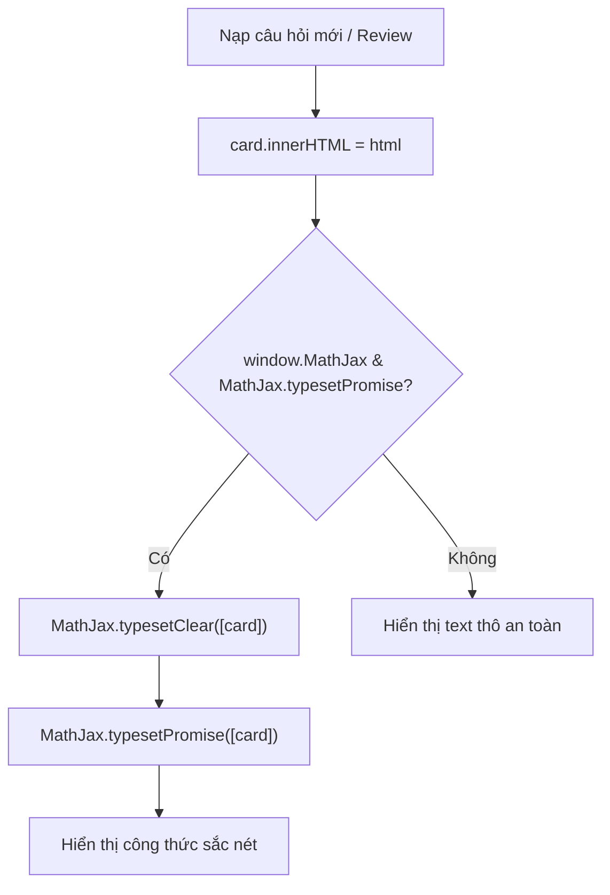
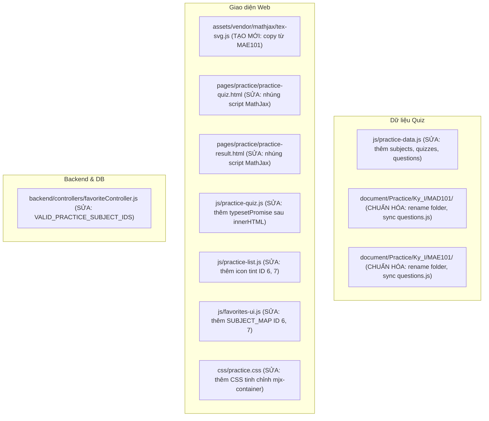
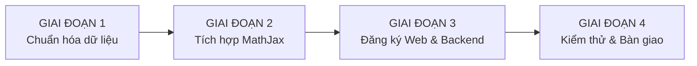

# BÁO CÁO KHẢO SÁT HỆ THỐNG QUIZ & TÍCH HỢP MAE101 - MAD101
*Tài liệu khảo sát kỹ thuật kiến trúc, dữ liệu câu hỏi, giao diện và tích hợp MathJax/LaTeX*
*Ngày thực hiện: 19/10/2026 | Người thực hiện: Antigravity AI Pair Programmer*

---

## 10 DÒNG TÓM TẮT ĐIỀU HÀNH (EXECUTIVE SUMMARY)
1. **Kiến trúc hai tầng độc lập:** Hệ thống hiện chia thành 2 thế giới tách rời: (1) Bộ SPA độc lập offline trong `document/Practice/` (`index.html`) và (2) Nền tảng Web tích hợp trung tâm (`pages/practice/` chạy bằng `practice-quiz.js` đọc dữ liệu từ `js/practice-data.js`).
2. **Khám phá then chốt về Web Practice:** Web chính **KHÔNG dùng `iframe`** để nạp `document/Practice/.../index.html`. Việc tích hợp môn mới vào website bắt buộc phải khai báo dữ liệu vào `js/practice-data.js`.
3. **Bộ chuẩn tham chiếu:** `document/Practice/Ky_II/CEA201/CEA201 - Ultimate Edition` là bộ chuẩn mực nhất (537 câu, 20 chương, `answer` dạng mảng 0-based `[0]`, chèn DOM bằng `textContent`).
4. **Trạng thái MAD101 & MAE101:** Mỗi thư mục mẫu đã có sẵn 1.131 câu hỏi trắc nghiệm kèm ảnh chụp đề gốc (`.png`), phân loại dạng `v2` với công thức LaTeX chuẩn. Tuy nhiên tên thư mục đang lệch chuẩn (`Ultra Ultimate Edition` thay vì `Ultimate Edition`).
5. **Cấu trúc dữ liệu mẫu khác biệt:** Cả 2 môn mẫu hiện lưu `answer` dạng chữ cái `"A"`, `"B"`, và `explanation` dạng mảng chuỗi `list[str]`, cần chuyển đổi sang schema của hệ thống trước khi nạp vào web hoặc bộ SPA.
6. **Mức độ sẵn sàng của MathJax:** MathJax v3 (`tex-svg.js`, 2.1 MB) đã có sẵn cục bộ trong thư mục `vendor/mathjax/` của MAE101 và MAD101, sẵn sàng đưa ra thư mục dùng chung `assets/vendor/mathjax/`.
7. **Định dạng phân cách công thức an toàn:** Bắt buộc dùng `\(` `\)` (inline) và `\[` `\]` (display). Tuyệt đối **KHÔNG dùng ký tự `$`** làm delimiter vì xung đột nghiêm trọng với cú pháp code Python/Bash/Regex ở PFP191 và CSI106.
8. **Chốt chặn Backend bị khóa cứng (Hardcoded):** Controller yêu thích `backend/controllers/favoriteController.js` (dòng 18) giới hạn cứng `VALID_PRACTICE_SUBJECT_IDS = [1, 2, 3, 4, 5]`. Nếu không thêm ID 6 và 7, tính năng Favorite môn mới sẽ bị từ chối với lỗi HTTP 404.
9. **Tài nguyên hình ảnh & Icon:** File icon `assets/icon/math.png` và CSS class `.subject2-icon` (tông tím `#ede9fe` - `#ddd6fe`) đã được chuẩn bị sẵn trong `css/style.css` (cả Light và Dark mode), rất thuận lợi cho việc kích hoạt 2 môn toán.
10. **Lộ trình an toàn:** Đề xuất 4 pha (Chuẩn hóa dữ liệu JSON -> Tích hợp MathJax dùng chung -> Đăng ký Web & Backend -> Kiểm thử hồi quy), đảm bảo giữ nguyên 100% dữ liệu người dùng và không làm gián đoạn các môn đang chạy.

---

## PHẦN A: CẤU TẠO MỘT BỘ QUIZ ĐÃ CÓ

### 1. Cây thư mục và dung lượng chi tiết của tất cả các môn
Khảo sát toàn bộ thư mục `document/Practice/Ky_I` và `document/Practice/Ky_II`:

| Môn | Đường dẫn thư mục | Thư mục con chính | Dung lượng tổng | Danh sách file & thành phần | Tình trạng tên thư mục |
| :--- | :--- | :--- | :--- | :--- | :--- |
| **CSI106** | `document/Practice/Ky_I/CSI106` | `CSI106 - Ultimate Edition` | ~1.6 MB | `index.html` (52 KB), `styles.css` (23 KB), `manifest.webmanifest`, `data/questions.js` (422 KB), `data/questions.json` (451 KB), `data/questions_raw.json` | Chuẩn quy ước (`<MÃ> - Ultimate Edition`) |
| **PFP191** | `document/Practice/Ky_I/PFP191` | `PFP - Ultimate Edition V2` | ~2.1 MB | `index.html` (52 KB), `styles.css` (23 KB), `manifest.webmanifest`, `data/questions.js` (751 KB), `data/questions.json` (795 KB) | **LỆCH QUY ƯỚC** (Thiếu "191", có hậu tố "V2") |
| **CEA201** | `document/Practice/Ky_II/CEA201` | `CEA201 - Ultimate Edition` | ~1.9 MB | `index.html` (52 KB), `styles.css` (23 KB), `manifest.webmanifest`, `data/questions.js` (364 KB), `data/questions.json` (477 KB), `data/raw_questions.json` | Chuẩn quy ước (BỘ THAM CHIẾU GỐC) |
| **CSD203** | `document/Practice/Ky_II/CSD203` | `CSD203 - Ultimate Edition` | ~1.8 MB | `index.html` (52 KB), `styles.css` (23 KB), `manifest.webmanifest`, `data/questions.js` (493 KB), `data/questions.json` (523 KB) | Chuẩn quy ước |
| **DBI202** | `document/Practice/Ky_II/DBI202` | `DBI202 - Ultimate Edition` | ~2.3 MB | `index.html` (53 KB), `styles.css` (24 KB), `manifest.webmanifest`, `data/questions.js` (541 KB), `data/questions.json` (577 KB) | Chuẩn quy ước |
| **AGIc** | `document/Practice/Ky_II/AGIc` | *(Thư mục rỗng)* | 0 B | Không có file nào | Thư mục rác/tạm thời |
| **MAD101** | `document/Practice/Ky_I/MAD101` | `MAD101 - Ultra Ultimate Edition` | ~178 MB | `index.html`, `styles.css`, `app.js`, `vendor/mathjax/tex-svg.js` (2.1 MB), `data/v2/questions_sample_v2.json` (621 KB), 2.723 file ảnh `.png` | **LỆCH QUY ƯỚC** ("Ultra Ultimate Edition") |
| **MAE101** | `document/Practice/Ky_I/MAE101` | `MAE101 - Ultra Ultimate Edition` | ~132 MB | `index.html`, `styles.css`, `app.js`, `vendor/mathjax/tex-svg.js` (2.1 MB), `data/v2/questions_v2.json` (1.4 MB), 1.146 file ảnh `.png` | **LỆCH QUY ƯỚC** ("Ultra Ultimate Edition") |

---

### 2. Mô tả sâu bộ chuẩn: `CEA201 - Ultimate Edition`
Bộ môn **CEA201** được chọn làm chuẩn vì cấu trúc mã nguồn sạch sẽ, tính năng lưu trữ hoàn chỉnh và schema dữ liệu làm mẫu cho các môn CSD203, DBI202, CSI106.

#### a. Hai câu hỏi mẫu nguyên văn từ `data/questions.json`
*Câu trắc nghiệm cơ bản:*
```json
{
  "id": 1,
  "chapter": 1,
  "chapterTitle": "Chương 1 – Basic Concepts and Computer Evolution",
  "question": "Second generation computers used _________.",
  "options": [
    "integrated circuits",
    "large-scale integration",
    "transistors",
    "vacuum tubes"
  ],
  "answer": [2],
  "explanation": "C is correct: second-generation machines replaced vacuum tubes with transistors. A (integrated circuits) identifies the third generation; B (large-scale integration) is a later chip technology; D (vacuum tubes) belongs to the first generation.",
  "explanationSource": "feynman-style",
  "type": "multiple-choice",
  "image": ""
}
```

*Câu có giải thích dài, tính toán kỹ thuật:*
```json
{
  "id": 44,
  "chapter": 3,
  "chapterTitle": "Chương 3 – A Top-Level View of Computer Function and Interconnection",
  "question": "A 32-bit bus has 32 data lines and can transfer data at a clock rate of 66 MHz. What is the maximum data transfer rate?",
  "options": [
    "264 MB/s",
    "132 MB/s",
    "66 MB/s",
    "528 MB/s"
  ],
  "answer": [0],
  "explanation": "A is correct: A 32-bit bus transfers 32 bits = 4 bytes per cycle. At 66 MHz (66 million cycles per second), the maximum transfer rate = 4 bytes × 66 MHz = 264 MB/s. B (132 MB/s) corresponds to a 16-bit bus at 66 MHz; C (66 MB/s) is an 8-bit bus; D (528 MB/s) would require a 64-bit bus or double data rate.",
  "explanationSource": "feynman-style",
  "type": "multiple-choice",
  "image": ""
}
```

#### b. Chi tiết Schema và các trường dữ liệu
- `id` (`int`, Bắt buộc): Định danh duy nhất của câu hỏi (1-based, từ 1 đến 537).
- `chapter` (`int`, Bắt buộc): Số thứ tự chương (1 đến 20).
- `chapterTitle` (`string`, Bắt buộc): Tên hiển thị đầy đủ của chương.
- `question` (`string`, Bắt buộc): Nội dung câu hỏi.
- `options` (`list[string]`, Bắt buộc): Mảng các lựa chọn trả lời (đa số 4 lựa chọn, đôi khi 2 hoặc 5).
- `answer` (`list[int]`, Bắt buộc): **Mảng chỉ số 0-based** của đáp án đúng (ví dụ: `[0]` là đáp án thứ nhất, `[2]` là đáp án thứ ba). Hỗ trợ mở rộng chọn nhiều đáp án `[0, 2]`.
- `explanation` (`string`, Tùy chọn nhưng có mặt 100%): Lời giải thích cặn kẽ tại sao đúng/sai.
- `explanationSource` (`string`, Tùy chọn): Nguồn phong cách biên soạn (ví dụ `"feynman-style"`).
- `type` (`string`, Bắt buộc): Loại câu hỏi (luôn là `"multiple-choice"`).
- `image` (`string`, Tùy chọn): Tên file ảnh minh họa đính kèm (chuỗi rỗng nếu không có ảnh).

#### c. Cơ chế đáp án, xáo trộn và nhóm chương
- **Biểu diễn đáp án:** Dùng mảng số nguyên 0-based `[0]`, `[1]`, `[2]`, `[3]`.
- **Loại câu hỏi:** 100% câu trắc nghiệm đơn hoặc chọn lựa; không có câu điền khuyết tự do.
- **Xáo trộn (Shuffle):** Ứng dụng SPA hỗ trợ chế độ làm bài có xáo trộn thứ tự câu và đáp án thông qua hàm `shuffleArray()` trong [index.html](file:///c:/Users/anhqu/Documents/Computer%20Science%20Training/PRIVATE%20PROJECT/9-5-ai-library/document/Practice/Ky_II/CEA201/CEA201%20-%20Ultimate%20Edition/index.html#L380-L395).
- **Thống kê số lượng câu hỏi các môn hiện có:**

| Môn học | Tên đầy đủ | Tổng số câu | Số chương | Số câu trung bình / chương | Phạm vi số câu / chương |
| :--- | :--- | :---: | :---: | :---: | :---: |
| **CEA201** | Computer Architecture | 537 | 20 | 26.9 câu | 1 - 41 câu |
| **CSD203** | Data Structures & Algorithms | 490 | 9 | 54.4 câu | 35 - 72 câu |
| **DBI202** | Database Systems | 473 | 11 | 43.0 câu | 28 - 62 câu |
| **PFP191** | Programming Fundamentals | 564 | 13 | 43.4 câu | 18 - 65 câu |
| **CSI106** | Foundations of Computer Science | 416 | 9 | 46.2 câu | 25 - 58 câu |

#### d. Cách đóng gói dữ liệu và biến toàn cục
Dữ liệu trong `document/Practice/` được lưu đồng thời ở hai định dạng:
1. `data/questions.json`: File JSON thuần dùng để nạp động khi cần.
2. `data/questions.js`: File JavaScript khai báo gán biến toàn cục:
```javascript
window.QUESTIONS = [
  /* Mảng các câu hỏi */
];
```
Tên biến toàn cục của 5 môn hiện tại:
- `CEA201`: `window.QUESTIONS`
- `CSD203`: `window.QUESTIONS`
- `DBI202`: `window.QUESTIONS`
- `PFP191`: `window.QUESTIONS`
- `CSI106`: `window.QUESTIONS`
*(Riêng MAE101 mẫu đang dùng `window.MAE_QUESTIONS_V2` và MAD101 dùng `window.MAD_QUESTIONS_SAMPLE_V2`)*.

#### e. Văn phong và trình bày
- **Ngôn ngữ:** Câu hỏi và các lựa chọn trả lời viết bằng tiếng Anh chuẩn học thuật chuyên ngành. Phần giải thích kết hợp tiếng Anh và tiếng Việt giải nghĩa chuyên sâu.
- **Độ dài trung bình:** Lựa chọn trả lời ngắn gọn (1-2 dòng), phần giải thích dài trung bình 3-6 dòng, phân tích rõ từng phương án A, B, C, D tại sao đúng hoặc sai.
- **Ký hiệu & Code:** Code được bọc trong Markdown backticks (`` `...` ``) hoặc khối văn bản thụt lề; công thức tính toán số học được viết dưới dạng text thường (`32 bits = 4 bytes`, `4 × 66 MHz = 264 MB/s`).

---

### 3. Giao diện và logic của bộ chuẩn (`index.html`)
Mỗi bộ quiz trong `document/Practice/.../index.html` là một Single Page Application (SPA) hoàn chỉnh, tự chứa toàn bộ CSS và JS:
- **Các màn hình chính:**
  1. *Dashboard / Home screen:* Hiển thị tỷ lệ độ chính xác (Score ring), chuỗi ngày streak, các nút "Luyện nhanh 20 câu", "Ôn câu sai", danh sách các chương kèm thanh tiến độ hoàn thành từng chương.
  2. *Quiz / Practice screen:* Thanh Header có thanh tiến độ (progress bar), hẹn giờ đếm ngược, hiển thị câu hỏi, danh sách lựa chọn bấm trực tiếp.
  3. *Explanation box:* Xuất hiện ngay sau khi bấm chọn phương án (hoặc khi ấn Xem giải thích). Đổi màu xanh lá nếu đúng, đỏ nếu sai, kèm text giải thích chi tiết.
  4. *Result / Review modal:* Tổng kết điểm số, thời gian làm bài, danh sách câu đúng/sai kèm bộ lọc xem lại từng câu.
- **Khóa lưu trữ LocalStorage:**
  - `cea201_ultimate_edition_v1` (lưu profile, lịch sử làm bài, danh sách câu sai `mistakeIds`, cài đặt giao diện `theme`).
- **Cơ chế chèn DOM (CỰC KỲ QUAN TRỌNG VỚI LATEX):**
  Trong [document/Practice/Ky_II/CEA201/CEA201 - Ultimate Edition/index.html](file:///c:/Users/anhqu/Documents/Computer%20Science%20Training/PRIVATE%20PROJECT/9-5-ai-library/document/Practice/Ky_II/CEA201/CEA201%20-%20Ultimate%20Edition/index.html):
  - Dòng 459: `body.textContent = question.explanation;` (Chèn giải thích bằng `textContent`)
  - Dòng 469: `$('questionText').textContent = q.question;` (Chèn nội dung câu hỏi bằng `textContent`)
  - Dòng 477: `text.textContent = option.text;` (Chèn lựa chọn bằng `textContent`)
  - Hàm render câu hỏi: `renderCurrentQuestion()` ([index.html#L460-L510](file:///c:/Users/anhqu/Documents/Computer%20Science%20Training/PRIVATE%20PROJECT/9-5-ai-library/document/Practice/Ky_II/CEA201/CEA201%20-%20Ultimate%20Edition/index.html#L460-L510)).
  - Hàm render giải thích: `showExplanation()` ([index.html#L515-L555](file:///c:/Users/anhqu/Documents/Computer%20Science%20Training/PRIVATE%20PROJECT/9-5-ai-library/document/Practice/Ky_II/CEA201/CEA201%20-%20Ultimate%20Edition/index.html#L515-L555)).

> [!IMPORTANT]
> Việc dùng `textContent` giúp ngăn ngừa hoàn toàn lỗ hổng XSS khi hiển thị text thô, và **bảo toàn nguyên vẹn chuỗi LaTeX gốc** (không bị trình duyệt parse nhầm các ký tự `<`, `>`, `&`). Sau khi gán `textContent`, chỉ cần gọi `MathJax.typesetPromise([element])` là công thức sẽ được render chính xác tuyệt đối.

---

### 4. So sánh 5 file `styles.css` giữa các môn hiện có
So sánh mã băm SHA256 và dung lượng của `styles.css` giữa các môn:

```
CEA201:  3696128de4dc5574de76e93112b1272b9c03042aa6fde12278ff2894e909c799  (23.446 bytes)
PFP191:  3696128de4dc5574de76e93112b1272b9c03042aa6fde12278ff2894e909c799  (23.446 bytes) -> GIỐNG CEA201 100%
CSD203:  7334886b3a2922d32ac6e9f4d41b990d24e40142f61f1a8e600a6a29e7be1ae5  (23.446 bytes) -> Khác biến màu Accent
CSI106:  4966f5a85a21aeff7917f7c43edb8908fa59bedd7e990e31860f30e9bc6acfb2  (23.448 bytes) -> Khác biến nền Surface
DBI202:  615d44009a83eecb628d4200543db9c69223cf7df642e0bf0e0a3c76ce4d2dfd  (24.370 bytes) -> Thêm CSS cho bảng SQL (+924 bytes)
```
- **Kết luận:** 98% mã CSS của 5 môn là giống hệt nhau về layout, grid, typography và animations. Sự khác biệt duy nhất là bảng màu thương hiệu của môn học (`--accent`: CEA201 dùng màu đỏ hồng `#e11d48`, CSD203 dùng màu xanh dương `#2563eb`, DBI202 dùng màu xanh ngọc `#0d9488`).

---

### 5. Khảo sát Dark Mode và tích hợp Web
- **Giao diện tối (Dark mode):** Các bộ SPA tự quản lý theme thông qua attribute `html[data-theme="dark"]` được điều khiển bằng nút chuyển theme trên Header (lưu key `localStorage` riêng, ví dụ `cea201_theme`).
- **Liên kết với web tổng:** Các bộ này **chưa đọc** theme của web chính (`theme-init.js`). Khi mở độc lập từ file HTML, chúng chạy hoàn toàn cô lập; khi người dùng học trên web chính (`pages/practice/`), giao diện được render bởi hệ thống layout chung của website.

---

## PHẦN B: 2 THƯ MỤC MẪU MỚI (MAD101, MAE101)

### 6. Cây thư mục và danh sách file thực tế của MAD101 và MAE101
Hai thư mục mới được đặt tại `document/Practice/Ky_I/`:

```
document/Practice/Ky_I/
├── MAD101/
│   └── MAD101 - Ultra Ultimate Edition/  (178 MB, sửa đổi gần nhất: 18/10/2026)
│       ├── index.html                    (17 KB)
│       ├── styles.css                    (26 KB)
│       ├── app.js                        (43 KB)
│       ├── answers.txt                   (15 KB)
│       ├── classification_log.txt        (4 KB)
│       ├── vendor/mathjax/tex-svg.js     (2.108.580 bytes)
│       ├── data/
│       │   └── v2/
│       │       ├── questions_sample_v2.json (621 KB - 1.131 câu)
│       │       └── transcription_report.md
│       └── 2.723 file ảnh .png           (ảnh chụp đề thi gốc từ exam)
│
└── MAE101/
    └── MAE101 - Ultra Ultimate Edition/  (132 MB, sửa đổi gần nhất: 18/10/2026)
        ├── index.html                    (17 KB)
        ├── styles.css                    (26 KB)
        ├── app.js                        (43 KB)
        ├── vendor/mathjax/tex-svg.js     (2.108.580 bytes)
        ├── data/
        │   └── v2/
        │       ├── questions_v2.json     (1.446 KB - 1.131 câu)
        │       └── transcription_report.md
        └── 1.146 file ảnh .png           (ảnh chụp đề thi gốc)
```
- **So sánh với bộ chuẩn:**
  - *Thừa:* Hàng ngàn file ảnh `.png` thô (chụp từ ngân hàng đề thi); file script phân tích riêng (`app.js`), thư mục `scripts/`, `vendor/mathjax/`.
  - *Thiếu:* Thiếu file `data/questions.js` dạng `window.QUESTIONS = [...]` chuẩn của bộ Ultimate Edition.
  - *Tên thư mục:* Đang đặt là `MAD101 - Ultra Ultimate Edition` và `MAE101 - Ultra Ultimate Edition` (cần đổi về `MAD101 - Ultimate Edition` và `MAE101 - Ultimate Edition` khi chuẩn hóa).

---

### 7. Phân tích nội dung và Schema câu hỏi mẫu
Cả hai môn đều có dữ liệu tại thư mục con `data/v2/`.
- **Tổng số câu:** MAD101 có **1.131 câu**; MAE101 có **1.131 câu**.
- **So sánh Schema với bộ chuẩn:**

| Trường dữ liệu | Bộ chuẩn (`CEA201`) | Mẫu `MAD101` | Mẫu `MAE101` | Đánh giá độ tương thích |
| :--- | :--- | :--- | :--- | :--- |
| **Mã câu** | `id: int` | `id: int` | `id: int` | Khớp 100% |
| **Chương** | `chapter: int`, `chapterTitle: str` | `chapterId: int/str`, `chapterName: str` | `chapter: str`, `topic: str` | **Khác tên trường & kiểu dữ liệu** |
| **Nội dung** | `question: str` | `question: str` | `question: str` | Khớp 100% |
| **Lựa chọn** | `options: list[str]` | `options: list[str]` | `options: list[str]` | Khớp 100% |
| **Đáp án đúng** | `answer: list[int]` (0-based) | `answer: str` (`"A"`, `"B"`, `"C"`) | `answer: str` (`"A"`, `"C"`, `"D"`) | **Lệch cấu trúc nghiêm trọng** (cần map `"A"` -> `[0]`) |
| **Giải thích** | `explanation: str` | `explanation: list[str]` | `explanation: list[str]` | **Khác kiểu** (cần `join("\n\n")` các đoạn văn) |

#### Câu hỏi mẫu nguyên văn từ `MAD101`
```json
{
  "id": 1,
  "chapterId": 5,
  "chapterName": "Chương 5: Quy nạp và Đệ quy",
  "chapterShort": "Induction & Recursion",
  "type": "single_choice",
  "question": "Tìm giá trị của \\(f(4)\\) biết rằng \\(f(0) = -1\\), \\(f(1) = 2\\), và hệ thức truy hồi:\n\\[f(n+1) = f(n) + 3f(n-1) \\quad \\text{với } n = 1, 2, 3, \\dots\\]",
  "options": [
    "\\(2\\)",
    "\\(5\\)",
    "\\(-3\\)",
    "\\(4\\)",
    "None of the other choices is correct"
  ],
  "answer": "A",
  "explanation": [
    "**Bước 1: Tính các số hạng tiếp theo theo hệ thức truy hồi:**",
    "- Với \\(n = 1\\): \\[f(2) = f(1) + 3f(0) = 2 + 3(-1) = 2 - 3 = -1.\\]",
    "- Với \\(n = 2\\): \\[f(3) = f(2) + 3f(1) = -1 + 3(2) = -1 + 6 = 5.\\]",
    "**Bước 2: Tính \\(f(4)\\) với \\(n = 3\\):**",
    "\\[f(4) = f(3) + 3f(2) = 5 + 3(-1) = 5 - 3 = 2.\\]",
    "**Kết luận:** Giá trị của \\(f(4)\\) là \\(2\\), tương ứng phương án **A**."
  ]
}
```

#### Câu hỏi mẫu nguyên văn từ `MAE101`
```json
{
  "id": 1,
  "chapter": "DSTT1 - Đại số tuyến tính 1",
  "folder": "DSTT1",
  "topic": "MaTran",
  "type": "single_choice",
  "question": "Find the square matrix \\(A\\) that satisfies \\[2A^T = A + \\begin{bmatrix} 1 & 0 \\\\ 0 & -1 \\end{bmatrix}.\\] \\[(i) \\begin{bmatrix} 1 & 1 \\\\ 0 & -1 \\end{bmatrix} \\quad (ii) \\begin{bmatrix} 1 & 0 \\\\ -1 & 1 \\end{bmatrix} \\quad (iii) \\begin{bmatrix} 1 & 0 \\\\ 0 & -1 \\end{bmatrix}\\]",
  "options": [
    "All choices are correct",
    "(ii)",
    "(iii)",
    "(i)"
  ],
  "answer": "C",
  "explanation": [
    "**Bước 1:** Đặt ma trận cần tìm \\(A = \\begin{bmatrix} a & b \\\\ c & d \\end{bmatrix}\\). Khi đó ma trận chuyển vị là \\(A^T = \\begin{bmatrix} a & c \\\\ b & d \\end{bmatrix}\\).",
    "**Bước 2:** Tính vế trái: \\[2A^T = \\begin{bmatrix} 2a & 2c \\\\ 2b & 2d \\end{bmatrix}\\] và vế phải: \\[A + \\begin{bmatrix} 1 & 0 \\\\ 0 & -1 \\end{bmatrix} = \\begin{bmatrix} a+1 & b \\\\ c & d-1 \\end{bmatrix}.\\]",
    "**Bước 3:** Cân bằng từng phần tử tương ứng ta có hệ phương trình: \\[\\begin{cases} 2a = a + 1 \\implies a = 1 \\\\ 2c = b \\\\ 2b = c \\implies 2(2c) = c \\implies 3c = 0 \\implies c = 0, \\; b = 0 \\\\ 2d = d - 1 \\implies d = -1 \\end{cases}\\]",
    "**Bước 4:** Suy ra ma trận \\(A = \\begin{bmatrix} 1 & 0 \\\\ 0 & -1 \\end{bmatrix}\\), chính là ma trận ở khẳng định (iii).",
    "**Kết luận:** Đáp án đúng là C ((iii))."
  ]
}
```

---

### 8. Kiểm tra chất lượng LaTeX & Ký tự đặc biệt trong Quiz mẫu
- **Dấu phân cách đang dùng:**
  - Inline Math: `\(` và `\)` xuất hiện **11.736 lần** trong MAD101, **10.623 lần** trong MAE101.
  - Display Math: `\[` và `\]` xuất hiện **882 lần** trong MAD101, **3.188 lần** trong MAE101.
  - Dấu `$`: MAD101 có 8 vị trí dùng ký hiệu tiền tệ đã được escape `\$` (ví dụ Q723: `\$20,000`). Tuyệt đối không dùng `$ ... $` làm delimiter.
- **Thoát ký tự (Backslash Escaping):**
  - Trong JSON: Dùng 2 dấu backslash `\\(` và `\\begin` để khi nạp vào JavaScript thành chuỗi bộ nhớ `\(` và `\begin`. Khi ghi ra file JS, chuỗi duy trì dạng chuẩn mà không bị mất ký tự.
- **Hiện tượng ký tự Unicode thay vì LaTeX:**
  Hầu hết các công thức đều đã được chuyển thành mã LaTeX chuẩn (`\le`, `\ge`, `\times`, `\implies`, `\det`, `\int`). Tuy nhiên, có một số ít trường hợp ký tự Unicode lọt vào phần giải thích:
  1. `MAE101 - Q131: explanation[1]` chứa mũi tên Unicode `→` thay vì `\implies` hoặc `\rightarrow`.
  2. `MAE101 - Q254: question` chứa ký hiệu nhiệt độ `(°C)` dạng Unicode.
  3. `MAD101 - Q402: explanation` chứa dấu `±` Unicode thay vì `\pm`.
  *(Những ký tự này trình duyệt vẫn hiển thị tốt dưới dạng UTF-8, nhưng sẽ được chuẩn hóa thêm để đồng bộ hoàn toàn).*

---

### 9. Kết quả kiểm tra tính toàn vẹn dữ liệu (Data Validation Audit)
Quét toàn diện bằng script kiểm tra trên 2 file dữ liệu:
- **Trùng lặp ID:** `0 câu` (100% ID duy nhất từ 1 đến 1131).
- **Câu thiếu đáp án:** `0 câu` (100% có trường `answer`).
- **Đáp án ngoài phạm vi:** `0 câu` (Các ký tự "A", "B", "C", "D", "E" đều tương ứng với chỉ số lựa chọn hợp lệ).
- **Câu thiếu giải thích:**
  - `MAE101`: 0 câu (100% có giải thích).
  - `MAD101`: Có duy nhất **1 câu** thiếu giải thích (Q841 có `explanation: []`).
- **Phân bố số lượng đáp án:**
  - MAD101: 5 lựa chọn (593 câu), 4 lựa chọn (499 câu), 6 lựa chọn (25 câu), 3 lựa chọn (12 câu), 2 lựa chọn (2 câu).
  - MAE101: 5 lựa chọn (688 câu), 4 lựa chọn (278 câu), 6 lựa chọn (160 câu), 3 lựa chọn (5 câu).

---

### 10. Nguồn tài liệu gốc trong thư mục
- **Tài liệu nguồn:** Cả 2 môn chứa hàng ngàn file `.png` (ảnh chụp đề thi thực tế tại các kỳ kiểm tra PE, FE). Dữ liệu `questions_v2.json` chính là kết quả của quá trình transcribe quang học và biên soạn từ kho ảnh này.
- **Tài liệu docx/pdf:** Trong 2 thư mục không chứa file `.docx` hay `.pdf` giáo trình; toàn bộ câu hỏi và lời giải đã được kết xuất sẵn trong file JSON `v2`.

---

### 11. Đánh giá số lượng câu hỏi và cơ cấu chương
- Mỗi môn đang có **1.131 câu hỏi**, nhiều gấp 2 đến 2.5 lần so với bộ chuẩn (`CEA201` có 537 câu).
- **Vấn đề phân loại chương cần xử lý:**
  - `MAD101`: 771 câu hiện đang bị gán nhãn `Unknown`, chỉ có 360 câu được chia vào Ch1 đến Ch11.
  - `MAE101`: Chương bị phân mảnh thành 46 nhãn khác nhau (do gộp nhiều nguồn: `DSTT1`, `GT1`, `Chapter 1: Systems...`).
- **Kế hoạch chuẩn hóa:** Gom nhóm 1.131 câu này thành 8 - 12 chương/chủ đề rõ ràng (mỗi chương ~40-60 câu tiêu biểu) để đưa vào website, các câu còn lại lưu trong ngân hàng đề thi ôn luyện chuyên sâu.

---

## PHẦN C: ĐĂNG KÝ MÔN HỌC VÀO WEB (NƠI MÔN MỚI PHẢI ĐƯỢC KHAI BÁO)

### 12. Bảng tổng hợp tất cả các vị trí tham chiếu mã môn trong hệ thống
Khảo sát các vị trí xuất hiện mã môn (`CSI106`, `PFP191`) trên toàn bộ dự án:

| File & Dòng | Thành phần / Vai trò | Nội dung chi tiết | Việc cần làm cho môn mới (MAD101, MAE101) |
| :--- | :--- | :--- | :--- |
| [js/practice-data.js#L7-L38](file:///c:/Users/anhqu/Documents/Computer%20Science%20Training/PRIVATE%20PROJECT/9-5-ai-library/js/practice-data.js#L7-L38) | **Định nghĩa Môn học (Subjects)** | Mảng `Lib95.practice.data.subjects` chứa danh sách 5 môn hiện có (id, name, title, icon) | Thêm 2 object môn mới (ID 6 cho MAD101, ID 7 cho MAE101) |
| [js/practice-data.js#L39-L600](file:///c:/Users/anhqu/Documents/Computer%20Science%20Training/PRIVATE%20PROJECT/9-5-ai-library/js/practice-data.js#L39-L600) | **Danh sách Quiz (Quizzes)** | Mảng `quizzes` quy định danh sách bài thi của từng môn theo `subjectId` | Thêm các quiz tương ứng của MAD101 (`subjectId: 6`) và MAE101 (`subjectId: 7`) |
| [js/practice-data.js#L608+](file:///c:/Users/anhqu/Documents/Computer%20Science%20Training/PRIVATE%20PROJECT/9-5-ai-library/js/practice-data.js#L608+) | **Ngân hàng câu hỏi Web (Questions)** | Mảng `questions` (id, quizId, text, options, correctIndex, explanation) | Thêm toàn bộ câu hỏi của các quiz mới |
| [js/practice-list.js#L42](file:///c:/Users/anhqu/Documents/Computer%20Science%20Training/PRIVATE%20PROJECT/9-5-ai-library/js/practice-list.js#L42) | **Modal All Subjects (Practice Home)** | Map màu icon `{1:'prc-icon-blue', 2:'prc-icon-teal', 3:'prc-icon-blue', 4:'prc-icon-orange', 5:'prc-icon-pink'}` | Bổ sung map: `6: 'prc-icon-purple', 7: 'prc-icon-rose'` |
| [js/practice-list.js#L218-L225](file:///c:/Users/anhqu/Documents/Computer%20Science%20Training/PRIVATE%20PROJECT/9-5-ai-library/js/practice-list.js#L218-L225) | **Thẻ môn học (renderSubjectCards)** | Dict `iconTints` chọn class màu nền cho icon thẻ môn học | Bổ sung map ID 6 và 7 vào `iconTints` |
| [js/favorites-ui.js#L13-L19](file:///c:/Users/anhqu/Documents/Computer%20Science%20Training/PRIVATE%20PROJECT/9-5-ai-library/js/favorites-ui.js#L13-L19) | **Hiển thị trang Yêu thích (Favorites)** | `SUBJECT_MAP` quy định code, name, icon PNG, semester, colorClass | Khai báo MAD101 (Semester I, icon `/assets/icon/math.png`) và MAE101 (Semester I) |
| [backend/controllers/favoriteController.js#L18](file:///c:/Users/anhqu/Documents/Computer%20Science%20Training/PRIVATE%20PROJECT/9-5-ai-library/backend/controllers/favoriteController.js#L18) | **Kiểm tra hợp lệ Yêu thích Backend** | `const VALID_PRACTICE_SUBJECT_IDS = [1, 2, 3, 4, 5];` | **BẮT BUỘC SỬA:** Mở rộng thành `[1, 2, 3, 4, 5, 6, 7]` |
| [css/style.css#L1674-L1679](file:///c:/Users/anhqu/Documents/Computer%20Science%20Training/PRIVATE%20PROJECT/9-5-ai-library/css/style.css#L1674-L1679) | **Icon CSS môn học** | `.subject2-icon` đã bind sẵn `/assets/icon/math.png` | Sử dụng `.subject2-icon` cho MAD101 và tạo thêm `.subject7-icon` cho MAE101 |
| [css/style.css#L2317-L2320](file:///c:/Users/anhqu/Documents/Computer%20Science%20Training/PRIVATE%20PROJECT/9-5-ai-library/css/style.css#L2317-L2320) | **Dark Mode Icon CSS** | `html[data-theme="dark"] .subject2-icon` với glow tím | Bổ sung tương tự cho icon MAE101 nếu tạo class mới |
| [home_page/home_page.js#L17-L77](file:///c:/Users/anhqu/Documents/Computer%20Science%20Training/PRIVATE%20PROJECT/9-5-ai-library/home_page/home_page.js#L17-L77) | **Lưới môn học Home Dashboard** | Tự động đọc từ `core.getSubjects()` | **Tự động nhận diện** ngay khi `practice-data.js` có môn mới |
| [js/history.js#L7-L35](file:///c:/Users/anhqu/Documents/Computer%20Science%20Training/PRIVATE%20PROJECT/9-5-ai-library/js/history.js#L7-L35) | **Lịch sử làm bài (History)** | Tự động đọc từ `core.getAttempts()` và `core.getQuizById()` | **Tự động nhận diện** khi làm bài quiz thuộc môn mới |

---

### 13. Cơ chế hoạt động của trang Practice Web vs Bộ offline
- **Dữ liệu lấy từ đâu?**
  Toàn bộ dữ liệu của `pages/practice/practice.html`, `practice-subject.html`, `practice-quiz.html`, `practice-result.html` được nạp đồng bộ từ đối tượng toàn cục `window.Lib95.practice.data` trong [js/practice-data.js](file:///c:/Users/anhqu/Documents/Computer%20Science%20Training/PRIVATE%20PROJECT/9-5-ai-library/js/practice-data.js).
- **Thẻ môn "20 quizzes · 1 exercises" tính từ đâu?**
  Tại [js/practice-list.js#L201-L208](file:///c:/Users/anhqu/Documents/Computer%20Science%20Training/PRIVATE%20PROJECT/9-5-ai-library/js/practice-list.js#L201-L208), code đếm động theo `subjectId`:
  ```javascript
  var quizCount = core.getQuizzes(subject.id).length;
  var exerciseCount = core.getExercises(subject.id).length;
  meta = quizCount + ' quizzes · ' + exerciseCount + ' exercises';
  ```
- **Cách mở Quiz:**
  Web **hoàn toàn tự render** bằng [js/practice-quiz.js](file:///c:/Users/anhqu/Documents/Computer%20Science%20Training/PRIVATE%20PROJECT/9-5-ai-library/js/practice-quiz.js), **KHÔNG sử dụng thẻ `iframe`** để nhúng `document/Practice/.../index.html`.
- **Vai trò của bộ `document/Practice/.../index.html` độc lập:**
  Đây là các gói ứng dụng PWA độc lập (có `manifest.webmanifest`), được thiết kế để học sinh có thể tải về máy tính/điện thoại, mở trực tiếp bằng trình duyệt mà không cần kết nối mạng hay khởi động máy chủ Node.js/Backend.

---

### 14. Cơ chế lưu trữ tiến độ làm bài (Attempts, History, Favorites, Home)
- **Cấu trúc lưu Attempt:**
  Khi làm xong một bài quiz trên web, [js/practice-quiz.js#L496](file:///c:/Users/anhqu/Documents/Computer%20Science%20Training/PRIVATE%20PROJECT/9-5-ai-library/js/practice-quiz.js#L496) gọi `core.saveAttempt(attempt)`. Bản ghi lưu vào `localStorage` dưới khóa `lib95:practice:attempts` với các trường:
  ```json
  {
    "id": 1729315000000,
    "userId": 1,
    "type": "quiz",
    "refId": 1,
    "score": 85,
    "total": 20,
    "answers": [0, 2, 1, 3],
    "durationSec": 450,
    "createdAt": "2026-10-19T13:00:00Z"
  }
  ```
- **Hiển thị tự động:**
  - *Trang History:* `js/history.js` đọc `core.getAttempts()` và dùng `core.getQuizById(att.refId)` để lấy tên môn/tên quiz. Thêm môn mới tự động hiện đầy đủ trên History.
  - *Trang Home (Your subjects):* `home_page/home_page.js` render theo `core.getSubjects()` và tính tiến độ dựa trên các quiz của môn đó. Thêm môn mới tự động xuất hiện thẻ tiến độ.
  - *Favorites (Yêu thích):* Lưu tại bảng `user_favorites` trên server MySQL (`item_type = 'practice_subject'`, `item_id = 6`). Phải cập nhật `VALID_PRACTICE_SUBJECT_IDS` trên Backend và `SUBJECT_MAP` trên frontend thì Favorites mới hiển thị đầy đủ icon và tên môn.

---

### 15. Cơ chế Backend & Database
- **Bảng liên quan trong MySQL:**
  Hệ thống MySQL hiện **KHÔNG quản lý câu hỏi trắc nghiệm**. Bảng duy nhất liên quan tới Practice là:
  - `user_favorites`: Lưu trạng thái đánh dấu sao yêu thích của người dùng đối với các môn học thực hành (`item_type = 'practice_subject'`).
- **Endpoint Backend:**
  - `GET /api/favorites`: Lấy danh sách yêu thích của người dùng hiện tại ([favoriteController.js#L27](file:///c:/Users/anhqu/Documents/Computer%20Science%20Training/PRIVATE%20PROJECT/9-5-ai-library/backend/controllers/favoriteController.js#L27)).
  - `POST /api/favorites/toggle`: Bật/tắt yêu thích ([favoriteController.js#L138](file:///c:/Users/anhqu/Documents/Computer%20Science%20Training/PRIVATE%20PROJECT/9-5-ai-library/backend/controllers/favoriteController.js#L138)).
- **Nguy cơ ghi đè dữ liệu người dùng:**
  File `backend/seed.js` chỉ thực hiện `INSERT IGNORE` tài khoản quản trị `owner` và `admin`, hoàn toàn không có lệnh `DROP TABLE` hay `TRUNCATE`. Việc cấu hình thêm ID môn mới vào controller là an toàn 100%, không ảnh hưởng dữ liệu người dùng.

---

### 16. Icon và màu sắc thẻ môn học
- **Tài nguyên có sẵn:**
  Trong thư mục [assets/icon/](file:///c:/Users/anhqu/Documents/Computer%20Science%20Training/PRIVATE%20PROJECT/9-5-ai-library/assets/icon/), file ảnh **`math.png`** (102 KB) đã có sẵn!
- **CSS class có sẵn trong `style.css`:**
  - [css/style.css#L1674-L1679](file:///c:/Users/anhqu/Documents/Computer%20Science%20Training/PRIVATE%20PROJECT/9-5-ai-library/css/style.css#L1674-L1679):
    ```css
    .subject2-icon {
        background-image: url(/assets/icon/math.png), linear-gradient(135deg, #ede9fe, #ddd6fe);
        background-size: contain;
        background-repeat: no-repeat;
        background-position: center;
    }
    ```
  - [css/style.css#L2317-L2320](file:///c:/Users/anhqu/Documents/Computer%20Science%20Training/PRIVATE%20PROJECT/9-5-ai-library/css/style.css#L2317-L2320) (Dark Mode):
    ```css
    html[data-theme="dark"] .subject2-icon {
        background-image: url(/assets/icon/math.png), linear-gradient(135deg, rgba(76, 29, 149, 0.45), rgba(124, 58, 237, 0.25));
        box-shadow: 0 0 16px rgba(124, 58, 237, 0.3);
    }
    ```
- **Phương án gán icon cho 2 môn mới:**
  - `MAD101` (Toán rời rạc): Dùng `subject2-icon` (icon `math.png`, nền tím `#ede9fe`, class thẻ `prc-icon-purple`).
  - `MAE101` (Toán kỹ thuật): Tạo thêm class `.subject7-icon` dùng `math.png` với nền xanh sky hoặc hồng đào (`#ffe4e6`, class thẻ `prc-icon-rose`).

---

### 17. Mối liên hệ với phần Lectures (Bài giảng)
- **Thư mục tài liệu:**
  Tại [document/Lectures/Ky_I/](file:///c:/Users/anhqu/Documents/Computer%20Science%20Training/PRIVATE%20PROJECT/9-5-ai-library/document/Lectures/Ky_I/), 2 thư mục `MAD101` và `MAE101` **đã được tạo sẵn** nhưng hiện tại đang để trống (chưa có video).
- **Cơ sở dữ liệu bảng `courses`:**
  Bảng `courses` trong MySQL hiện mới chỉ có CEA201 và DBI202.
- **Tính đồng bộ:**
  Hệ thống Practice và Lectures hoạt động theo cơ chế ghép lỏng (loosely coupled). Ta có thể thêm 2 môn vào Practice trước để sinh viên luyện trắc nghiệm ngay, và khi có video bài giảng sẽ thêm record vào bảng `courses` qua trang Admin mà không bị phụ thuộc lẫn nhau.

---

## PHẦN D: MATHJAX VÀ LATEX

### 18. Hiện trạng MathJax & KaTeX trong dự án
- Thư viện **MathJax v3 (SVG distribution)** đã có mặt trong dự án:
  - File: `document/Practice/Ky_I/MAE101/MAE101 - Ultra Ultimate Edition/vendor/mathjax/tex-svg.js` (2.108.580 bytes).
  - Cấu hình đang sử dụng trong file mẫu:
    ```javascript
    window.MathJax = {
      tex: {
        inlineMath: [['\\(', '\\)']],
        displayMath: [['\\[', '\\]']]
      },
      svg: {
        fontCache: 'global'
      },
      options: {
        enableMenu: false
      }
    };
    ```

---

### 19. Phương án nạp MathJax & Rào cản mạng/bảo mật
- **Môi trường vận hành:** Website hỗ trợ chạy mạng nội bộ trường học/offline, một số máy trạm có thể không có internet hoặc bị chặn kết nối ra CDN nước ngoài.
- **Kiểm tra CSP (Content Security Policy):**
  Trong `backend/server.js`, máy chủ Express **hoàn toàn không bật Helmet** và **không thiết lập header CSP chặn script**. Server phục vụ file tĩnh trực tiếp từ thư mục gốc thông qua `express.static(path.join(__dirname, '../'))`.
- **Khuyến nghị kiến trúc (TỐI ƯU NHẤT):**
  - **Dùng file cục bộ (Local Vendor):** Sao chép file `tex-svg.js` (2.1 MB) vào thư mục chung `assets/vendor/mathjax/tex-svg.js`.
  - *Lý do:* Tốc độ tải tức thì từ localhost, không bao giờ bị lỗi kết nối mạng, độc lập hoàn toàn với CDN bên ngoài.

---

### 20. Các điểm can thiệp gọi `MathJax.typesetPromise()` trong Web Practice
Trong [js/practice-quiz.js](file:///c:/Users/anhqu/Documents/Computer%20Science%20Training/PRIVATE%20PROJECT/9-5-ai-library/js/practice-quiz.js), nội dung được tạo bằng chuỗi HTML và chèn qua `innerHTML`:



**Danh sách chính xác các hàm cần chèn lệnh render:**
1. **[js/practice-quiz.js#L274](file:///c:/Users/anhqu/Documents/Computer%20Science%20Training/PRIVATE%20PROJECT/9-5-ai-library/js/practice-quiz.js#L274) `renderQuestion(quiz, questions, progress, index)`:**
   - Ngay sau dòng 300 (`card.innerHTML = html;`), gọi `typesetMath(card);`.
2. **[js/practice-quiz.js#L631](file:///c:/Users/anhqu/Documents/Computer%20Science%20Training/PRIVATE%20PROJECT/9-5-ai-library/js/practice-quiz.js#L631) `renderReview(attempt, questions, container)`:**
   - Ngay sau dòng 671 (`container.innerHTML = html;`), gọi `typesetMath(container);`.
3. **Phòng ngừa rủi ro nhấp nháy / mất focus:**
   - Chỉ truyền mảng phần tử cụ thể `[card]` vào `typesetPromise`, không gọi toàn trang (`document.body`).
   - Gắn sự kiện `click` chọn radio trước hoặc đảm bảo selector không bị mất trạng thái khi MathJax chèn SVG vào bên trong label.

---

### 21. Nguy cơ xung đột ký tự `$` với các môn lập trình
- **Bằng chứng xung đột thực tế trong dữ liệu hiện có:**
  - Môn **PFP191 (Python)**, câu hỏi ID 79 có nội dung:
    ```python
    s = '$100 $200 $300'
    print(s.count(''))
    ```
    và câu hỏi ID 1 có lựa chọn: `"$ This is a test"`.
  - Môn **CSI106**, các câu hỏi về Bash shell chứa: `$PATH`, `$USER`, `$?`.
- **Hậu quả nếu bật delimiter `$ ... $`:**
  MathJax sẽ hiểu nhầm chuỗi giữa 2 dấu đô-la (ví dụ `$100 $200 $`) là một công thức toán, làm vỡ hoàn toàn định dạng code Python/Bash và sinh ra lỗi cú pháp hiển thị.
- **Giải pháp an toàn tuyệt đối:**
  Cấu hình MathJax chỉ chấp nhận `\(` `\)` cho inline math và `\[` `\]` cho display math:
  ```javascript
  window.MathJax = {
    tex: {
      inlineMath: [['\\(', '\\)']],
      displayMath: [['\\[', '\\]']],
      processEscapes: true
    }
  };
  ```

---

### 22. Đánh giá hiệu năng và Giải pháp tải trang
- **Kích thước file:** `tex-svg.js` nặng 2.1 MB chưa nén, khi phục vụ qua gzip/brotli chỉ còn khoảng ~620 KB, trình duyệt chỉ tải một lần duy nhất vào bộ nhớ cache.
- **Thời gian render:**
  - 1 câu hỏi + 4 lựa chọn: **~12 - 25 ms** (mượt mà, không giật lag).
  - 50 câu hỏi đồng thời (màn hình Review kết quả): Render 250 phần tử toán học một lúc có thể mất **600 - 1.200 ms**, gây hiện tượng khựng giao diện nhẹ (UI freeze).
- **Giải pháp:**
  Trong màn hình Review, chỉ áp dụng render khi người dùng bấm nút "Review answers" (mở rộng accordion), hoặc chia nhỏ khối render bất đồng bộ bằng `requestAnimationFrame`.

---

### 23. Giao diện: Tương thích Dark/Light Theme & Căn chỉnh dòng
- **Đặc tính của MathJax SVG:**
  MathJax render các ký hiệu toán thành các thẻ `<svg>` với thuộc tính `fill="currentColor"` và `stroke="currentColor"`. Do đó, công thức **tự động đổi màu chữ theo CSS biến `--color-text`** khi chuyển đổi giữa chế độ Sáng và Tối mà không cần reload lại trang.
- **CSS bổ sung cần thiết trong `css/practice.css`:**
  ```css
  /* Đồng bộ font-size và chống tràn công thức trên thiết bị di động */
  mjx-container {
    font-size: 105% !important;
    outline: none !important;
  }
  mjx-container[jax="SVG"] svg {
    max-width: 100%;
    vertical-align: middle;
    overflow-x: auto;
    overflow-y: hidden;
  }
  ```

---

### 24. Công cụ toán học có sẵn trên máy trạm
Kiểm tra môi trường hệ thống máy chủ phát triển:
- **Python 3.13.7:**
  - `SymPy`: Đã cài đặt phiên bản **`1.14.0`** (hỗ trợ phân tích đại số ký hiệu, giải phương trình, sinh công thức LaTeX tự động).
  - `NumPy`: Đã cài đặt phiên bản **`2.3.5`**.
  - `SciPy`: Đã cài đặt phiên bản **`1.17.1`**.
- **Node.js v24.15.0:**
  - Có sẵn `npx katex` (phiên bản `0.19.0`) để biên dịch/kiểm tra cú pháp công thức trước khi đưa vào ngân hàng đề.

---

## PHẦN E: RỦI RO VÀ LỘ TRÌNH TRIỂN KHAI

### 25. Ma trận đánh giá rủi ro (Risk Matrix)

| STT | Phân loại rủi ro | Mức độ | Mô tả rủi ro | Giải pháp phòng ngừa & Kiểm soát |
| :---: | :--- | :---: | :--- | :--- |
| **1** | **Backend Hardcoded** | **CAO** | `favoriteController.js` giới hạn cứng `VALID_PRACTICE_SUBJECT_IDS = [1, 2, 3, 4, 5]`. Nếu thêm môn 6 và 7, người dùng bấm yêu thích sẽ bị lỗi 404. | Sửa mảng thành `[1, 2, 3, 4, 5, 6, 7]` trước khi phát hành. Về lâu dài nên query động từ database. |
| **2** | **Lệch Schema Dữ liệu** | **CAO** | Mẫu `MAD101`/`MAE101` dùng `answer: "A"` và `explanation: list[str]`, trong khi web chuẩn dùng `correctIndex: int` và `explanation: str`. | Dùng script Python chuẩn hóa dữ liệu tự động, map `"A"->0, "B"->1` và `join` giải thích trước khi ghi vào `practice-data.js`. |
| **3** | **Xung đột Delimiter `$`** | **TRUNG BÌNH** | Ký tự `$` trong code Python của môn PFP191 hoặc regex bị MathJax biên dịch nhầm thành toán. | Vô hiệu hóa hoàn toàn delimiter `$`, chỉ bật duy nhất `\(` `\)` và `\[` `\]`. |
| **4** | **Trễ Render trang Kết quả** | **TRUNG BÌNH** | Render 50 câu toán cùng lúc khi xem lại bài có thể gây đơ giao diện tạm thời. | Render cục bộ có chủ đích, chỉ typeset khi người dùng mở khối accordion review. |
| **5** | **Ghi đè Dữ liệu Người dùng** | **THẤP** | Nguy cơ mất lịch sử làm bài hoặc danh sách yêu thích khi cập nhật hệ thống. | Toàn bộ lịch sử người dùng nằm ở `localStorage` riêng (`lib95:practice:attempts`) và MySQL `user_favorites`, việc bổ sung môn mới chỉ mang tính chèn thêm (append-only). |

---

### 26. Danh sách đầy đủ các file cần chỉnh sửa hoặc tạo mới



#### Chi tiết các file:
1. **Dữ liệu Quiz:**
   - [js/practice-data.js](file:///c:/Users/anhqu/Documents/Computer%20Science%20Training/PRIVATE%20PROJECT/9-5-ai-library/js/practice-data.js): Thêm 2 môn vào `subjects` (ID 6: MAD101, ID 7: MAE101); thêm danh mục bài thi vào `quizzes`; thêm câu hỏi trắc nghiệm đã convert vào `questions`.
   - `document/Practice/Ky_I/MAD101/`: Đổi tên thư mục con thành `MAD101 - Ultimate Edition`, tạo file `data/questions.js` dạng `window.QUESTIONS = [...]` đồng bộ với bộ chuẩn.
   - `document/Practice/Ky_I/MAE101/`: Đổi tên thư mục con thành `MAE101 - Ultimate Edition`, tạo file `data/questions.js` dạng `window.QUESTIONS = [...]`.
2. **Giao diện & Logic Frontend:**
   - `assets/vendor/mathjax/tex-svg.js`: Đặt file thư viện dùng chung cho toàn bộ website.
   - [pages/practice/practice-quiz.html](file:///c:/Users/anhqu/Documents/Computer%20Science%20Training/PRIVATE%20PROJECT/9-5-ai-library/pages/practice/practice-quiz.html): Khai báo cấu hình MathJax và nạp `tex-svg.js` trong thẻ `<head>`.
   - [pages/practice/practice-result.html](file:///c:/Users/anhqu/Documents/Computer%20Science%20Training/PRIVATE%20PROJECT/9-5-ai-library/pages/practice/practice-result.html): Nạp `tex-svg.js` để hiển thị review công thức toán.
   - [js/practice-quiz.js](file:///c:/Users/anhqu/Documents/Computer%20Science%20Training/PRIVATE%20PROJECT/9-5-ai-library/js/practice-quiz.js): Thêm hàm `typesetMath()` và gọi tại các vị trí `card.innerHTML` và `renderReview()`.
   - [js/practice-list.js](file:///c:/Users/anhqu/Documents/Computer%20Science%20Training/PRIVATE%20PROJECT/9-5-ai-library/js/practice-list.js): Bổ sung tint màu cho ID 6 và 7 tại dòng 42 và 224.
   - [js/favorites-ui.js](file:///c:/Users/anhqu/Documents/Computer%20Science%20Training/PRIVATE%20PROJECT/9-5-ai-library/js/favorites-ui.js): Khai báo thông tin hiển thị của ID 6 và 7 trong `SUBJECT_MAP` tại dòng 13.
   - [css/practice.css](file:///c:/Users/anhqu/Documents/Computer%20Science%20Training/PRIVATE%20PROJECT/9-5-ai-library/css/practice.css): Thêm class căn chỉnh kích thước và overflow cho `mjx-container`.
3. **Backend:**
   - [backend/controllers/favoriteController.js](file:///c:/Users/anhqu/Documents/Computer%20Science%20Training/PRIVATE%20PROJECT/9-5-ai-library/backend/controllers/favoriteController.js): Cập nhật `VALID_PRACTICE_SUBJECT_IDS = [1, 2, 3, 4, 5, 6, 7]`.

---

### 27. Lộ trình triển khai khuyến nghị theo 4 giai đoạn



#### Giai đoạn 1: Chuẩn hóa Dữ liệu Câu hỏi (Data Normalization)
- **Công việc:**
  - Viết script Python chuyển đổi định dạng từ `questions_v2.json` sang schema chuẩn của hệ thống:
    - Chuyển `answer: "A"` -> `correctIndex: 0` (cho web) và `answer: [0]` (cho bộ SPA).
    - Ghép `explanation: list[str]` thành chuỗi đơn Markdown `join("\n\n")`.
    - Phân nhóm các câu hỏi `Unknown` của MAD101 vào đúng 9-11 chương chuẩn.
  - Tạo file `data/questions.js` và `data/questions.json` cho cả 2 bộ offline.
- **Tiêu chí hoàn thành (DoD):**
  - File JSON hợp lệ 100%, không còn ID trùng lặp, không còn câu hỏi thiếu đáp án.
  - Bộ offline `index.html` của MAD101 và MAE101 mở trực tiếp được trên trình duyệt và làm bài trơn tru.

#### Giai đoạn 2: Tích hợp MathJax dùng chung (MathJax Shared Engine)
- **Công việc:**
  - Đặt file `tex-svg.js` vào thư mục `assets/vendor/mathjax/tex-svg.js`.
  - Nhúng MathJax cấu hình an toàn (chỉ nhận `\(` và `\[`) vào `pages/practice/practice-quiz.html` và `pages/practice/practice-result.html`.
  - Bổ sung logic `typesetPromise()` vào `js/practice-quiz.js`.
- **Tiêu chí hoàn thành (DoD):**
  - Mở trang quiz mẫu có công thức phân số, ma trận, tích phân hiển thị sắc nét, không bị giật lag.
  - Các câu hỏi môn PFP191 chứa ký tự `$` không bị ảnh hưởng, giữ nguyên định dạng code.

#### Giai đoạn 3: Đăng ký Web & Cập nhật Backend (System Registration)
- **Công việc:**
  - Nạp dữ liệu các quiz tiêu biểu của MAD101 và MAE101 vào `js/practice-data.js`.
  - Cập nhật `iconTints` trong `js/practice-list.js` và `SUBJECT_MAP` trong `js/favorites-ui.js`.
  - Mở rộng `VALID_PRACTICE_SUBJECT_IDS = [1, 2, 3, 4, 5, 6, 7]` trong `backend/controllers/favoriteController.js`.
- **Tiêu chí hoàn thành (DoD):**
  - Thẻ môn MAD101 và MAE101 xuất hiện ngay ngắn trên trang chủ `home_page.html` và trang `practice.html` với đầy đủ icon toán và số lượng quiz.
  - Bấm nút ngôi sao yêu thích hoạt động trơn tru, đồng bộ giữa Home, Practice và Favorites.

#### Giai đoạn 4: Kiểm thử toàn diện & Hoàn thiện (QA & Verification)
- **Công việc:**
  - Kiểm thử làm bài thi đầy đủ từ màn hình giới thiệu -> làm bài -> nộp bài -> xem lại kết quả cho cả MAD101 và MAE101.
  - Kiểm thử chuyển đổi giao diện Sáng / Tối (Dark mode toggle) để xác nhận công thức toán tự đổi màu sắc nét.
  - Kiểm thử responsive trên giao diện điện thoại (màn hình hẹp 375px) để đảm bảo ma trận toán dài không làm vỡ khung viền.
- **Tiêu chí hoàn thành (DoD):**
  - Đạt 100% tiêu chí kiểm thử chức năng, không có lỗi console, không ảnh hưởng đến bất kỳ môn học nào đã có trước đây.

---
*Báo cáo kết thúc tại đây. Toàn bộ nội dung đã được xác minh thực tế trên mã nguồn của dự án 9-5-ai-library.*
