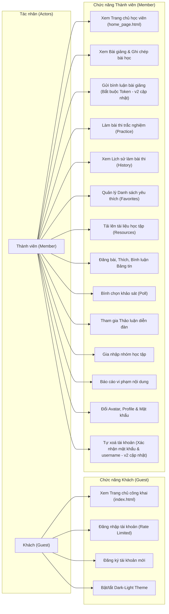
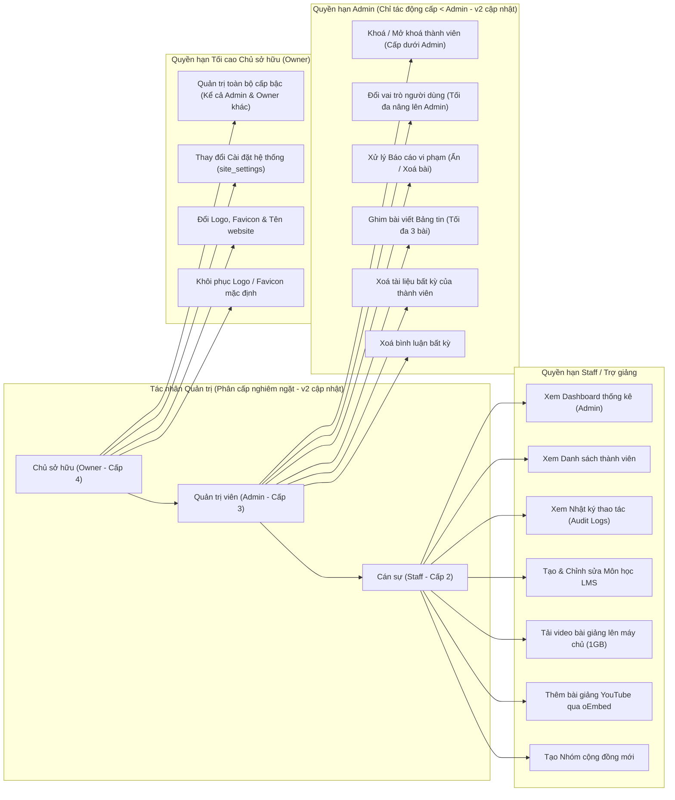

# SƠ ĐỒ USE CASE VÀ MA TRẬN QUYỀN HỆ THỐNG (01_use_cases.md) (v2 cập nhật)

**Dự án:** 9-5-ai-library  
**Phiên bản:** v2 (Cập nhật sau đợt vá bảo mật & kiểm thử v2)  
**Ghi chú kiểm tra cú pháp Mermaid:** Cú pháp đã được tự rà soát thủ công chi tiết từng sơ đồ theo đúng đặc tả cú pháp Mermaid.js (toàn bộ nhãn có chứa ký tự đặc biệt, dấu ngoặc đều được bọc trong dấu ngoặc kép `""`, không sử dụng thẻ HTML thô, mũi tên chuẩn xác) để đảm bảo render 100% chuẩn xác trên GitHub/GitLab markdown viewer.

---

## 1. SƠ ĐỒ USE CASE TỔNG THỂ THEO VAI TRÒ (ACTORS & USE CASES)

### 1.1. Sơ đồ Use Case cho Khách (Guest) và Thành viên học viên (Member) (v2 cập nhật)
- **Mục đích:** Thể hiện ranh giới các tính năng công khai dành cho khách vãng lai và các tính năng học tập, tương tác khi đã đăng nhập với vai trò Member. Trong v2, quyền bình luận bài giảng (LMS Comment) đã được thắt chặt bắt buộc đăng nhập (F-002).
- **Nguồn:** [`backend/middlewares/authMiddleware.js`](file:///c:/Users/anhqu/Documents/Computer%20Science%20Training/PRIVATE%20PROJECT/9-5-ai-library/backend/middlewares/authMiddleware.js), [`backend/routes/lmsRoutes.js`](file:///c:/Users/anhqu/Documents/Computer%20Science%20Training/PRIVATE%20PROJECT/9-5-ai-library/backend/routes/lmsRoutes.js), [`js/auth-guard.js`](file:///c:/Users/anhqu/Documents/Computer%20Science%20Training/PRIVATE%20PROJECT/9-5-ai-library/js/auth-guard.js), [`pages/auth/login.html`](file:///c:/Users/anhqu/Documents/Computer%20Science%20Training/PRIVATE%20PROJECT/9-5-ai-library/pages/auth/login.html).

---

### 1.2. Sơ đồ Use Case cho Ban điều hành (Staff, Admin, Owner) (v2 cập nhật)
- **Mục đích:** Thể hiện sự phân cấp quyền hạn quản trị nội dung LMS, kiểm duyệt cộng đồng và cấu hình hệ thống. Trong v2, cấp bậc quản trị tuân theo thứ bậc nghiêm ngặt: `Owner (4) > Admin (3) > Staff (2) > Member (1)` (F-003). Admin bị từ chối khi sửa quyền/trạng thái của Owner hoặc tự phong Owner.
- **Nguồn:** [`backend/middlewares/authMiddleware.js`](file:///c:/Users/anhqu/Documents/Computer%20Science%20Training/PRIVATE%20PROJECT/9-5-ai-library/backend/middlewares/authMiddleware.js), [`backend/controllers/adminController.js`](file:///c:/Users/anhqu/Documents/Computer%20Science%20Training/PRIVATE%20PROJECT/9-5-ai-library/backend/controllers/adminController.js), [`backend/routes/adminRoutes.js`](file:///c:/Users/anhqu/Documents/Computer%20Science%20Training/PRIVATE%20PROJECT/9-5-ai-library/backend/routes/adminRoutes.js), [`backend/routes/settingsRoutes.js`](file:///c:/Users/anhqu/Documents/Computer%20Science%20Training/PRIVATE%20PROJECT/9-5-ai-library/backend/routes/settingsRoutes.js).

---

## 2. BẢNG MA TRẬN QUYỀN (USE CASE × VAI TRÒ) ĐỐI CHIẾU CODE THỰC TẾ (v2 cập nhật)

| Nhóm chức năng | Tên Use Case cụ thể | Guest | Member | Staff | Admin | Owner | Middleware Backend bảo vệ | Controller / File code thực tế | Ghi chú phiên bản v2 |
|:---|:---|:---:|:---:|:---:|:---:|:---:|:---|:---|:---|
| **Auth** | Xem cổng thông tin public | ✅ | ✅ | ✅ | ✅ | ✅ | None (Static Whitelist) | `index.html` | Whitelist static phục vụ |
| **Auth** | Đăng nhập tài khoản | ✅ | ❌ | ❌ | ❌ | ❌ | `rateLimiter` (10 lần/15p) | `authController.login` | (v2) Rate limit IP + username |
| **Auth** | Đăng ký tài khoản | ✅ | ❌ | ❌ | ❌ | ❌ | None | `authController.register` | Kiểm tra allow_registration |
| **User** | Xem hồ sơ cá nhân | ❌ | ✅ | ✅ | ✅ | ✅ | `verifyToken` | `userController.getCurrentUser` | (v2) Check DB status realtime |
| **User** | Đổi avatar & thông tin cá nhân | ❌ | ✅ | ✅ | ✅ | ✅ | `verifyToken` | `userController.updateProfile` | |
| **User** | Đổi mật khẩu tài khoản | ❌ | ✅ | ✅ | ✅ | ✅ | `verifyToken` | `userController.changePassword` | bcrypt kiểm tra mật khẩu cũ |
| **User** | Tự xoá tài khoản cá nhân | ❌ | ✅ | ✅ | ✅ | ✅ | `verifyToken` | `userController.deleteAccount` | (v2) Xác nhận mật khẩu + username |
| **LMS** | Xem danh sách khoá học / bài giảng | ⚠️ | ✅ | ✅ | ✅ | ✅ | None (GET public) | `lmsController.getAllCourses` | |
| **LMS** | Tải xem tệp video bài giảng | ⚠️ | ✅ | ✅ | ✅ | ✅ | None (Static Whitelist) | `document/Lectures/**` | Stream Range 206 |
| **LMS** | Bình luận bài giảng | ❌ | ✅ | ✅ | ✅ | ✅ | `verifyToken` | `lmsController.addComment` | (v2) Bắt buộc Token, sanitize DOM |
| **LMS** | Xoá bình luận bài giảng của mình | ❌ | ✅ | ✅ | ✅ | ✅ | `verifyToken` | `lmsController.deleteComment` | |
| **LMS** | Xoá bình luận bài giảng người khác | ❌ | ❌ | ✅ | ✅ | ✅ | `verifyToken`, `isStaffAdminOwner` | `lmsController.deleteComment` | |
| **LMS** | Tạo / Sửa / Xoá môn học | ❌ | ❌ | ✅ | ✅ | ✅ | `verifyToken`, `isStaffAdminOwner` | `lmsController.createCourse` | |
| **LMS** | Tải video MP4/MOV lên kho lưu | ❌ | ❌ | ✅ | ✅ | ✅ | `verifyToken`, `isStaffAdminOwner` | `lmsRoutes.js` (`upload-video`) | FFmpeg + FFprobe |
| **LMS** | Thêm bài giảng YouTube qua oEmbed | ❌ | ❌ | ✅ | ✅ | ✅ | `verifyToken`, `isStaffAdminOwner` | `lmsRoutes.js` (`youtube-info`) | YouTube oEmbed |
| **Practice** | Xem danh sách môn thi & đề thi | ❌ | ✅ | ✅ | ✅ | ✅ | Client side | `js/practice-core.js` | 7 môn, 3 file dữ liệu |
| **Practice** | Làm bài trắc nghiệm & chấm điểm | ❌ | ✅ | ✅ | ✅ | ✅ | Client side | `js/practice-quiz.js` | 4,524 câu hỏi hợp lệ |
| **Practice** | Lưu kết quả thi vào Lịch sử | ❌ | ✅ | ✅ | ✅ | ✅ | localStorage client | `js/practice-core.js` | |
| **Community** | Xem bảng tin bài viết (Feed) | ❌ | ✅ | ✅ | ✅ | ✅ | `verifyToken` | `communityController.getAllPosts` | Real-time status check |
| **Community** | Đăng bài viết (Post/Photo/Link) | ❌ | ✅ | ✅ | ✅ | ✅ | `verifyToken`, `canWriteCommunity` | `communityController.createPost` | Chặn Banned/Pending |
| **Community** | Bỏ phiếu bình chọn (Poll) | ❌ | ✅ | ✅ | ✅ | ✅ | `verifyToken`, `canWriteCommunity` | `communityController.votePoll` | |
| **Community** | Sửa bài viết của chính mình | ❌ | ✅ | ✅ | ✅ | ✅ | `verifyToken`, `canWriteCommunity` | `communityController.updatePost` | |
| **Community** | Xoá bài viết của chính mình | ❌ | ✅ | ✅ | ✅ | ✅ | `verifyToken` | `communityController.deletePost` | |
| **Community** | Xoá bài viết của người khác | ❌ | ❌ | ❌ | ✅ | ✅ | `verifyToken` (Kiểm tra role) | `communityController.deletePost` | |
| **Community** | Ghim bài viết lên đầu trang | ❌ | ❌ | ❌ | ✅ | ✅ | `verifyToken`, `isAdminOrOwner` | `communityController.togglePinPost` | Tối đa 3 bài |
| **Community** | Tạo nhóm cộng đồng mới | ❌ | ❌ | ✅ | ✅ | ✅ | `verifyToken`, `isStaffAdminOwner` | `communityController.createGroup` | |
| **Community** | Gửi báo cáo vi phạm nội dung | ❌ | ✅ | ✅ | ✅ | ✅ | `verifyToken`, `canWriteCommunity` | `communityController.createReport` | |
| **Resources** | Tải tệp tài liệu học tập lên | ❌ | ✅ | ✅ | ✅ | ✅ | `verifyToken` | `resourceController.createResource` | |
| **Resources** | Tải về / Xem trước tài liệu | ❌ | ✅ | ✅ | ✅ | ✅ | `verifyToken` | `resourceController.downloadResource` | |
| **Resources** | Xoá tài liệu của người khác | ❌ | ❌ | ❌ | ✅ | ✅ | `verifyToken` (Kiểm tra role) | `resourceController.deleteResource` | |
| **Admin** | Xem Dashboard chỉ số & Biểu đồ | ❌ | ❌ | ✅ | ✅ | ✅ | `verifyToken`, `isStaffAdminOwner` | `dashboardController.getDashboardStats` | |
| **Admin** | Xem Danh sách người dùng hệ thống | ❌ | ❌ | ✅ | ✅ | ✅ | `verifyToken`, `isStaffAdminOwner` | `adminController.getAllUsers` | |
| **Admin** | Phê duyệt / Khoá tài khoản thành viên | ❌ | ❌ | ❌ | ⚠️ (1) | ✅ | `verifyToken`, `isAdminOrOwner` | `adminController.updateUser` | (v2) Admin chỉ khoá cấp dưới |
| **Admin** | Thay đổi vai trò người dùng | ❌ | ❌ | ❌ | ⚠️ (1) | ✅ | `verifyToken`, `isAdminOrOwner` | `adminController.updateUser` | (v2) Admin không đổi/gán Owner |
| **Admin** | Xử lý Báo cáo vi phạm (Ẩn / Phục hồi) | ❌ | ❌ | ❌ | ✅ | ✅ | `verifyToken`, `isAdminOrOwner` | `moderationController.handleReport` | |
| **Admin** | Xem Nhật ký Audit Logs | ❌ | ❌ | ✅ | ✅ | ✅ | `verifyToken`, `isStaffAdminOwner` | `adminRoutes.js` | |
| **Owner** | Chỉnh sửa Cài đặt hệ thống (Settings) | ❌ | ❌ | ❌ | ❌ | ✅ | `verifyToken`, `isOwner` | `settingsController.updateSettings` | |
| **Owner** | Đổi Logo / Favicon câu lạc bộ | ❌ | ❌ | ❌ | ❌ | ✅ | `verifyToken`, `isOwner` | `settingsController.uploadBranding` | |

*(1) Ghi chú quy tắc thứ bậc v2: Admin chỉ có quyền thao tác trên người dùng có cấp bậc thấp hơn mình (Staff, Member). Admin không thể sửa trạng thái/vai trò của Owner, và không thể thăng cấp bất kỳ ai lên Owner (HTTP 403 Forbidden).*
