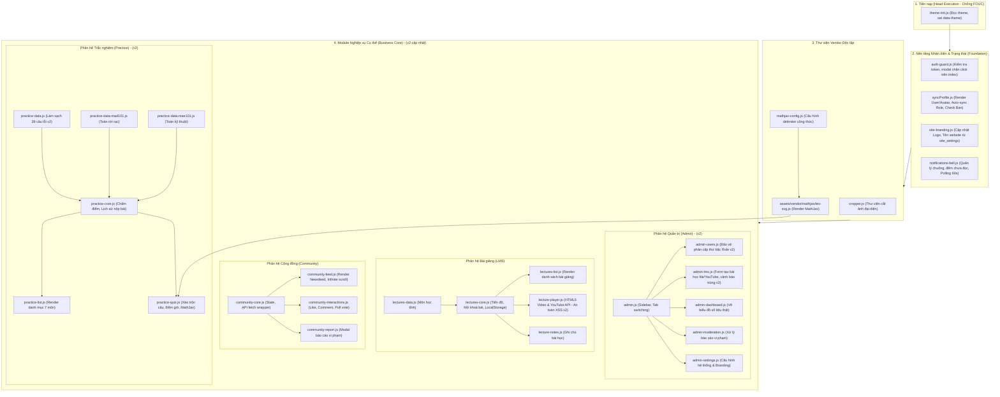
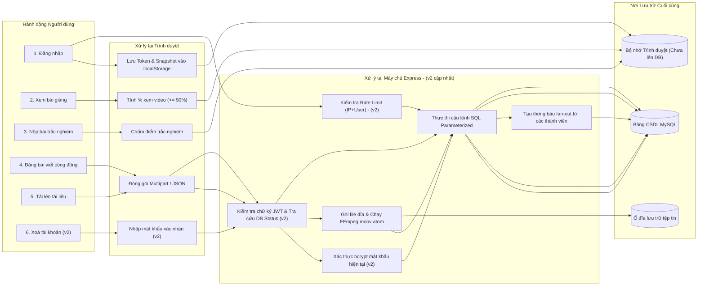

# SƠ ĐỒ KIẾN TRÚC TỔNG THỂ VÀ THÀNH PHẦN HỆ THỐNG (02_architecture.md) (v2 cập nhật)

**Dự án:** 9-5-ai-library  
**Phiên bản:** v2 (Cập nhật sau đợt vá bảo mật & kiểm thử v2)  
**Ghi chú kiểm tra cú pháp Mermaid:** Cú pháp đã được tự rà soát thủ công chi tiết từng sơ đồ theo đúng đặc tả cú pháp Mermaid.js (toàn bộ nhãn có chứa ký tự đặc biệt, dấu ngoặc đều được bọc trong dấu ngoặc kép `""`, không sử dụng thẻ HTML thô, mũi tên chuẩn xác) để đảm bảo render 100% chuẩn xác trên GitHub/GitLab markdown viewer.

---

## 1. SƠ ĐỒ KIẾN TRÚC TỔNG THỂ HỆ THỐNG (SYSTEM ARCHITECTURE) (v2 cập nhật)

- **Mục đích:** Thể hiện sự tương tác giữa Trình duyệt người dùng (Client Browser), Máy chủ ứng dụng (Express.js), Cơ sở dữ liệu quan hệ (MySQL 8.x), Hệ thống tệp đĩa vật lý (Local File Storage) và các Dịch vụ đám mây bên ngoài (YouTube, CDN).
- **Điểm mới phiên bản v2:**
  1. Thêm bộ lọc chặn 404 bảo mật trước Static (`backend/server.js`) chặn triệt để `/backend`, `/tools`, `.env`, `.sql`, `.bak`, `*.md` (F-001).
  2. Thay thế `express.static(root)` bằng WhiteList mount các thư mục cần thiết (`/pages`, `/css`, `/js`, `/assets`, `/home_page`, `/document/Lectures`, `/document/Practice`, `/document/uploads`) với `dotfiles: 'deny'`, `index: false` (F-001).
  3. Bổ sung Middleware tiêu đề bảo mật (`X-Content-Type-Options`, `X-Frame-Options`, `Referrer-Policy`, `X-XSS-Protection`) (F-008).
  4. Bổ sung In-Memory Rate Limiter bảo vệ endpoint đăng nhập (F-007).
  5. `verifyToken` bổ sung truy vấn CSDL thời gian thực kiểm tra trạng thái hoạt động tài khoản (F-005).

```mermaid
flowchart TB
    subgraph ClientLayer["Lớp Trình duyệt Khách (Client Browser)"]
        BrowserUI["Giao diện người dùng (HTML5 / Vanilla CSS3)"]
        ClientStorage["Lưu trữ cục bộ (localStorage / sessionStorage)"]
        ClientRuntime["Runtime JavaScript (DOM, Fetch API, MathJax)"]
    end

    subgraph ExternalServices["Dịch vụ Bên ngoài (External Services)"]
        YT_Iframe["YouTube Player (IFrame Embed Video)"]
        YT_oEmbed["YouTube oEmbed API (Metadata Video)"]
        CDN_KaTeX["CDN jsDelivr (KaTeX Math CSS/JS)"]
    end

    subgraph AppServerLayer["Lớp Máy chủ Ứng dụng Express.js (Cổng 3000) - (v2 cập nhật)"]
        SecHeaders["Tiêu đề bảo mật (Security Headers: nosniff, SAMEORIGIN - v2)"]
        StaticBlock["Lớp chặn bảo mật 404 (Chặn /backend, /tools, .env, .sql... - v2)"]
        StaticWhitelist["Bộ định tuyến Static Whitelist (/pages, /css, /js, /assets... - v2)"]
        RateLimiter["In-Memory Rate Limiter (Chống Brute Force 10req/15m - v2)"]
        AuthMiddleware["Xác thực JWT + DB Ban Check Realtime (v2)"]
        APIRouters["Bộ định tuyến API (10 Route Modules)"]
        
        subgraph NativeTools["Công cụ Xử lý Đa phương tiện"]
            FFmpeg["FFmpeg CLI (-movflags +faststart)"]
            FFprobe["FFprobe CLI (Đo thời lượng video)"]
        end
    end

    subgraph PersistenceLayer["Lớp Lưu trữ Bền vững (Data Persistence)"]
        MySQL[("Cơ sở dữ liệu MySQL 8.x (ai_club_db)")]
        DiskLectures["document/Lectures/ (Tệp Video bài giảng)"]
        DiskResources["backend/storage/resources/ (Tài liệu học tập)"]
        DiskUploads["assets/uploads/ (Ảnh bài đăng & Avatar)"]
    end

    BrowserUI <--> ClientRuntime
    ClientRuntime <--> ClientStorage
    BrowserUI -. Nhúng phát video .-> YT_Iframe
    BrowserUI -. Nạp font/script .-> CDN_KaTeX

    SecHeaders --> StaticBlock
    ClientRuntime -- "Yêu cầu tệp tĩnh GET" --> SecHeaders
    StaticBlock -- "Đường dẫn nhạy cảm" --> Ret404["Trả về HTTP 404 Not Found"]
    StaticBlock -- "Đường dẫn hợp lệ" --> StaticWhitelist
    StaticWhitelist --> DiskLectures
    StaticWhitelist --> BrowserUI

    ClientRuntime -- "Yêu cầu POST /api/auth/login" --> RateLimiter
    RateLimiter -- "Vượt ngưỡng 10 lần/15p" --> Ret429["Trả về HTTP 429 Too Many Requests"]
    RateLimiter -- "Hợp lệ" --> APIRouters

    ClientRuntime -- "Gọi REST API kèm Bearer JWT" --> AuthMiddleware
    AuthMiddleware -- "Tra cứu realtime status" --> MySQL
    AuthMiddleware -- "Hợp lệ" --> APIRouters
    
    APIRouters -- "Truy vấn CSDL (mysql2/promise)" --> MySQL
    APIRouters -- "Lưu tệp tải lên (Multer)" --> DiskResources
    APIRouters -- "Lưu ảnh đính kèm (Multer)" --> DiskUploads
    APIRouters -- "Tải video bài giảng" --> DiskLectures
    APIRouters -- "Gọi dòng lệnh tối ưu MP4" --> FFmpeg
    APIRouters -- "Đọc thời lượng video" --> FFprobe
    APIRouters -- "Fetch oEmbed lấy thông tin video" --> YT_oEmbed
```

---

## 2. SƠ ĐỒ THÀNH PHẦN FRONTEND VÀ THỨ TỰ NẠP (FRONTEND COMPONENTS & LOAD ORDER) (v2 cập nhật)

- **Mục đích:** Thể hiện cấu trúc các module JavaScript dùng chung, quan hệ phụ thuộc và trình tự thực thi từ khi nạp thẻ `<head>` đến khi hoàn tất render DOM.
- **Điểm mới phiên bản v2:**
  1. `lecture-player.js`: Loại bỏ hoàn toàn `innerHTML` khi render bình luận, sử dụng `createElement` và `textContent` chống XSS (F-002).
  2. `admin-users.js`: Ẩn/disable các nút thao tác trên tài khoản cấp cao hơn hoặc bằng Admin nhằm đảm bảo phân cấp thứ bậc (F-003).
  3. `settings-preferences.js` và `settings.html`: Bổ sung modal xác nhận nhập mật khẩu hiện tại khi bấm xoá tài khoản (F-004).
  4. `practice-quiz-intro.html`: Bổ sung nạp `practice-data-mad101.js` và `practice-data-mae101.js` để hiển thị đầy đủ câu hỏi toán học (F-010/011).

---

## 3. SƠ ĐỒ LUỒNG DỮ LIỆU CHÍNH TRONG HỆ THỐNG (DATA FLOW DIAGRAM) (v2 cập nhật)

- **Mục đích:** Mô tả đường đi của dữ liệu từ khi người dùng thao tác đến các kho lưu trữ và phản hồi trở lại UI.

