# SƠ ĐỒ TUẦN TỰ HỆ THỐNG - CÁC KỊCH BẢN CHÍNH (04_sequence_diagrams.md) (v2 cập nhật)

**Dự án:** 9-5-ai-library  
**Phiên bản:** v2 (Cập nhật sau đợt vá bảo mật & kiểm thử v2)  
**Ghi chú kiểm tra cú pháp Mermaid:** Mỗi sơ đồ đều bao gồm Luồng chính (Happy Path) và ít nhất một Nhánh rẽ xử lý lỗi (Error Branch). Cú pháp đã được tự rà soát thủ công chi tiết từng sơ đồ theo đúng đặc tả cú pháp Mermaid.js (toàn bộ nhãn có chứa ký tự đặc biệt, dấu ngoặc đều được bọc trong dấu ngoặc kép `""`, không sử dụng thẻ HTML thô, mũi tên chuẩn xác) để đảm bảo render 100% chuẩn xác trên GitHub/GitLab markdown viewer.

---

## 1. ĐĂNG NHẬP, RATE LIMITING VÀ CHUYỂN HƯỚNG THEO VAI TRÒ (v2 cập nhật)
- **Mục đích:** Mô tả luồng học viên hoặc quản trị viên đăng nhập, cơ chế giới hạn tần suất chống dò quét mật khẩu (Rate Limiting 10 lần/15 phút - F-007), lưu trữ token và chuyển hướng an toàn.
- **Nguồn:** [`pages/auth/login.html`](file:///c:/Users/anhqu/Documents/Computer%20Science%20Training/PRIVATE%20PROJECT/9-5-ai-library/pages/auth/login.html), [`backend/middlewares/rateLimiter.js`](file:///c:/Users/anhqu/Documents/Computer%20Science%20Training/PRIVATE%20PROJECT/9-5-ai-library/backend/middlewares/rateLimiter.js), [`backend/controllers/authController.js`](file:///c:/Users/anhqu/Documents/Computer%20Science%20Training/PRIVATE%20PROJECT/9-5-ai-library/backend/controllers/authController.js).

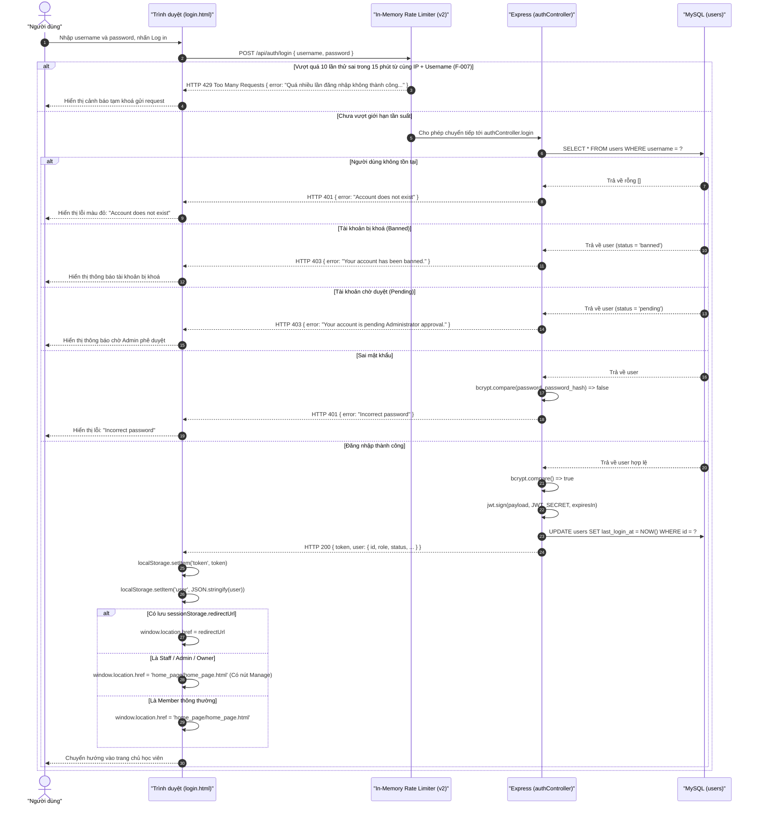

---

## 2. ĐĂNG KÝ VÀ PHÊ DUYỆT TÀI KHOẢN MỚI
- **Mục đích:** Mô tả quy trình đăng ký thành viên mới dựa trên cấu hình hệ thống (`require_approval`, `min_password_length`).
- **Nguồn:** [`pages/auth/signup.html`](file:///c:/Users/anhqu/Documents/Computer%20Science%20Training/PRIVATE%20PROJECT/9-5-ai-library/pages/auth/signup.html), [`js/auth.js:25-50`](file:///c:/Users/anhqu/Documents/Computer%20Science%20Training/PRIVATE%20PROJECT/9-5-ai-library/js/auth.js#L25-L50), [`backend/controllers/authController.js:69-122`](file:///c:/Users/anhqu/Documents/Computer%20Science%20Training/PRIVATE%20PROJECT/9-5-ai-library/backend/controllers/authController.js#L69-L122).

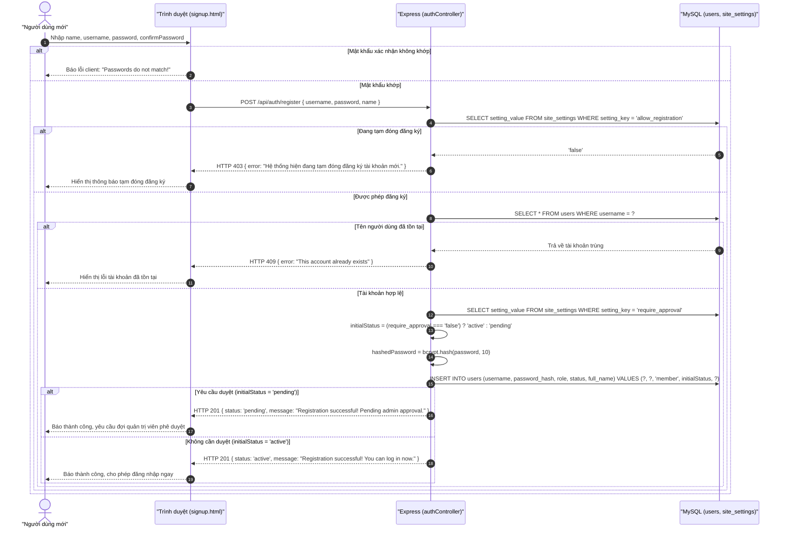

---

## 3. LUỒNG QUÊN / ĐẶT LẠI MẬT KHẨU (HIỆN TRẠNG MOCK VÀ ĐỀ XUẤT)
- **Mục đích:** Thể hiện hiện trạng đứt gãy luồng quên mật khẩu tại giao diện tĩnh và luồng đề xuất hoàn thiện.
- **Nguồn:** [`pages/auth/forgot_pass.html`](file:///c:/Users/anhqu/Documents/Computer%20Science%20Training/PRIVATE%20PROJECT/9-5-ai-library/pages/auth/forgot_pass.html), [`Finding F-014`](file:///c:/Users/anhqu/Documents/Computer%20Science%20Training/PRIVATE%20PROJECT/9-5-ai-library/flowchart%20testcase/02_FINDINGS_REGISTER.md).

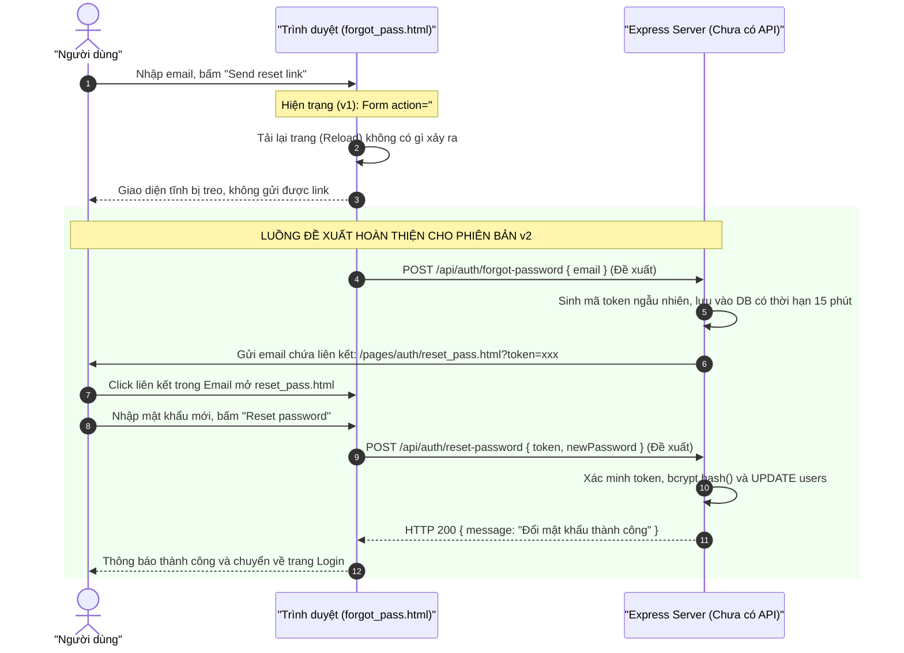

---

## 4. LÀM BÀI TRẮC NGHIỆM VÀ LƯU LỊCH SỬ THI (PRACTICE QUIZ)
- **Mục đích:** Mô tả luồng làm bài thi trắc nghiệm, đếm ngược thời gian, chấm điểm tự động và lưu lịch sử vào localStorage.
- **Nguồn:** [`pages/practice/practice-quiz.html`](file:///c:/Users/anhqu/Documents/Computer%20Science%20Training/PRIVATE%20PROJECT/9-5-ai-library/pages/practice/practice-quiz.html), [`js/practice-quiz.js:150-280`](file:///c:/Users/anhqu/Documents/Computer%20Science%20Training/PRIVATE%20PROJECT/9-5-ai-library/js/practice-quiz.js#L150-L280), [`js/practice-core.js:130-170`](file:///c:/Users/anhqu/Documents/Computer%20Science%20Training/PRIVATE%20PROJECT/9-5-ai-library/js/practice-core.js#L130-L170).

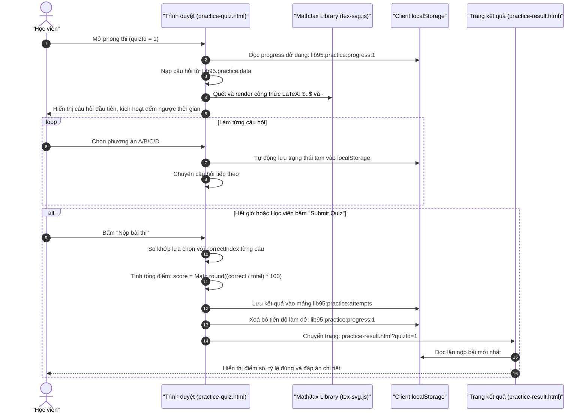

---

## 5. XEM BÀI GIẢNG FILE NỘI BỘ VÀ TÍNH TIẾN ĐỘ HOÀN THÀNH
- **Mục đích:** Mô tả việc phát video MP4 cục bộ, tự động lưu mốc thời gian xem và đánh dấu hoàn thành bài học khi xem $\ge 90\%$.
- **Nguồn:** [`pages/lectures/lecture.html`](file:///c:/Users/anhqu/Documents/Computer%20Science%20Training/PRIVATE%20PROJECT/9-5-ai-library/pages/lectures/lecture.html), [`js/lecture-player.js:300-380`](file:///c:/Users/anhqu/Documents/Computer%20Science%20Training/PRIVATE%20PROJECT/9-5-ai-library/js/lecture-player.js#L300-L380), [`js/lectures-core.js:135-155`](file:///c:/Users/anhqu/Documents/Computer%20Science%20Training/PRIVATE%20PROJECT/9-5-ai-library/js/lectures-core.js#L135-L155).

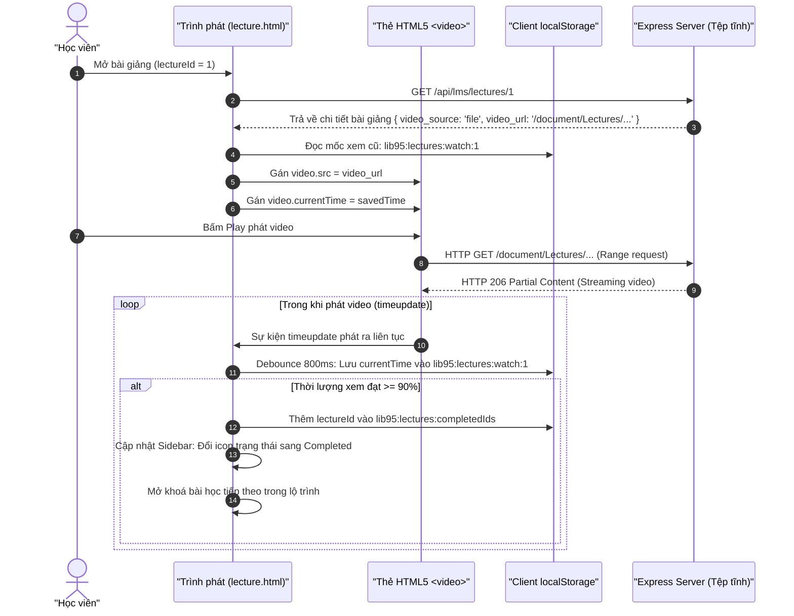

---

## 6. XEM BÀI GIẢNG YOUTUBE VÀ ĐỒNG BỘ TIẾN ĐỘ QUA POLLING
- **Mục đích:** Mô tả việc nhúng YouTube IFrame API và sử dụng interval polling để lấy tiến độ thời gian thực.
- **Nguồn:** [`js/lecture-player.js:90-225`](file:///c:/Users/anhqu/Documents/Computer%20Science%20Training/PRIVATE%20PROJECT/9-5-ai-library/js/lecture-player.js#L90-L225), [`LMS_YOUTUBE_AUDIT.md:15`](file:///c:/Users/anhqu/Documents/Computer%20Science%20Training/PRIVATE%20PROJECT/9-5-ai-library/LMS_YOUTUBE_AUDIT.md#L15).

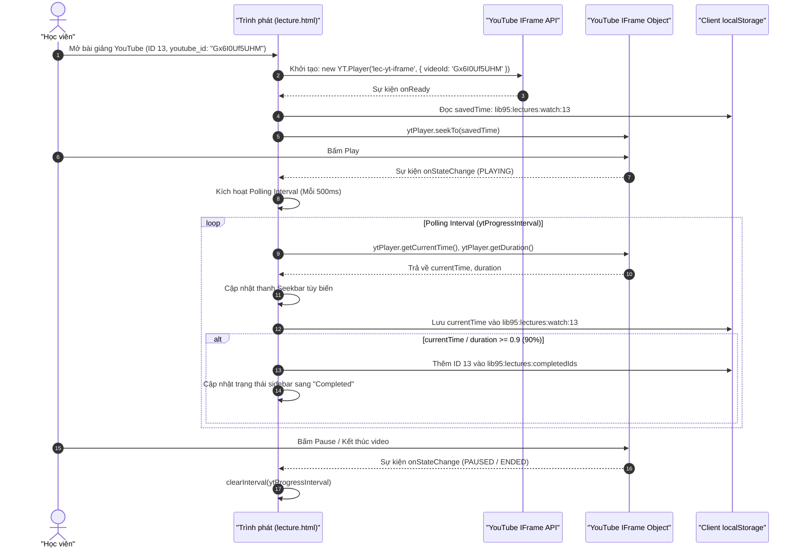

---

## 7. ADMIN TẠO BÀI GIẢNG VIDEO TẢI LÊN (FILE UPLOAD & FFMPEG)
- **Mục đích:** Mô tả quy trình upload video lớn (tối đa 1GB), tối ưu hoá `moov atom` qua FFmpeg và đo thời lượng qua FFprobe.
- **Nguồn:** [`backend/routes/lmsRoutes.js:145-181`](file:///c:/Users/anhqu/Documents/Computer%20Science%20Training/PRIVATE%20PROJECT/9-5-ai-library/backend/routes/lmsRoutes.js#L145-L181), [`backend/controllers/lmsController.js:150-210`](file:///c:/Users/anhqu/Documents/Computer%20Science%20Training/PRIVATE%20PROJECT/9-5-ai-library/backend/controllers/lmsController.js#L150-L210).

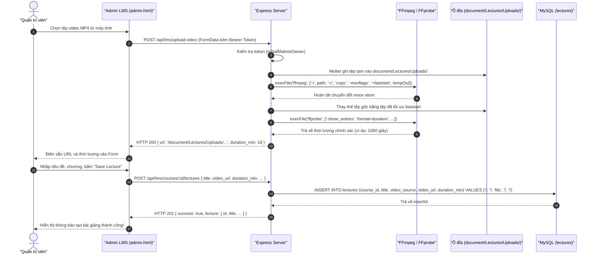

---

## 8. ADMIN TẠO BÀI GIẢNG YOUTUBE (OEMBED & DETECT METADATA)
- **Mục đích:** Mô tả tính năng thêm bài giảng qua liên kết YouTube, trích xuất ID an toàn và tự động lấy metadata qua oEmbed.
- **Nguồn:** [`backend/routes/lmsRoutes.js:33-85`](file:///c:/Users/anhqu/Documents/Computer%20Science%20Training/PRIVATE%20PROJECT/9-5-ai-library/backend/routes/lmsRoutes.js#L33-L85), [`js/admin-lms.js`](file:///c:/Users/anhqu/Documents/Computer%20Science%20Training/PRIVATE%20PROJECT/9-5-ai-library/js/admin-lms.js).

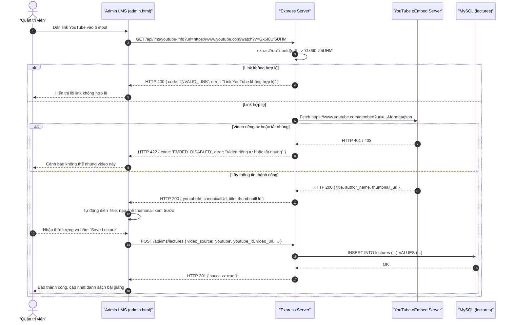

---

## 9. ĐĂNG BÀI VIẾT CỘNG ĐỒNG VÀ PHÁT THÔNG BÁO (FAN-OUT)
- **Mục đích:** Mô tả việc tạo bài đăng, kiểm tra trạng thái tài khoản (`canWriteCommunity`) và tạo thông báo fan-out tới các thành viên.
- **Nguồn:** [`backend/controllers/communityController.js:180-260`](file:///c:/Users/anhqu/Documents/Computer%20Science%20Training/PRIVATE%20PROJECT/9-5-ai-library/backend/controllers/communityController.js#L180-L260).

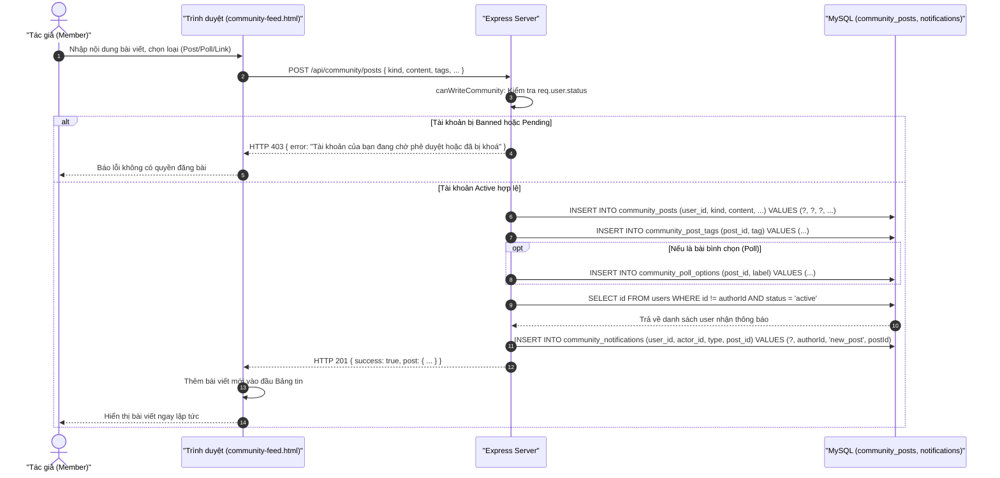

---

## 10. GHIM VÀ BỎ GHIM BÀI VIẾT (TỐI ĐA 3 BÀI)
- **Mục đích:** Mô tả tính năng ghim bài viết lên đầu trang cộng đồng của Admin/Owner và kiểm tra giới hạn 3 bài.
- **Nguồn:** [`backend/controllers/communityController.js:330-380`](file:///c:/Users/anhqu/Documents/Computer%20Science%20Training/PRIVATE%20PROJECT/9-5-ai-library/backend/controllers/communityController.js#L330-L380).

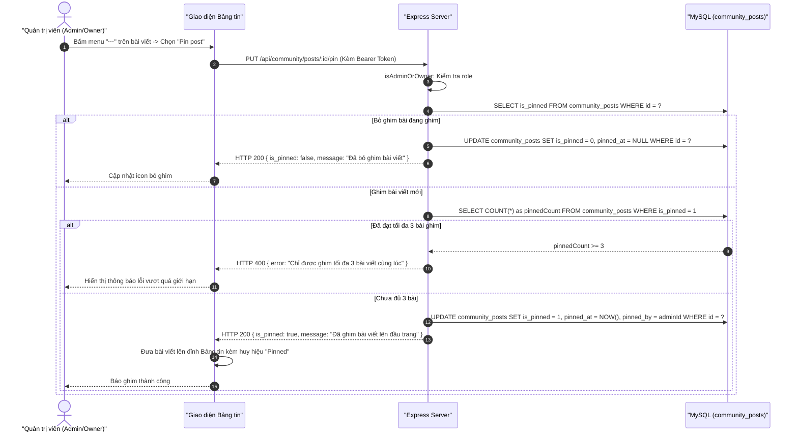

---

## 11. BÁO CÁO VI PHẠM VÀ QUY TRÌNH KIỂM DUYỆT (MODERATION)
- **Mục đích:** Mô tả việc thành viên báo cáo nội dung xấu và quản trị viên xử lý báo cáo (Ẩn/Phục hồi/Xoá vĩnh viễn).
- **Nguồn:** [`backend/controllers/moderationController.js:15-180, 270-360`](file:///c:/Users/anhqu/Documents/Computer%20Science%20Training/PRIVATE%20PROJECT/9-5-ai-library/backend/controllers/moderationController.js#L15-L180), [`js/community-report.js`](file:///c:/Users/anhqu/Documents/Computer%20Science%20Training/PRIVATE%20PROJECT/9-5-ai-library/js/community-report.js).

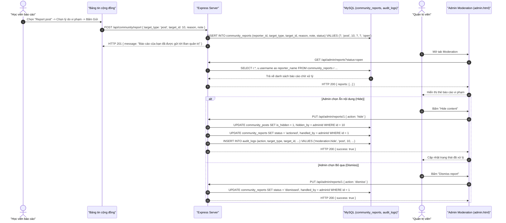

---

## 12. BẬT / TẮT YÊU THÍCH (TOGGLE FAVORITES ĐA HÌNH)
- **Mục đích:** Thể hiện luồng bookmark môn học bài giảng, môn thực hành hoặc tài nguyên học tập.
- **Nguồn:** [`backend/controllers/favoriteController.js:150-240`](file:///c:/Users/anhqu/Documents/Computer%20Science%20Training/PRIVATE%20PROJECT/9-5-ai-library/backend/controllers/favoriteController.js#L150-L240), [`pages/favorites.html`](file:///c:/Users/anhqu/Documents/Computer%20Science%20Training/PRIVATE%20PROJECT/9-5-ai-library/pages/favorites.html).

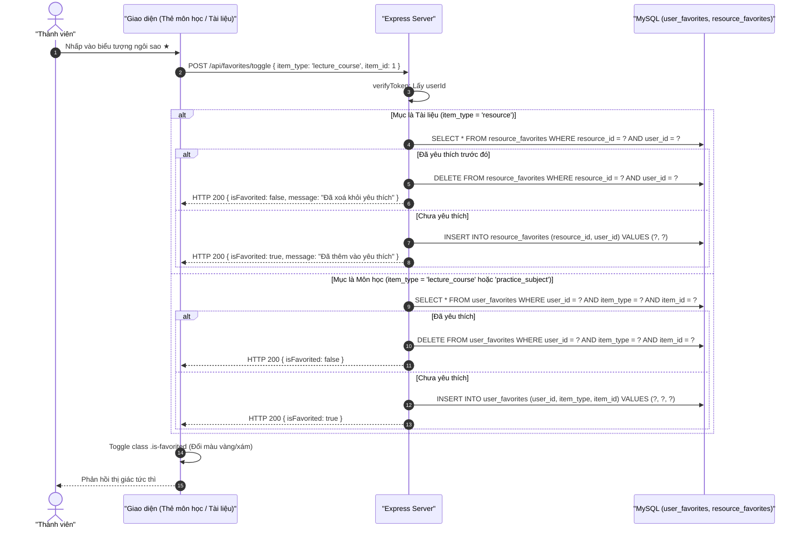

---

## 13. CẬP NHẬT ẢNH ĐẠI DIỆN VÀ ĐỒNG BỘ HỒ SƠ (AVATAR CROP)
- **Mục đích:** Mô tả việc cắt ảnh đại diện bằng Cropper.js, lưu base64/URL và tự động cập nhật UI toàn trang.
- **Nguồn:** [`pages/settings/settings.html`](file:///c:/Users/anhqu/Documents/Computer%20Science%20Training/PRIVATE%20PROJECT/9-5-ai-library/pages/settings/settings.html), [`js/settings-profile.js:50-130`](file:///c:/Users/anhqu/Documents/Computer%20Science%20Training/PRIVATE%20PROJECT/9-5-ai-library/js/settings-profile.js#L50-L130), [`js/syncProfile.js:10-50`](file:///c:/Users/anhqu/Documents/Computer%20Science%20Training/PRIVATE%20PROJECT/9-5-ai-library/js/syncProfile.js#L10-L50).

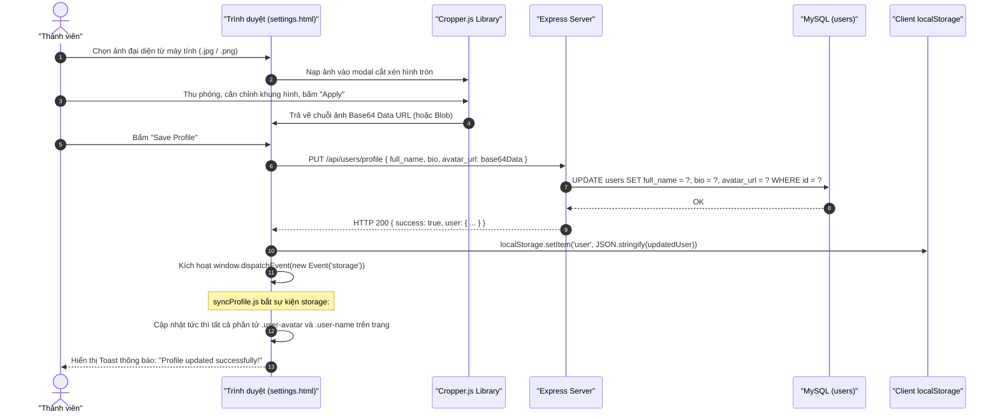

---

## 14. ĐỔI MẬT KHẨU TÀI KHOẢN (CHANGE PASSWORD)
- **Mục đích:** Mô tả việc kiểm tra mật khẩu cũ bằng bcrypt trước khi mã hoá và cập nhật mật khẩu mới.
- **Nguồn:** [`backend/controllers/userController.js:40-70`](file:///c:/Users/anhqu/Documents/Computer%20Science%20Training/PRIVATE%20PROJECT/9-5-ai-library/backend/controllers/userController.js#L40-L70), [`js/settings-account.js`](file:///c:/Users/anhqu/Documents/Computer%20Science%20Training/PRIVATE%20PROJECT/9-5-ai-library/js/settings-account.js).

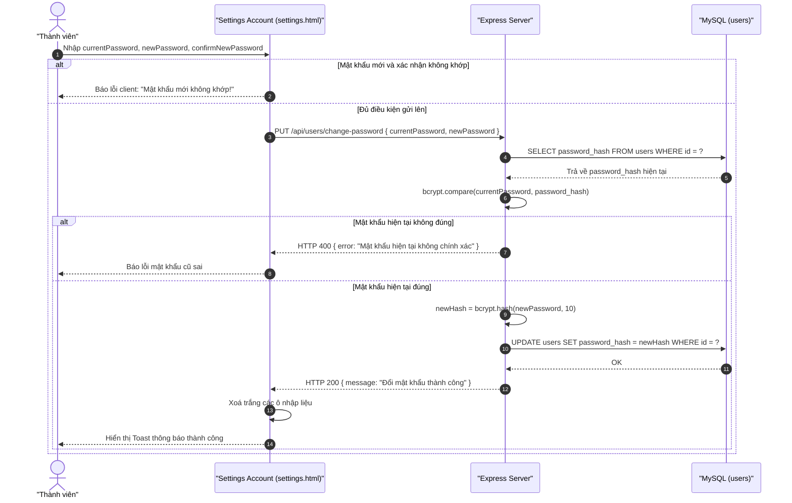

---

## 15. CHUÔNG THÔNG BÁO, POLLING VÀ ĐỒNG BỘ ĐA TAB
- **Mục đích:** Mô tả chu kỳ kiểm tra thông báo mới mỗi 60 giây, đánh dấu đã đọc và đồng bộ trạng thái tức thì giữa các tab qua Storage Event.
- **Nguồn:** [`js/notifications-bell.js:100-240`](file:///c:/Users/anhqu/Documents/Computer%20Science%20Training/PRIVATE%20PROJECT/9-5-ai-library/js/notifications-bell.js#L100-L240), [`backend/controllers/communityController.js:1450-1550`](file:///c:/Users/anhqu/Documents/Computer%20Science%20Training/PRIVATE%20PROJECT/9-5-ai-library/backend/controllers/communityController.js#L1450-L1550).

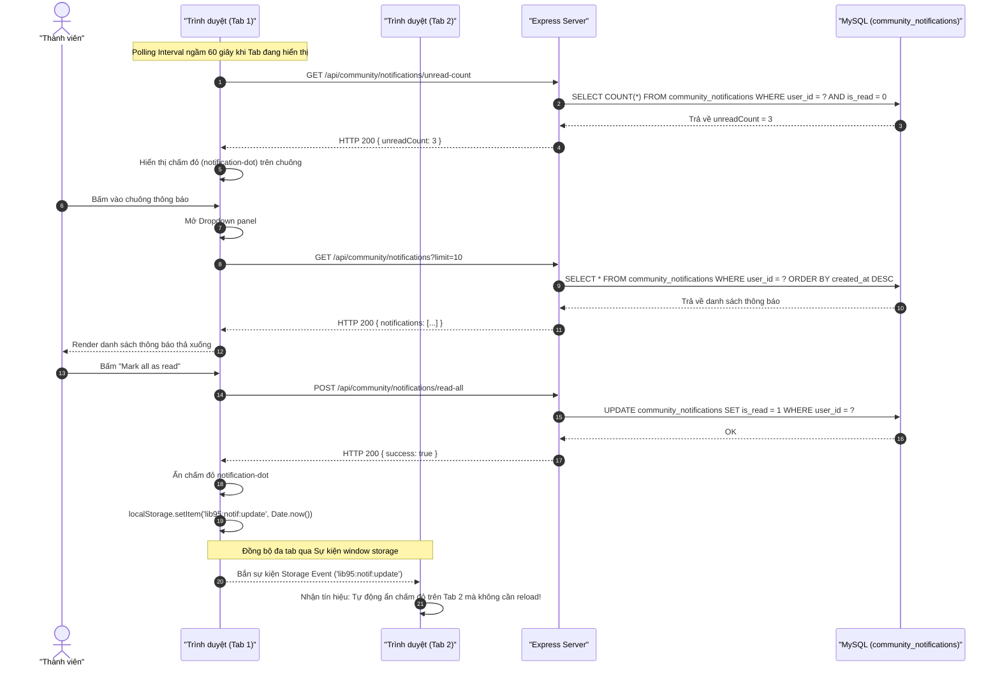

---

## 16. GỬI BÌNH LUẬN BÀI GIẢNG (BẮT BUỘC TOKEN VÀ CHỐNG XSS - F-002) (v2 cập nhật)
- **Mục đích:** Mô tả quy trình gửi bình luận bài giảng đã được thắt chặt bảo mật trong v2: Bắt buộc đăng nhập (`verifyToken`), kiểm tra bài giảng tồn tại, giới hạn độ dài nội dung và render an toàn bằng DOM API chống XSS.
- **Nguồn:** [`backend/routes/lmsRoutes.js`](file:///c:/Users/anhqu/Documents/Computer%20Science%20Training/PRIVATE%20PROJECT/9-5-ai-library/backend/routes/lmsRoutes.js), [`backend/controllers/lmsController.js`](file:///c:/Users/anhqu/Documents/Computer%20Science%20Training/PRIVATE%20PROJECT/9-5-ai-library/backend/controllers/lmsController.js), [`js/lecture-player.js`](file:///c:/Users/anhqu/Documents/Computer%20Science%20Training/PRIVATE%20PROJECT/9-5-ai-library/js/lecture-player.js).

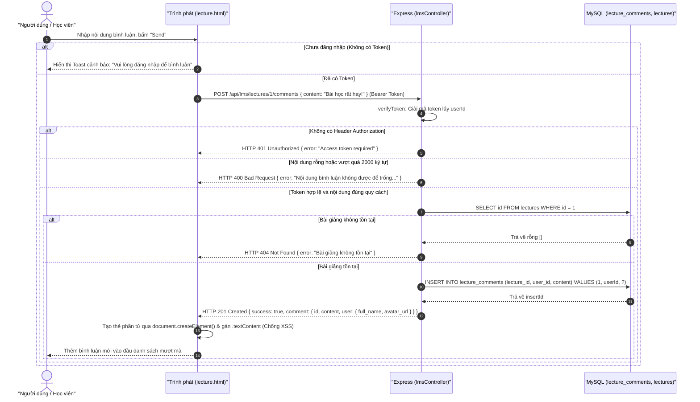

---

## 17. PHÂN CẤP QUYỀN QUẢN TRỊ NGƯỜI DÙNG (HIERARCHY CHECK - F-003) (v2 cập nhật)
- **Mục đích:** Mô tả việc kiểm tra thứ bậc nghiêm ngặt (`Owner: 4 > Admin: 3 > Staff: 2 > Member: 1`) khi quản trị viên thay đổi vai trò hoặc khoá tài khoản.
- **Nguồn:** [`backend/controllers/adminController.js`](file:///c:/Users/anhqu/Documents/Computer%20Science%20Training/PRIVATE%20PROJECT/9-5-ai-library/backend/controllers/adminController.js), [`js/admin-users.js`](file:///c:/Users/anhqu/Documents/Computer%20Science%20Training/PRIVATE%20PROJECT/9-5-ai-library/js/admin-users.js).

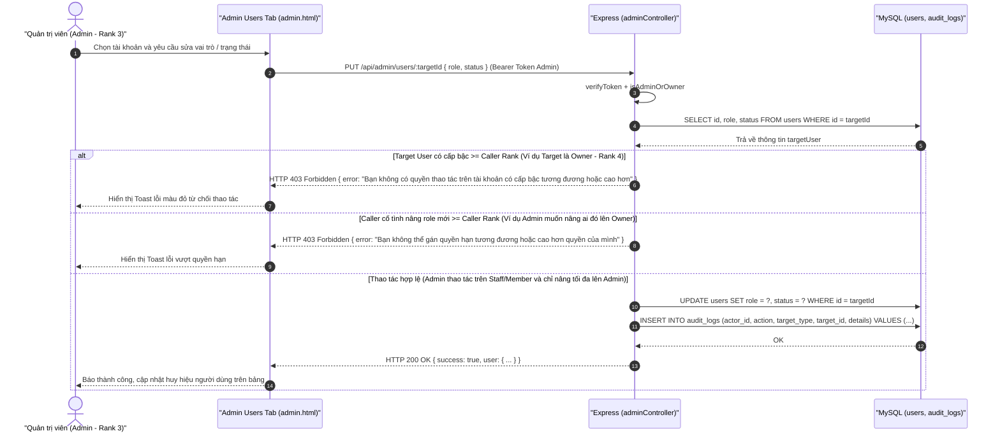

---

## 18. TỰ XOÁ TÀI KHOẢN CÁ NHÂN (XÁC NHẬN MẬT KHẨU BCRYPT - F-004) (v2 cập nhật)
- **Mục đích:** Mô tả quy trình tự xoá tài khoản cá nhân an toàn trong v2: Bắt buộc người dùng nhập xác nhận Username và Mật khẩu hiện tại, kiểm tra bằng `bcrypt.compare()` trước khi xoá dữ liệu vĩnh viễn.
- **Nguồn:** [`backend/controllers/userController.js`](file:///c:/Users/anhqu/Documents/Computer%20Science%20Training/PRIVATE%20PROJECT/9-5-ai-library/backend/controllers/userController.js), [`pages/settings/settings.html`](file:///c:/Users/anhqu/Documents/Computer%20Science%20Training/PRIVATE%20PROJECT/9-5-ai-library/pages/settings/settings.html), [`js/settings-preferences.js`](file:///c:/Users/anhqu/Documents/Computer%20Science%20Training/PRIVATE%20PROJECT/9-5-ai-library/js/settings-preferences.js).

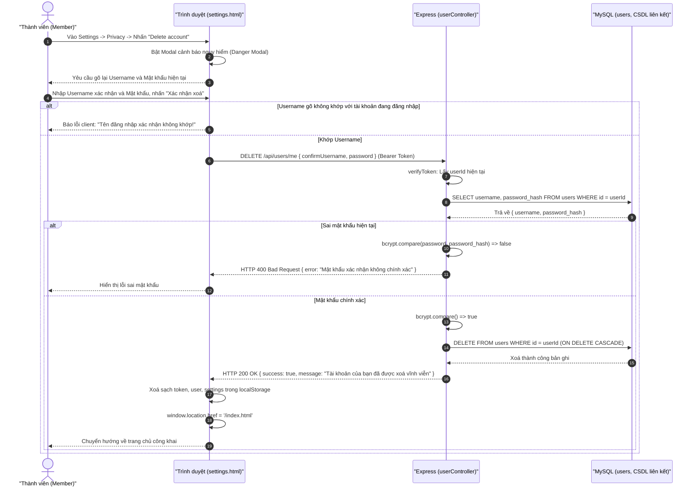
