# SƠ ĐỒ LƯU TRÌNH HOẠT ĐỘNG VÀ XỬ LÝ ĐIỀU KIỆN BIÊN (05_activity_flowcharts.md) (v2 cập nhật)

**Dự án:** 9-5-ai-library  
**Phiên bản:** v2 (Cập nhật sau đợt vá bảo mật & kiểm thử v2)  
**Ghi chú kiểm tra cú pháp Mermaid:** Mỗi lưu trình đều thể hiện các nhánh rẽ điều kiện (Decision nodes), xử lý lỗi và điều kiện biên. Cú pháp đã được tự rà soát thủ công chi tiết từng sơ đồ theo đúng đặc tả cú pháp Mermaid.js (toàn bộ nhãn có chứa ký tự đặc biệt, dấu ngoặc đều được bọc trong dấu ngoặc kép `""`, không sử dụng thẻ HTML thô, mũi tên chuẩn xác) để đảm bảo render 100% chuẩn xác trên GitHub/GitLab markdown viewer.

---

## 1. ĐỊNH TUYẾN THEO VAI TRÒ VÀ TRẠNG THÁI TÀI KHOẢN (ROLE & STATUS ROUTING) (v2 cập nhật)
- **Mục đích:** Mô tả cây quyết định điều hướng khi người dùng truy cập một URL bất kỳ trong hệ thống. Trong v2, `verifyToken` kiểm tra trực tiếp trạng thái CSDL thời gian thực: tài khoản bị khoá (Banned) sẽ bị chặn ngay lập tức ở cấp backend với mã HTTP 403 mà không phụ thuộc vào payload JWT cũ (F-005).
- **Nguồn:** [`backend/middlewares/authMiddleware.js`](file:///c:/Users/anhqu/Documents/Computer%20Science%20Training/PRIVATE%20PROJECT/9-5-ai-library/backend/middlewares/authMiddleware.js), [`js/auth-guard.js`](file:///c:/Users/anhqu/Documents/Computer%20Science%20Training/PRIVATE%20PROJECT/9-5-ai-library/js/auth-guard.js), [`js/syncProfile.js:148-202`](file:///c:/Users/anhqu/Documents/Computer%20Science%20Training/PRIVATE%20PROJECT/9-5-ai-library/js/syncProfile.js#L148-L202).

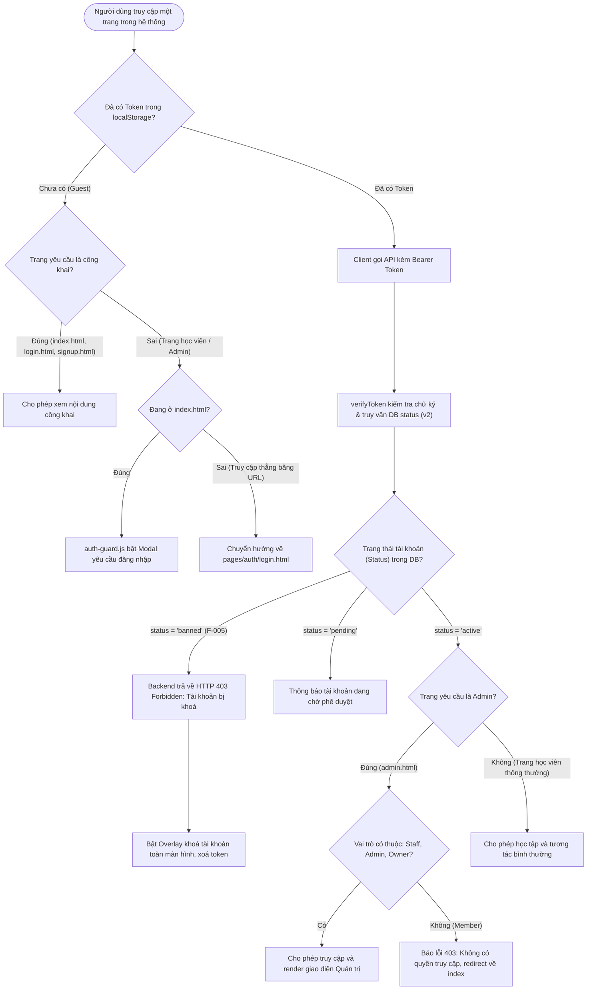

---

## 2. LỰA CHỌN VÀ HIỂN THỊ CÁC MÔN TIÊU BIỂU TẠI TRANG CHỦ (HOME SUBJECTS)
- **Mục đích:** Mô tả cách nạp danh mục môn học, tính toán tiến độ trung bình và xử lý layout 6 môn (3x2).
- **Nguồn:** [`home_page/home_page.js:17-104`](file:///c:/Users/anhqu/Documents/Computer%20Science%20Training/PRIVATE%20PROJECT/9-5-ai-library/home_page/home_page.js#L17-L104), [`HOME_SUBJECTS_AUDIT.md:8-19`](file:///c:/Users/anhqu/Documents/Computer%20Science%20Training/PRIVATE%20PROJECT/9-5-ai-library/HOME_SUBJECTS_AUDIT.md#L8-L19).

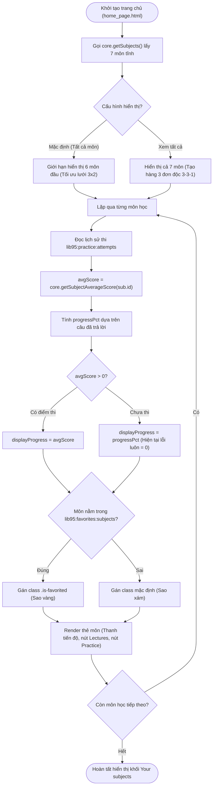

---

## 3. LƯU TRÌNH LÀM BÀI TRẮC NGHIỆM VÀ XỬ LÝ MATHJAX
- **Mục đích:** Mô tả việc chuẩn bị câu hỏi, xáo trộn thứ tự, bảo toàn công thức toán học LaTeX và nộp bài.
- **Nguồn:** [`js/practice-quiz.js`](file:///c:/Users/anhqu/Documents/Computer%20Science%20Training/PRIVATE%20PROJECT/9-5-ai-library/js/practice-quiz.js), [`js/mathjax-config.js`](file:///c:/Users/anhqu/Documents/Computer%20Science%20Training/PRIVATE%20PROJECT/9-5-ai-library/js/mathjax-config.js).

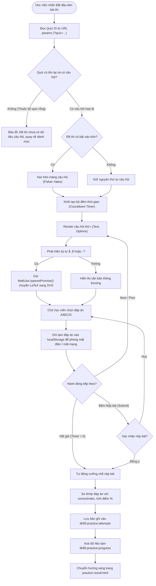

---

## 4. QUY TẮC MỞ KHOÁ VÀ HOÀN THÀNH BÀI GIẢNG TUẦN TỰ
- **Mục đích:** Mô tả thuật toán xác định trạng thái bài giảng (Locked, In-progress, Completed) dựa trên tiến độ bài trước.
- **Nguồn:** [`js/lectures-core.js:70-90, 135-155`](file:///c:/Users/anhqu/Documents/Computer%20Science%20Training/PRIVATE%20PROJECT/9-5-ai-library/js/lectures-core.js#L70-L90), [`js/lecture-player.js:200-220`](file:///c:/Users/anhqu/Documents/Computer%20Science%20Training/PRIVATE%20PROJECT/9-5-ai-library/js/lecture-player.js#L200-L220).

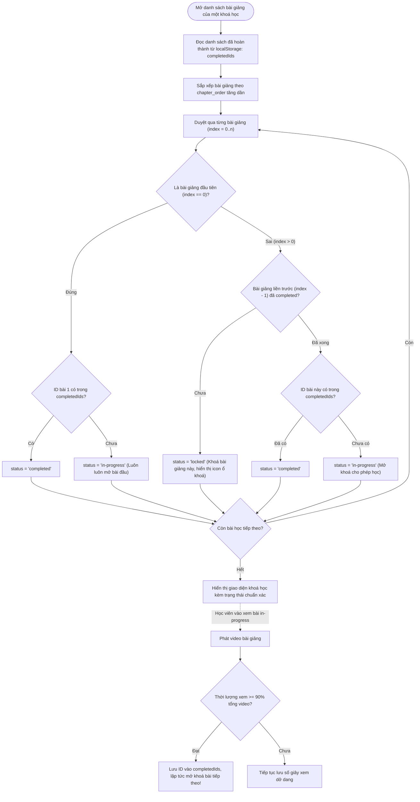

---

## 5. QUY TRÌNH TẢI LÊN VIDEO VÀ TỐI ƯU HOÁ FASTSTART
- **Mục đích:** Mô tả luồng xử lý tệp video MP4/MOV gửi lên từ Admin: kiểm tra dung lượng, chạy FFmpeg hoán đổi moov atom và đo thời lượng qua FFprobe.
- **Nguồn:** [`backend/routes/lmsRoutes.js:125-181`](file:///c:/Users/anhqu/Documents/Computer%20Science%20Training/PRIVATE%20PROJECT/9-5-ai-library/backend/routes/lmsRoutes.js#L125-L181).

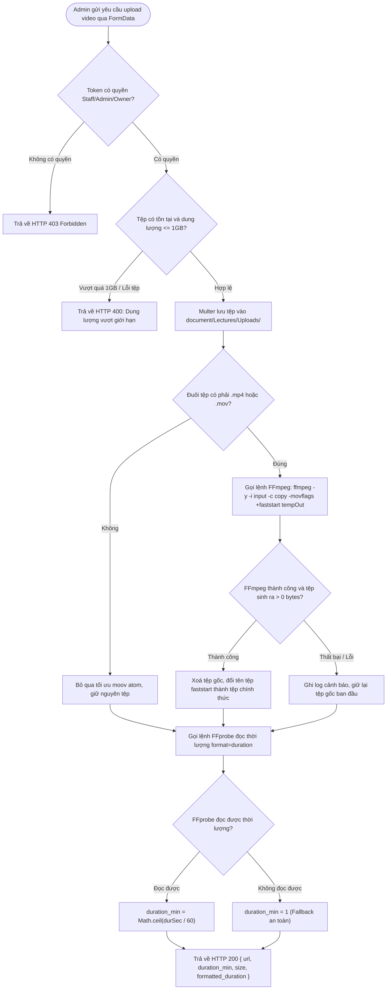

---

## 6. VÒNG ĐỜI THÔNG BÁO VÀ BỘ LỌC CÀI ĐẶT HỌC VIÊN
- **Mục đích:** Thể hiện vòng đời của một thông báo từ khi sinh ra (sự kiện mới) đến khi gửi qua chuông và bị ảnh hưởng bởi cài đặt người dùng.
- **Nguồn:** [`backend/controllers/communityController.js:1450-1550`](file:///c:/Users/anhqu/Documents/Computer%20Science%20Training/PRIVATE%20PROJECT/9-5-ai-library/backend/controllers/communityController.js#L1450-L1550), [`js/notifications-bell.js`](file:///c:/Users/anhqu/Documents/Computer%20Science%20Training/PRIVATE%20PROJECT/9-5-ai-library/js/notifications-bell.js).

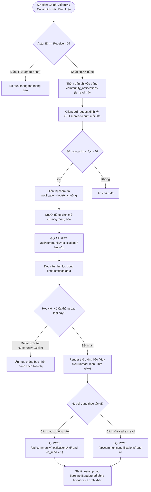

---

## 7. QUY TRÌNH KIỂM DUYỆT BÁO CÁO VI PHẠM (COMMUNITY MODERATION)
- **Mục đích:** Mô tả các nhánh xử lý báo cáo vi phạm nội dung của Admin: Ẩn bài viết, Khôi phục, Bỏ qua hoặc Xoá vĩnh viễn.
- **Nguồn:** [`backend/controllers/moderationController.js:270-360`](file:///c:/Users/anhqu/Documents/Computer%20Science%20Training/PRIVATE%20PROJECT/9-5-ai-library/backend/controllers/moderationController.js#L270-L360).

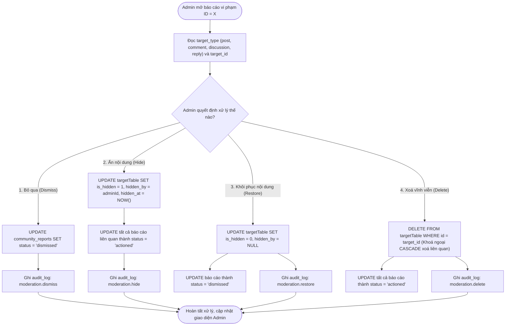

---

## 8. KHỞI TẠO THEME CHỐNG FOUC VÀ TÙY CHỈNH GIAO DIỆN
- **Mục đích:** Mô tả cách `theme-init.js` ngăn chặn hiện tượng chớp trắng màn hình và cách áp dụng Accent Color, Cỡ chữ.
- **Nguồn:** [`js/theme-init.js:1-35`](file:///c:/Users/anhqu/Documents/Computer%20Science%20Training/PRIVATE%20PROJECT/9-5-ai-library/js/theme-init.js#L1-L35), [`DARK_THEME_AUDIT.md`](file:///c:/Users/anhqu/Documents/Computer%20Science%20Training/PRIVATE%20PROJECT/9-5-ai-library/DARK_THEME_AUDIT.md).

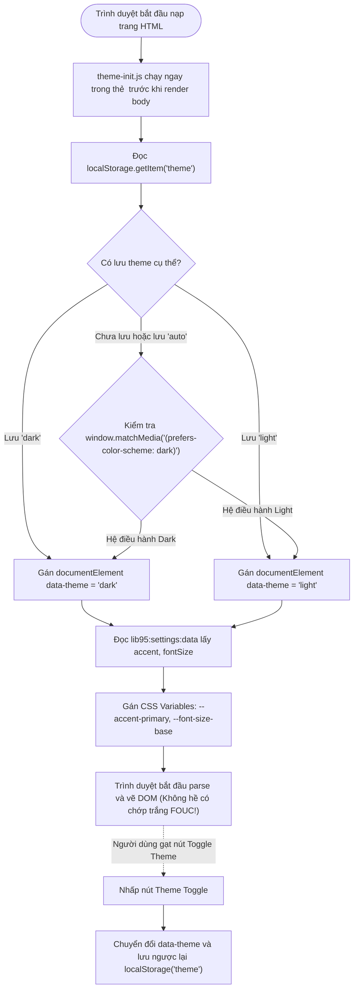

---

## 9. QUY TRÌNH LƯU SETTINGS (AUTOSAVE VS SAVE CHANGES)
- **Mục đích:** Mô tả sự khác biệt giữa các cài đặt giao diện/thông báo được lưu tức thì (Autosave) và form thông tin tài khoản cần bấm nút Lưu.
- **Nguồn:** [`js/settings-core.js`](file:///c:/Users/anhqu/Documents/Computer%20Science%20Training/PRIVATE%20PROJECT/9-5-ai-library/js/settings-core.js), [`SETTINGS_AUDIT.md`](file:///c:/Users/anhqu/Documents/Computer%20Science%20Training/PRIVATE%20PROJECT/9-5-ai-library/SETTINGS_AUDIT.md).

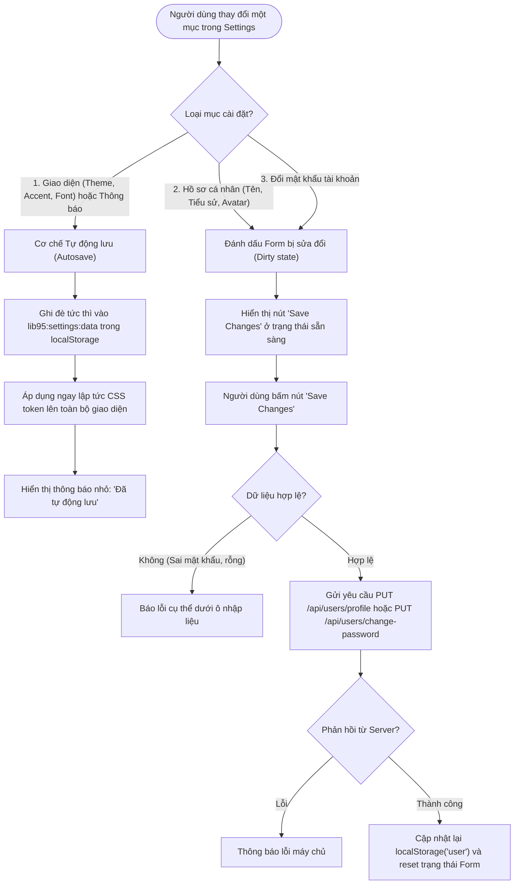

---

## 10. KHỞI ĐỘNG MÁY CHỦ EXPRESS VÀ KHỞI TẠO CSDL (v2 cập nhật)
- **Mục đích:** Mô tả trình tự khởi động ứng dụng backend: Nạp môi trường, kiểm tra độ an toàn JWT Secret, kết nối CSDL, áp dụng các tiêu đề bảo mật (Security Headers), gắn Rate Limiter, gắn lớp chặn 404 bảo mật và WhiteList tệp tĩnh trước khi mở cổng lắng nghe.
- **Nguồn:** [`backend/server.js`](file:///c:/Users/anhqu/Documents/Computer%20Science%20Training/PRIVATE%20PROJECT/9-5-ai-library/backend/server.js), [`backend/config/initDb.js`](file:///c:/Users/anhqu/Documents/Computer%20Science%20Training/PRIVATE%20PROJECT/9-5-ai-library/backend/config/initDb.js).

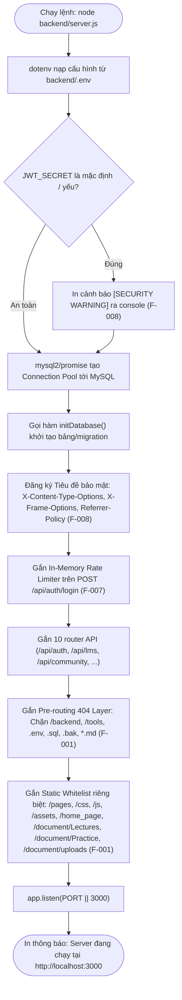

---

## 11. QUY TRÌNH XÁC MINH VÀ XOÁ TÀI KHOẢN AN TOÀN (F-004) (v2 cập nhật)
- **Mục đích:** Mô tả các bước xác minh danh tính nhiều lớp khi người dùng yêu cầu xoá tài khoản cá nhân: kiểm tra xác nhận tên đăng nhập phía client và xác minh mật khẩu bằng bcrypt phía máy chủ trước khi thực thi lệnh xoá theo tầng (Cascading Delete).
- **Nguồn:** [`backend/controllers/userController.js:80-120`](file:///c:/Users/anhqu/Documents/Computer%20Science%20Training/PRIVATE%20PROJECT/9-5-ai-library/backend/controllers/userController.js), [`js/settings-preferences.js`](file:///c:/Users/anhqu/Documents/Computer%20Science%20Training/PRIVATE%20PROJECT/9-5-ai-library/js/settings-preferences.js), [`pages/settings/settings.html`](file:///c:/Users/anhqu/Documents/Computer%20Science%20Training/PRIVATE%20PROJECT/9-5-ai-library/pages/settings/settings.html).

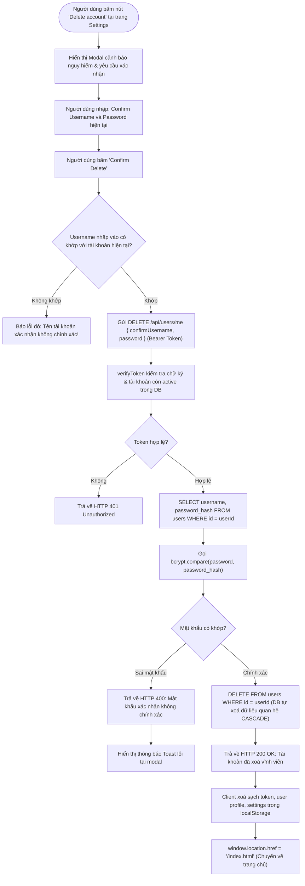
