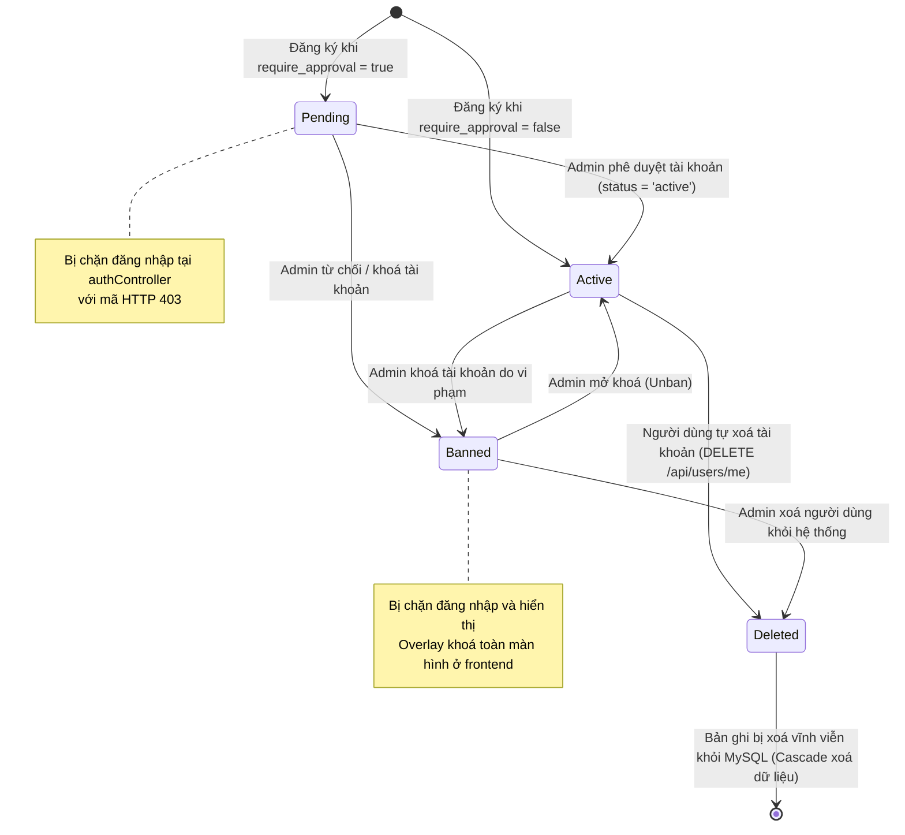
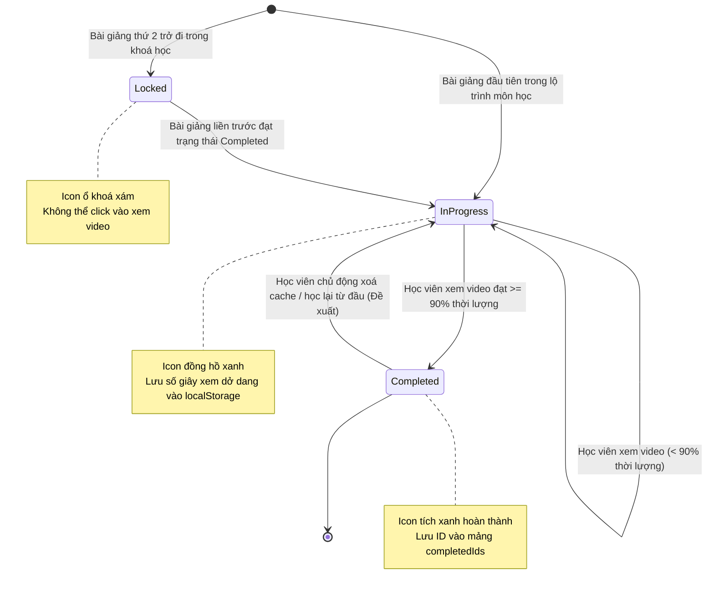
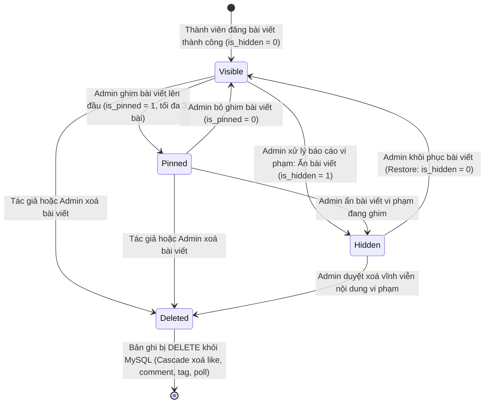
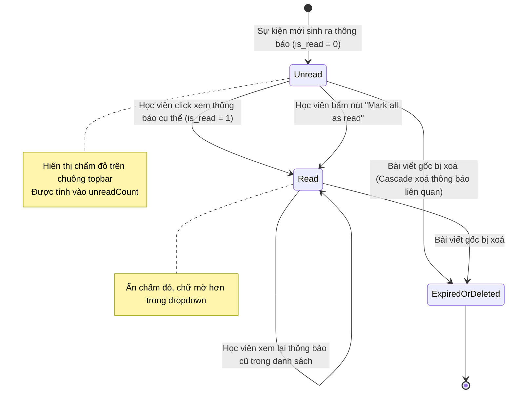
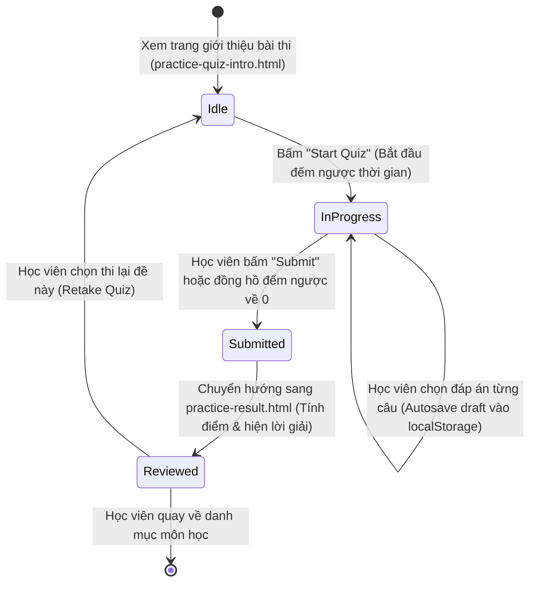
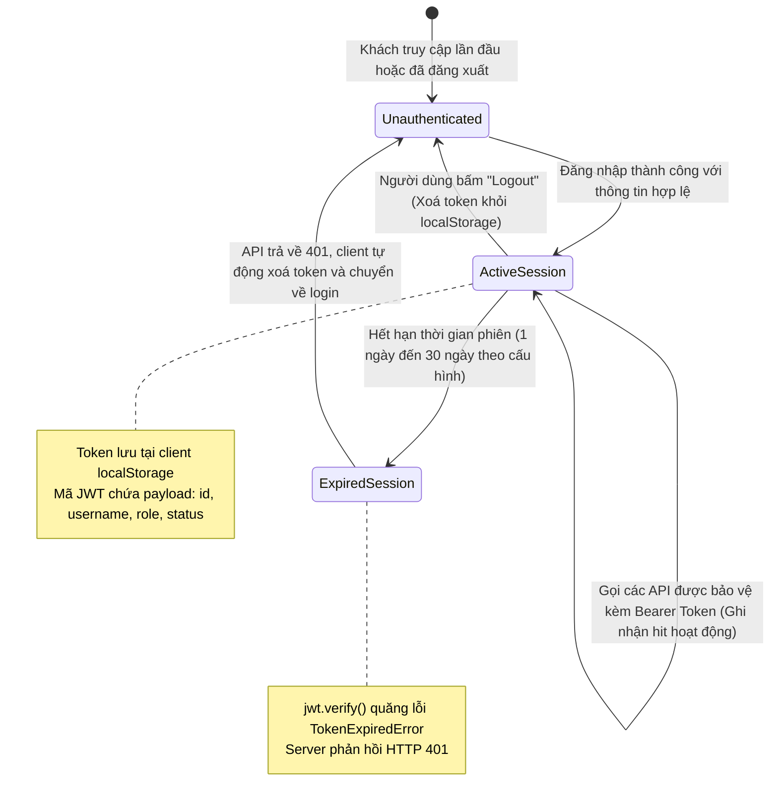

# SƠ ĐỒ TRẠNG THÁI HỆ THỐNG - 6 THỰC THỂ CỐT LÕI (06_state_diagrams.md)

**Dự án:** 9-5-ai-library  
**Phiên bản:** v1  
**Ghi chú kiểm tra:** Viết bằng chuẩn `stateDiagram-v2` của Mermaid. Cú pháp đã tự rà soát từng sơ đồ đảm bảo không có từ khoá lỗi.

---

## 1. TRẠNG THÁI TÀI KHOẢN NGƯỜI DÙNG (USER ACCOUNT STATE)
- **Mục đích:** Mô tả vòng đời của một tài khoản từ lúc đăng ký, chờ duyệt, hoạt động, bị khoá và xoá khỏi cơ sở dữ liệu.
- **Nguồn:** [`backend/controllers/authController.js:25-30, 98`](file:///c:/Users/anhqu/Documents/Computer%20Science%20Training/PRIVATE%20PROJECT/9-5-ai-library/backend/controllers/authController.js#L25-L30), [`backend/controllers/adminController.js:27-31`](file:///c:/Users/anhqu/Documents/Computer%20Science%20Training/PRIVATE%20PROJECT/9-5-ai-library/backend/controllers/adminController.js#L27-L31), [`backend/controllers/userController.js:86`](file:///c:/Users/anhqu/Documents/Computer%20Science%20Training/PRIVATE%20PROJECT/9-5-ai-library/backend/controllers/userController.js#L86).

---

## 2. TRẠNG THÁI TIẾN ĐỘ BÀI GIẢNG THEO HỌC VIÊN (LECTURE PROGRESS STATE)
- **Mục đích:** Mô tả trạng thái của từng bài giảng đối với một học viên (Khoá, Đang học, Hoàn thành).
- **Nguồn:** [`js/lectures-core.js:70-90, 135-155`](file:///c:/Users/anhqu/Documents/Computer%20Science%20Training/PRIVATE%20PROJECT/9-5-ai-library/js/lectures-core.js#L70-L90), [`js/lecture-player.js:200-220, 310-315`](file:///c:/Users/anhqu/Documents/Computer%20Science%20Training/PRIVATE%20PROJECT/9-5-ai-library/js/lecture-player.js#L200-L220).

---

## 3. TRẠNG THÁI BÀI VIẾT BẢNG TIN CỘNG ĐỒNG (COMMUNITY POST STATE)
- **Mục đích:** Mô tả các trạng thái hiển thị của bài viết: Bình thường, Được ghim, Bị ẩn do kiểm duyệt và Đã xoá.
- **Nguồn:** [`backend/controllers/communityController.js:180-260, 330-380`](file:///c:/Users/anhqu/Documents/Computer%20Science%20Training/PRIVATE%20PROJECT/9-5-ai-library/backend/controllers/communityController.js#L180-L260), [`backend/controllers/moderationController.js:290-325`](file:///c:/Users/anhqu/Documents/Computer%20Science%20Training/PRIVATE%20PROJECT/9-5-ai-library/backend/controllers/moderationController.js#L290-L325).

---

## 4. TRẠNG THÁI THÔNG BÁO CỘNG ĐỒNG (NOTIFICATION STATE)
- **Mục đích:** Mô tả trạng thái của thông báo gửi tới người dùng trong quá trình tiếp nhận và đọc.
- **Nguồn:** [`backend/controllers/communityController.js:1450-1550`](file:///c:/Users/anhqu/Documents/Computer%20Science%20Training/PRIVATE%20PROJECT/9-5-ai-library/backend/controllers/communityController.js#L1450-L1550), [`js/notifications-bell.js`](file:///c:/Users/anhqu/Documents/Computer%20Science%20Training/PRIVATE%20PROJECT/9-5-ai-library/js/notifications-bell.js).

---

## 5. VÒNG ĐỜI LƯỢT LÀM BÀI TRẮC NGHIỆM (QUIZ ATTEMPT LIFECYCLE)
- **Mục đích:** Mô tả các bước chuyển trạng thái từ lúc bắt đầu thi đến khi nộp bài và xem lại đáp án.
- **Nguồn:** [`js/practice-quiz.js`](file:///c:/Users/anhqu/Documents/Computer%20Science%20Training/PRIVATE%20PROJECT/9-5-ai-library/js/practice-quiz.js), [`pages/practice/practice-quiz-intro.html`](file:///c:/Users/anhqu/Documents/Computer%20Science%20Training/PRIVATE%20PROJECT/9-5-ai-library/pages/practice/practice-quiz-intro.html).

---

## 6. VÒNG ĐỜI PHIÊN ĐĂNG NHẬP VÀ MÃ JWT (AUTH SESSION & JWT LIFECYCLE)
- **Mục đích:** Mô tả vòng đời của token xác thực từ khi đăng nhập đến khi hết hạn hoặc bị đăng xuất.
- **Nguồn:** [`backend/controllers/authController.js:38-55`](file:///c:/Users/anhqu/Documents/Computer%20Science%20Training/PRIVATE%20PROJECT/9-5-ai-library/backend/controllers/authController.js#L38-L55), [`backend/middlewares/authMiddleware.js:5-27`](file:///c:/Users/anhqu/Documents/Computer%20Science%20Training/PRIVATE%20PROJECT/9-5-ai-library/backend/middlewares/authMiddleware.js#L5-L27), [`js/syncProfile.js:80-90`](file:///c:/Users/anhqu/Documents/Computer%20Science%20Training/PRIVATE%20PROJECT/9-5-ai-library/js/syncProfile.js#L80-L90).

