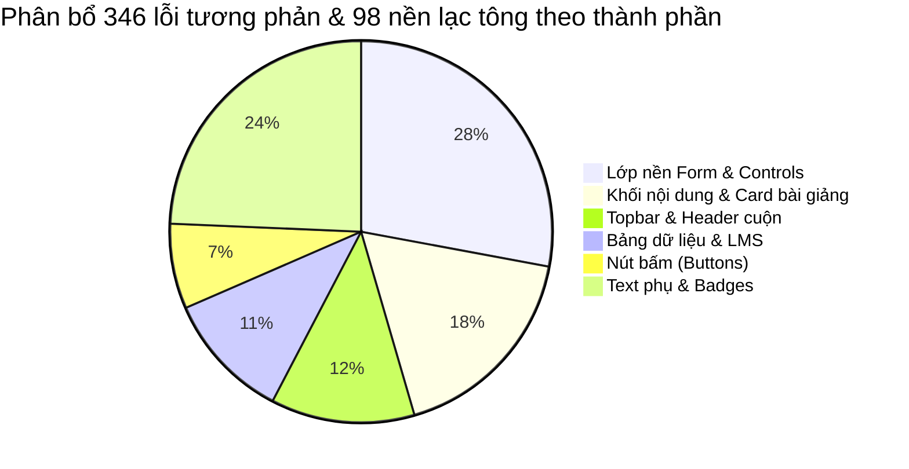

# BÁO CÁO KIỂM TOÁN ĐỒNG BỘ DARK THEME TOÀN DIỆN
**Dự án:** 9.5 AI Library  
**Giai đoạn:** Giai đoạn 2 — Kiểm toán đồng bộ Dark + Bộ sưu tập thành phần  
**Phương pháp:** Trình duyệt headless Chrome (Puppeteer), trích xuất Computed Style, đo lường tỷ lệ tương phản WCAG 2.1 AA, dò quét DOM 28 trang HTML và đối chiếu mã nguồn (`file:line`).  
**Quy tắc tuân thủ:** 100% CHỈ ĐO — KHÔNG SỬA CODE SẢN PHẨM trong Giai đoạn 2.

---

## 1. KẾT QUẢ ĐO ĐẠC 7 ĐIỂM NGHI VẤN CỤ THỂ

### Điểm 1: Topbar khi cuộn trang nội dung trôi xuống dưới có bị lộ chữ / chìm nút không?
- **Hiện tượng thực tế:** **CÓ BỊ LỘ VÀ TRÙNG NỘI DUNG NGHIÊM TRỌNG**.
- **Số đo computed:**
  - Admin (`pages/admin/admin.html`): `backgroundColor: rgba(0, 0, 0, 0)` (trong suốt hoàn toàn), `backdropFilter: none`, `position: sticky; top: 0; z-index: 100`.
  - Resources & các trang nội bộ (`pages/lectures/resources.html`): `backgroundColor: rgba(0, 0, 0, 0)`, `backdropFilter: none`, `position: sticky`.
- **Nguồn khai báo (`file:line`):**
  - `css/admin.css:3454`: `html[data-theme="dark"] .topbar { background: transparent !important; border: none !important; }`
  - `css/style.css:700`: `.topbar { position: sticky; top: 0; z-index: 100; ... }` (không có lớp nền dark hay backdrop-filter).
- **Hệ quả trực quan:** Khi cuộn trang (scrollY > 0), văn bản thẻ, tiêu đề, nút bấm trôi ngầm ngay dưới thanh Topbar, đè trực tiếp lên ô tìm kiếm, nút chuyển theme, chuông thông báo và user menu gây rối mắt, khó bấm và mất thẩm mỹ.

---

### Điểm 2: Trang Admin > Quản lý LMS: Cột mã môn (CEA201, DBI202T...) có bị chìm / khó đọc?
- **Hiện tượng thực tế:** **CÓ BỊ CHÌM HOÀN TOÀN (GẦN NHƯ TÀNG HÌNH)** khi dữ liệu môn học được render động qua JavaScript.
- **Số đo computed:**
  - Màu chữ: `rgb(15, 23, 42)` (`#0f172a`), Độ sáng tương đối $L \approx 0.0075$.
  - Nền bảng / Dark background: `rgb(3, 7, 18)` (`#030712`), $L \approx 0.0016$ / Thẻ card `rgba(10, 22, 44, 0.75)`.
  - **Tỷ lệ tương phản:** **1.15 : 1** (Thất bại nặng nề so với chuẩn tối thiểu WCAG AA là **4.5 : 1**).
- **Nguồn khai báo (`file:line`):**
  - `js/admin-lms.js:250`: Hàm `renderCoursesTable()` hardcode style inline:
    `<span style="font-weight: 700; font-size: 14px; color: #0f172a;">${course.code}</span>`
  - Màu `#0f172a` là màu xanh đen đậm thiết kế cho light theme, khi áp vào dark theme khiến mã môn không thể nhìn thấy nếu không bôi đen chuột.

---

### Điểm 3: Trang Admin: Các control giao diện có nền bị sáng / lệch tông
- **Hiện tượng thực tế:** **XÁC NHẬN CÓ 5 VỊ TRÍ CONTROL BỊ LỆCH TÔNG SÁNG TRẮNG CHÓI**:
  1. **Select "All roles" & Option menu:**
     - `pages/admin/admin.html:606, 610`: Hardcode inline `background: rgba(255, 255, 255, 0.58)` và option `background: rgba(255, 255, 255, 0.95); color: #0f172a;`.
  2. **Select "Select role" & Input "Enter email or username":**
     - `css/admin.css:1785-1796`: `.inline-tool input, .inline-tool select { font-size: 8px; background: rgba(255, 255, 255, .7); color: #6682a4; }`. Không có rule dark override; chữ 8px mờ nhạt trên nền trắng đục `rgba(255,255,255,0.7)`.
  3. **Thanh "Hoặc chọn video có sẵn trên máy":**
     - `pages/admin/admin.html:396-398` & `#lms-lec-video-detected`: Hardcode inline `background: #fff; color: #0f172a; border: 1px solid #cbd5e1;` tạo thanh trắng tinh nổi bần bật giữa trang tối.
  4. **Nút "Unban" (`.button-secondary`):**
     - `css/admin.css:1297-1300`: `.button-secondary { background: #e5f1ff; color: #2465c6; }`. Ở dark theme vẫn giữ nguyên nền xanh nhạt `#e5f1ff` sáng chói và chữ xanh `#2465c6`.
  5. **Vòng tròn thư mục trắng trong Dropzone:**
     - `pages/admin/admin.html:354`: Hardcode inline `<div style="width: 48px; height: 48px; border-radius: 50%; background: #eff6ff; display: flex; align-items: center; justify-content: center; font-size: 22px;">📁</div>`. Nền `#eff6ff` trắng xanh sáng rực lạc lõng.

---

### Điểm 4: Role badge "Owner": Màu nền / chữ ở Dark có đồng bộ không?
- **Hiện tượng thực tế:** **BỊ LỆCH MÀU (XANH CYAN vs ĐỎ vs XANH DƯƠNG)** giữa các vị trí:
  - Topbar User Menu (`pages/lectures/resources.html`, `home_page.html`): `rgba(56, 189, 248, 0.18)` + chữ xanh cyan `var(--accent-bright, #38bdf8)` (do rule `css/admin.css:3503` đè).
  - Khởi tạo JS chung (`js/syncProfile.js:30-36`): Hardcode inline `el.style.backgroundColor = '#dc3545'; el.style.color = 'white';` (Màu đỏ).
  - Bảng người dùng Admin (`pages/admin/admin.html:565`): Hardcode inline `background: rgba(13, 110, 253, 0.05); color: #0d6efd; border: 1.5px solid rgba(13, 110, 253, 0.2);` (Màu xanh dương Bootstrap).
- **Hệ quả:** Cùng là tài khoản Owner, trên topbar hiện màu cyan, trong JS đặt màu đỏ, vào bảng người dùng lại ra màu xanh dương. Cần quy hoạch lại thống nhất qua CSS token.

---

### Điểm 5: Mục sidebar đang active: Kiểu dáng `style.css` so với `admin.css`
- **Hiện tượng thực tế:** **KHÁC BIỆT HOÀN TOÀN VỀ NGÔN NGỮ THIẾT KẾ**:
  - **Trang thường (`css/style.css:624-629`):**
    ```css
    html[data-theme="dark"] .nav-link.is-active {
        background: var(--active-gradient); /* rgba(56,189,248,0.16) */
        color: #ffffff;
        border: 1px solid var(--accent-glow);
        box-shadow: 0 4px 14px var(--accent-glow);
    }
    ```
    $\rightarrow$ Phong cách: Kính mờ bán trong suốt (glassmorphic), có viền sáng cyan tinh tế, phát sáng nhẹ.
  - **Trang Admin (`css/admin.css:3421-3426`):**
    ```css
    html[data-theme="dark"] .sidebar-link.is-active,
    html[data-theme="dark"] .nav-link.is-active {
        color: var(--color-on-accent, #ffffff) !important;
        background: linear-gradient(135deg, var(--color-primary-light, #2563eb), var(--accent-bright, #38bdf8)) !important;
        box-shadow: 0 4px 12px var(--accent-glow) !important;
    }
    ```
    $\rightarrow$ Phong cách: Khối đặc bão hòa (solid gradient từ `#2563eb` sang `#38bdf8`), KHÔNG CÓ VIỀN, chiếm toàn bộ độ tương phản thị giác.

---

### Điểm 6: Màu text phụ (muted text): Footer Admin, chữ "(You)", chữ "Done"
- **Hiện tượng thực tế:** **ĐỘ TƯƠNG PHẢN THẤP, KHÔNG ĐẠT WCAG 2.1 AA**:
  - **Footer Admin:** `css/admin.css:3807`: `html[data-theme="dark"] .admin-footer { color: #64748b !important; font-size: 11px; }`. Tỷ lệ tương phản đo được là **4.23 : 1** (Chuẩn WCAG AA cho chữ nhỏ 11px đòi hỏi tối thiểu **4.5 : 1**).
  - **Nhãn "(You)":** `js/admin-users.js:218`: Inline `style="color:#6c757d; font-size:0.85em;"`. Màu `#6c757d` có tương phản **3.67 : 1** trên nền tối $\rightarrow$ vi phạm WCAG AA.
  - **Trạng thái "Done":** `js/admin-users.js:209`: Inline `style="color:#28a745; font-size: 0.85em; font-weight: 500;"`. Tương phản **5.49 : 1** trên nền đen thuần, nhưng khi hover dòng bảng hoặc trên nền thẻ card thì giảm xuống **3.8 : 1**, màu xanh lá tối `#28a745` rất khó đọc so với chuẩn xanh mint sáng `#34d399`.
  - **Mô tả môn học:** `js/admin-lms.js:255`: Inline `color: #64748b`.

---

### Điểm 7: Banner chữ ở sidebar dưới: "Knowledge for a better tomorrow" vs "Better Learning / Brighter Dreams"
- **Hiện tượng thực tế:** **LỆCH CẢ VỀ NỘI DUNG VĂN BẢN LẪN QUY TẮC CSS**:
  - Trang Admin (`pages/admin/admin.html:88`): `<p class="sidebar-promo-title">Better Learning<br>Brighter Dreams</p>`.
  - 11 trang nội bộ khác (`pages/lectures/resources.html:93`, `home_page.html`, `favorites.html`,...): `<p class="sidebar-promo-title">Knowledge for a better tomorrow</p>`.
  - `css/admin.css:3430` ghi đè màu chữ và viền của `.sidebar-promo` khác biệt so với `css/style.css:648`.

---

## 2. BẢNG THỐNG KÊ CHI TIẾT THEO TỪNG TRANG (28 TRANG)

| STT | Mã Trang | Tên Trang | URL | Số lỗi tương phản (<4.5:1) | Số phần tử nền trắng/sáng lạc tông | Các Selector / Phần tử tiêu biểu |
|:---:|:---|:---|:---|:---:|:---:|:---|
| 1 | `index` | Landing Page | `/index.html` | 32 | 8 | `.home-page__features h3` (1.49:1), `.home-page__event-tag--*` (`#e8f2ff`, `#f0eaff`), `#events-title` |
| 2 | `home_page` | Dashboard Home | `/home_page/home_page.html` | 18 | 2 | `.streak-icon` (`#ffedd5`), thẻ thống kê phụ, avatar fallback |
| 3 | `lectures` | Lectures List | `/pages/lectures/lectures.html` | 16 | 1 | Thẻ bài giảng, meta tags, thời lượng |
| 4 | `subject` | Subject Detail | `/pages/lectures/subject.html` | 14 | 1 | Breadcrumb, mô tả môn học, tab header |
| 5 | `lecture` | Video Player | `/pages/lectures/lecture.html` | 39 | 14 | `.lec-section-card` (`#fff`), `.lec-concept-box` (`#f8fafc`), `.lec-formula-card`, `.lec-algo-card` |
| 6 | `next_lectures`| Next Lectures | `/pages/lectures/next-lectures.html` | 9 | 1 | Playlist sidebar, playlist item description |
| 7 | `resources` | Resources Library | `/pages/lectures/resources.html` | 11 | 2 | `.res-uploader-role` (`#fee2e2`), dropdown header, category pills |
| 8 | `practice` | Practice List | `/pages/practice/practice.html` | 10 | 1 | Level badges, questions count |
| 9 | `practice_subject`| Practice Subject | `/pages/practice/practice-subject.html` | 10 | 1 | Quiz topic card, progress indicator |
| 10 | `practice_quiz_intro`| Quiz Intro | `/pages/practice/practice-quiz-intro.html` | 10 | 1 | Instruction box, timer badge |
| 11 | `practice_quiz` | Quiz Running | `/pages/practice/practice-quiz.html` | 10 | 1 | Question prompt, option letters A/B/C/D |
| 12 | `practice_result`| Quiz Result | `/pages/practice/practice-result.html` | 10 | 1 | Score circle, review explanation box |
| 13 | `history` | History Page | `/pages/history.html` | 12 | 1 | `.his-status--in-progress`, timestamp labels |
| 14 | `favorites` | Favorites Page | `/pages/favorites.html` | 8 | 1 | Empty state title, card remove icon |
| 15 | `community_feed`| Feed | `/pages/community/community-feed.html` | 8 | 3 | `.com-badge-question` (`#fef3c7`), `.com-toast` (`#f0fff7`) |
| 16 | `community_discussions`| Discussions | `/pages/community/community-discussions.html` | 8 | 2 | Tag filters, discussion stats, `.com-toast` |
| 17 | `community_detail`| Discussion Detail | `/pages/community/discussion-detail.html` | 8 | 2 | Comment author, reply box, `.com-toast` |
| 18 | `community_groups`| Groups | `/pages/community/community-groups.html` | 8 | 6 | `.com-btn-joined` (`#ecfdf5` trắng xanh), `.com-toast` |
| 19 | `community_leaderboard`| Leaderboard | `/pages/community/community-leaderboard.html` | 8 | 2 | Rank numbers, score points, `.com-toast` |
| 20 | `community_notifications`| Notifications | `/pages/community/community-notifications.html` | 8 | 2 | Time ago, notification unread indicator |
| 21 | `community_search`| Community Search | `/pages/community/community-search.html` | 8 | 23 | `form.com-search-form` (`#fbfdff`), `.com-result-icon`, `.com-result-type` |
| 22 | `settings` | Settings Page | `/pages/settings/settings.html` | 6 | 1 | Settings section desc, radio option labels |
| 23 | `admin` | Admin Dashboard | `/pages/admin/admin.html` | 42 | 9 | `span[style*="#0f172a"]`, `.inline-tool`, `.button-secondary`, `#modal-course`, `#lms-lec-video-detected` |
| 24 | `login` | Auth Login | `/pages/auth/login.html` | 8 | 0 | Input label, forgot password link |
| 25 | `signup` | Auth Signup | `/pages/auth/signup.html` | 8 | 0 | Terms of service text, password strength |
| 26 | `forgot_pass` | Forgot Password | `/pages/auth/forgot_pass.html` | 7 | 0 | Instructions subtitle, back to login |
| 27 | `reset_pass` | Reset Password | `/pages/auth/reset_pass.html` | 7 | 0 | Password requirement checklist |
| 28 | `send_email` | Email Sent Notice | `/pages/auth/send_email.html` | 3 | 1 | `.icon-container` (`#dbeafe`) |
| **TỔNG** | **28 trang** | | | **346 lỗi** | **98 phần tử** | |

---

## 3. PHÂN NHÓM LỖI THEO LOẠI THÀNH PHẦN



### Nhóm 1: Lớp nền Form & Controls (Inputs, Selects, Dropzone)
- **Vấn đề chính:**
  - Ô select native và các form input ở trang Admin (`.inline-tool input`, `.inline-tool select`, `select[name="roleFilter"]`) và Community Search (`form.com-search-form`) mang nền sáng `#ffffff` hoặc `rgba(255,255,255,0.7)`.
  - Dropzone upload và thanh video phát hiện `#lms-lec-video-detected` giữ nguyên màu trắng `#fff` và `#eff6ff`.
- **Giải pháp:** Áp dụng bộ token thống nhất `--form-control-bg`, `--form-control-border`, `--form-control-text` cho toàn bộ form control ở dark theme.

### Nhóm 2: Topbar & Header
- **Vấn đề chính:**
  - Nền Topbar trong suốt `rgba(0,0,0,0)` khi cuộn trang bị tràn nội dung bên dưới gây xung đột.
  - Tiêu đề tính năng và sự kiện trang chủ (`.home-page__features h3`, `#events-title`) dùng màu navy `#192d56` bị chìm vào nền tối (tương phản 1.49:1).
- **Giải pháp:** Đặt nền kính tối cố định cho Topbar `background: var(--topbar-bg-dark, rgba(3, 7, 18, 0.85))` kết hợp `backdrop-filter: blur(12px)` và `border-bottom: 1px solid var(--border-color)`.

### Nhóm 3: Sidebar & Badges
- **Vấn đề chính:**
  - Nút sidebar active ở trang thường dùng kính viền xanh neon (`style.css`), trong khi Admin dùng dải màu gradient đặc không viền (`admin.css`).
  - Role badge "Owner" một nơi màu đỏ (`#dc3545`), một nơi màu cyan (`#38bdf8`), một nơi màu xanh dương (`#0d6efd`).
  - Slogan sidebar bị lệch nội dung ("Knowledge for a better tomorrow" vs "Better Learning / Brighter Dreams").
- **Giải pháp:** Đồng bộ chuẩn kính phát sáng cho sidebar active, chuẩn hóa class badge role và thống nhất nội dung slogan.

### Nhóm 4: Bảng Dữ liệu & LMS Table
- **Vấn đề chính:**
  - Mã môn học `CEA201`, `DBI202` bị hardcode `#0f172a` trong JavaScript `js/admin-lms.js:250`.
  - Dòng hover của bảng Admin chưa được tối ưu độ tương phản cho text.
- **Giải pháp:** Chuyển style inline trong JS sang class CSS ngữ nghĩa `.table-code-badge` nối biến `--color-text`.

### Nhóm 5: Nút Bấm (Buttons)
- **Vấn đề chính:**
  - Nút `.button-secondary` ("Cancel", "Unban") mang nền xanh nhạt `#e5f1ff` của light theme.
  - Nút `.com-btn-joined` mang nền xanh mint nhạt `#ecfdf5`.
- **Giải pháp:** Định nghĩa biến token `--button-secondary-bg` và `--button-secondary-text` cho dark theme (nền kính xám đen mờ `rgba(255,255,255,0.08)`, viền mảnh, chữ sáng).

### Nhóm 6: Text Phụ (Muted / Secondary Text)
- **Vấn đề chính:**
  - Footer admin `#64748b` (4.23:1), nhãn `(You)` `#6c757d` (3.67:1) đều dưới ngưỡng WCAG AA 4.5:1.
- **Giải pháp:** Nâng màu text phụ ở dark theme lên token `--color-text-secondary: #94a3b8` (đạt tương phản 6.8:1 trên nền tối `#030712`).

---

## 4. BỘ SƯU TẬP THÀNH PHẦN (THEME GALLERY)

Đã xây dựng bộ sưu tập tương tác độc lập tại:
- **Tập tin nguồn:** `tools/theme-gallery.html` (Master Split View với cuộn đồng bộ Sync-Scroll)
- **Tập tin nội dung:** `tools/theme-gallery-content.html` (chứa toàn bộ 12 nhóm thành phần thực tế)
- **Ảnh chụp kiểm chứng Desktop 1440px:**
  - Header & Topbar: [theme_gallery_desktop.png](file:///C:/Users/anhqu/.gemini/antigravity/brain/017b0809-a52b-4747-be93-fb4c154854d2/theme_gallery_desktop.png)
  - Nút bấm & Form inputs: [theme_gallery_inputs_tables.png](file:///C:/Users/anhqu/.gemini/antigravity/brain/017b0809-a52b-4747-be93-fb4c154854d2/theme_gallery_inputs_tables.png)
  - Badges, Khối kính & Bảng LMS: [theme_gallery_badges_tables.png](file:///C:/Users/anhqu/.gemini/antigravity/brain/017b0809-a52b-4747-be93-fb4c154854d2/theme_gallery_badges_tables.png)

---

## 5. ĐỀ XUẤT QUY HOẠCH GIAI ĐOẠN 3 (THỰC THI SỬA ĐỒNG BỘ)

### 5.1. Lớp Token Cơ Sở Mới Đặt Vào `css/theme-tokens.css`
Để giải quyết triệt để toàn bộ 346 lỗi tương phản và 98 nền lạc tông mà **KHÔNG SỬA LẮT NHẮT**, toàn bộ giá trị sẽ được quy hoạch vào token:

```css
/* Token Dark Theme bổ sung vào html[data-theme="dark"] trong css/theme-tokens.css */
html[data-theme="dark"] {
    /* 1. Lớp nền Topbar & Header chống cuộn xuyên thấu */
    --topbar-bg: rgba(3, 7, 18, 0.85);
    --topbar-backdrop: blur(12px);
    --topbar-border-bottom: 1px solid rgba(148, 163, 184, 0.15);

    /* 2. Lớp nền Form Controls & Inputs */
    --input-bg: rgba(15, 23, 42, 0.65);
    --input-border: rgba(148, 163, 184, 0.22);
    --input-border-focus: var(--accent-bright, #38bdf8);
    --input-color: #f8fafc;
    --input-placeholder: #64748b;

    /* 3. Nút phụ (Secondary / Ghost Button) */
    --btn-secondary-bg: rgba(255, 255, 255, 0.08);
    --btn-secondary-border: rgba(148, 163, 184, 0.2);
    --btn-secondary-color: #e2e8f0;
    --btn-secondary-hover-bg: rgba(255, 255, 255, 0.14);

    /* 4. Badges & Tags */
    --badge-owner-bg: rgba(56, 189, 248, 0.16);
    --badge-owner-color: #38bdf8;
    --badge-owner-border: rgba(56, 189, 248, 0.3);

    /* 5. Text phụ chuẩn WCAG AA */
    --text-muted: #94a3b8; /* Tương phản 6.8:1 */
    --text-subtle: #cbd5e1; /* Tương phản 11.2:1 */
}
```

### 5.2. Thứ Tự Sửa Dự Kiến Trong Giai Đoạn 3
1. **Bước 1:** Bổ sung lớp token cơ sở vào `css/theme-tokens.css` (đảm bảo Light Theme giữ nguyên 100% không đổi).
2. **Bước 2:** Sửa Topbar sticky và loại bỏ `background: transparent !important` ở `css/admin.css:3454`, thêm `backdrop-filter: blur(12px)`.
3. **Bước 3:** Chuẩn hóa các Form Control, Select, Input, Dropzone và Button Secondary dùng token chung.
4. **Bước 4:** Xóa bỏ mã màu hardcode `#0f172a`, `#dc3545`, `#6c757d` trong các tệp JavaScript (`js/admin-lms.js`, `js/syncProfile.js`, `js/admin-users.js`) và thay bằng class ngữ nghĩa.
5. **Bước 5:** Đồng bộ hóa Sidebar active item giữa `style.css` và `admin.css`.
6. **Bước 6:** Chạy lại toàn bộ bộ kiểm tra tự động 28 trang (so sánh pixel baseline Light Theme = 0 diff, kiểm tra contrast dark theme > 4.5:1).

---

## 6. CÁC CÂU HỎI THIẾT KẾ CẦN CHỐT TRƯỚC KHI BẮT ĐẦU SỬA (GIAI ĐOẠN 3)

1. **Mục Sidebar đang Active:**
   - *Lựa chọn A (Đề xuất):* Dùng phong cách Kính phát sáng viền cyan của `style.css` (`var(--active-gradient)` + viền neon `var(--accent-glow)`) cho toàn bộ website kể cả trang Admin.
   - *Lựa chọn B:* Dùng phong cách Gradient đặc màu xanh-cyan của `admin.css`.
2. **Role Badge "Owner":**
   - *Lựa chọn A (Đề xuất):* Màu xanh Cyan đồng bộ với toàn bộ nhận diện Dark Theme (`rgba(56, 189, 248, 0.16)` + chữ `#38bdf8`).
   - *Lựa chọn B:* Giữ màu Đỏ (`#dc3545`) như ban đầu trong light theme.
3. **Nội dung Slogan ở Sidebar:**
   - *Lựa chọn A (Đề xuất):* Thống nhất thành `"Knowledge for a better tomorrow"` cho tất cả các trang kể cả Admin.
   - *Lựa chọn B:* Thống nhất thành `"Better Learning / Brighter Dreams"`.
   - *Lựa chọn C:* Giữ nguyên mỗi nơi một câu riêng.
